# Evidencia · Issue #10 — Pruebas E2E con Playwright del flujo administrativo, urgencias y regresión web

Suite de **Playwright** que abre el panel en Chromium y lo recorre como un ADMIN contra el **backend real y PostgreSQL**,
sin mocks de la API. Incluye un flujo web completo (pedido → mapa → planificación → ruta DRAFT), urgencias, seguimiento,
entregas fallidas y fallas de red simuladas. Cada fallo deja captura, video y traza.

- **Issue:** [#10](https://github.com/logistica-gc-uta/frontend-web-logistica/issues/10)
- **Fecha de ejecución:** 03/11/2026
- **Backend:** `logistica-gc-uta/backend` en `main` @ `adfe30c`
- **Frontend:** rama `test/10-e2e-playwright` (desde `main` @ `936ec3c`)
- **Herramienta:** `@playwright/test` 1.64.1 (versión fija), Chromium

## 1. Qué se implementó

| Parte                                  | Detalle                                                                                                                                                                                               |
| -------------------------------------- | ----------------------------------------------------------------------------------------------------------------------------------------------------------------------------------------------------- |
| Configuración (`playwright.config.ts`) | Chromium, una prueba a la vez (comparten base y chofer), levanta `pnpm dev` si no está corriendo, huso `America/Guayaquil`. Ante un fallo guarda **traza, captura y video**; genera un reporte HTML.  |
| Credenciales                           | Se leen de `.env.integration.local` (ignorado por git), el mismo de las pruebas de integración. La sesión ADMIN se guarda en `e2e/.auth/` (también ignorado). No hay contraseñas en el repositorio.   |
| Datos aislados (`e2e/support/data.ts`) | Cada ejecución crea con la API su zona, su producto y pedidos `E2E-…`. La planificación usa un día al azar entre 2050 y 2079. No depende de datos ajenos ni consume el stock del seed.                |
| Chofer (`driverActions`)               | Las acciones del chofer se hacen con la API y los **mismos endpoints que la app Flutter**. Al terminar, siempre se cierran las rutas abiertas y el chofer queda disponible.                           |
| Evidencia (`e2e/support/evidence.ts`)  | Con `E2E_CAPTURAS=1` guarda capturas de los elementos clave en `docs/evidencias/capturas/10-e2e-playwright/`; sin esa variable no escribe nada en el repositorio.                                     |
| Comando                                | `pnpm test:e2e`. No forma parte de `pnpm test` ni del CI porque necesita el backend; Vitest no toma la carpeta `e2e/`.                                                                                |
| Tipos (`tsconfig.e2e.json`)            | Las pruebas E2E entran en `pnpm typecheck`, oxlint y Prettier como el resto del código.                                                                                                               |
| Plantilla de issue (`fallo-e2e.md`)    | **Fallo de prueba E2E**: archivo y título, tipo (real o simulada), commits, error y los artefactos que hay que adjuntar (captura, traza, video, contexto), sin adjuntar la sesión ni las contraseñas. |

## 2. Cómo ejecutarla

```bash
pnpm exec playwright install chromium   # una sola vez
pnpm test:e2e                            # toda la suite
pnpm test:e2e e2e/02-pedido-a-ruta.spec.ts
E2E_CAPTURAS=1 pnpm test:e2e             # además guarda las capturas de evidencia
```

Requisitos: backend levantado (`docker compose up -d`, `pnpm prisma db init`, `pnpm run seed`, `pnpm run start:dev`),
`.env.integration.local` completo y el chofer del seed disponible.

## 3. Resultado

```
Running 17 tests using 1 worker
  ok  1 [setup] › auth.setup.ts › sesión ADMIN
  ok  2 [chromium] › 01-login.spec.ts › sin sesión, una página protegida lleva al login
  ok  3 [chromium] › 01-login.spec.ts › el ADMIN ingresa, ve el menú y puede cerrar sesión
  ok  4 [chromium] › 01-login.spec.ts › una contraseña incorrecta se rechaza y no abre el panel
  ok  5 [chromium] › 01-login.spec.ts › un CLIENT no puede entrar al panel administrativo
  ok  6 [chromium] › 02-pedido-a-ruta.spec.ts › del alta del pedido a la ruta DRAFT corregida
  ok  7 [chromium] › 03-validaciones-pedido.spec.ts › el formulario explica cada dato faltante y no envía nada
  ok  8 [chromium] › 03-validaciones-pedido.spec.ts › una fecha pasada y una ubicación sin confirmar se rechazan antes de enviar
  ok  9 [chromium] › 03-validaciones-pedido.spec.ts › si otro pedido se lleva el último stock, el backend rechaza el alta y no se muestra éxito
  ok 10 [chromium] › 04-operacion-del-dia.spec.ts › una ruta en curso no se modifica y una urgencia sin cupo queda pendiente con su motivo
  ok 11 [chromium] › 04-operacion-del-dia.spec.ts › el seguimiento separa entregas, visitas fallidas y la disponibilidad del chofer
  ok 12 [chromium] › 04-operacion-del-dia.spec.ts › la entrega fallida se gestiona aparte y solo se reprograma con un acuerdo
  ok 13 [chromium] › 05-fallas-simuladas.spec.ts › [simulada] un 409 al confirmar la ruta no la da por guardada
  ok 14 [chromium] › 05-fallas-simuladas.spec.ts › [simulada] un tiempo de espera agotado se informa y el reintento funciona
  ok 15 [chromium] › 05-fallas-simuladas.spec.ts › [simulada] un 403 en la bandeja se muestra y al reintentar carga la real
  ok 16 [chromium] › 05-fallas-simuladas.spec.ts › [simulada] sin conexión el alta del pedido falla sin éxito falso y al reintentar se registra una vez
  ok 17 [chromium] › 05-fallas-simuladas.spec.ts › [simulada] el seguimiento avisa la pérdida de conexión y se recupera solo
  17 passed (1.4m)
```

La suite completa se ejecutó **dos veces seguidas** con el mismo resultado (17/17), cada una con datos nuevos.

### Verificaciones de calidad

| Comando                                    | Resultado                                                              |
| ------------------------------------------ | ---------------------------------------------------------------------- |
| `pnpm lint`                                | 0 errores (incluye `e2e/`)                                             |
| `pnpm typecheck`                           | 0 errores (incluye `e2e/` y `playwright.config.ts`)                    |
| `pnpm format:check`                        | Sin observaciones                                                      |
| `pnpm test:coverage` (umbral del CI: 80 %) | **478/478** pruebas (60 archivos) · 99,8 % de líneas · 93,4 % de ramas |
| `pnpm build`                               | Correcto                                                               |
| `pnpm test:integration`                    | **43/43** contra la API real (sin cambios)                             |
| `pnpm test:e2e`                            | **17/17**: 12 reales (contando la sesión ADMIN) y 5 simuladas          |

## 4. Escenarios: reales y simulados

**Reales:** navegador real, frontend real y API real con PostgreSQL. Solo las acciones del chofer se hacen con la API.

| Archivo                  | Qué comprueba                                                                                                                                                                                                                                                                                                                                       |
| ------------------------ | --------------------------------------------------------------------------------------------------------------------------------------------------------------------------------------------------------------------------------------------------------------------------------------------------------------------------------------------------- |
| `01-login`               | Sin sesión redirige al login; el ADMIN ingresa y cierra sesión; contraseña incorrecta y rol CLIENT rechazados.                                                                                                                                                                                                                                      |
| `02-pedido-a-ruta`       | **Flujo web completo:** alta del pedido con clic en el mapa y _Confirmar ubicación_ → `PENDING` en la API → _Previsualizar_ dos veces sin crear rutas → _Confirmar ruta_ con doble clic = **una sola** ruta DRAFT con sus 3 pedidos → la propuesta ya no los ofrece → _Corregir paradas_ cambia el orden en la API y la ruta sigue DRAFT.           |
| `03-validaciones-pedido` | Campos obligatorios, fecha pasada y ubicación sin confirmar: se explican y **no sale ninguna petición**. Si otro pedido se lleva el último stock mientras el formulario está abierto, el backend rechaza el alta y se muestra el error, sin mensaje de éxito.                                                                                       |
| `04-operacion-del-dia`   | Con el chofer del seed y pedidos de **hoy**: R1 en curso aparece _En curso_ sin acciones, y la API rechaza reordenarla (409). Una urgencia nueva no se puede insertar en R1: se propone _Salida nueva_ y el ADMIN la rechaza con motivo; el pedido sigue `PENDING`.                                                                                 |
|                          | Seguimiento **sin recargar**: 0 → 1 de 2 entregados (50 %), visita fallida con motivo, _Completada_ con el chofer _Retornando al depósito: todavía no está disponible_ (API: no disponible) y, tras el regreso, _Regresó al depósito y está disponible_ (API: disponible).                                                                          |
|                          | Entrega fallida: no aparece en Urgencias ni queda `DELIVERED`/`CANCELLED`; sin acuerdo el botón _Reprogramar_ sigue deshabilitado; con día y franja se reprograma (API: `PENDING` con la fecha acordada). R2 se entrega y el Seguimiento muestra las dos visitas: **R1 fallida y R2 entregada** (API: `FAILED` y `SUCCESSFUL`, pedido `DELIVERED`). |

**Simuladas** (`05-fallas-simuladas`, título con `[simulada]`): panel y backend reales, pero la falla se inyecta en la red
del navegador con `page.route` y `page.routeWebSocket`, porque un 403, un 409, un tiempo de espera agotado o una caída de
red no se pueden provocar a voluntad en el backend.

| Falla inyectada                                 | Qué se comprueba                                                                                                       |
| ----------------------------------------------- | ---------------------------------------------------------------------------------------------------------------------- |
| 409 en `POST /routes`                           | La tarjeta muestra _Conflicto… Vuelve a previsualizar_, no aparece _Guardada como borrador_ y la API no tiene la ruta. |
| `GET /route-proposals` tarda más de 30 s        | _El servidor tardó demasiado en responder_; al reintentar se calcula la propuesta real.                                |
| 403 en `GET /dispatch/inbox`                    | Se muestra el error sin urgencias inventadas; _Reintentar_ carga la bandeja real.                                      |
| Sin red al registrar un pedido                  | _No se pudo conectar con el servidor_, sin éxito; lo escrito se conserva y el reintento lo registra (201).             |
| Websocket de Socket.IO cortado y sin reconexión | _Conexión perdida: reintentando…_; al volver la red, _Conexión recuperada_ sin recargar.                               |

### Capturas

| Pedido registrado con ubicación confirmada                 | Ruta DRAFT confirmada una sola vez                             |
| ---------------------------------------------------------- | -------------------------------------------------------------- |
| 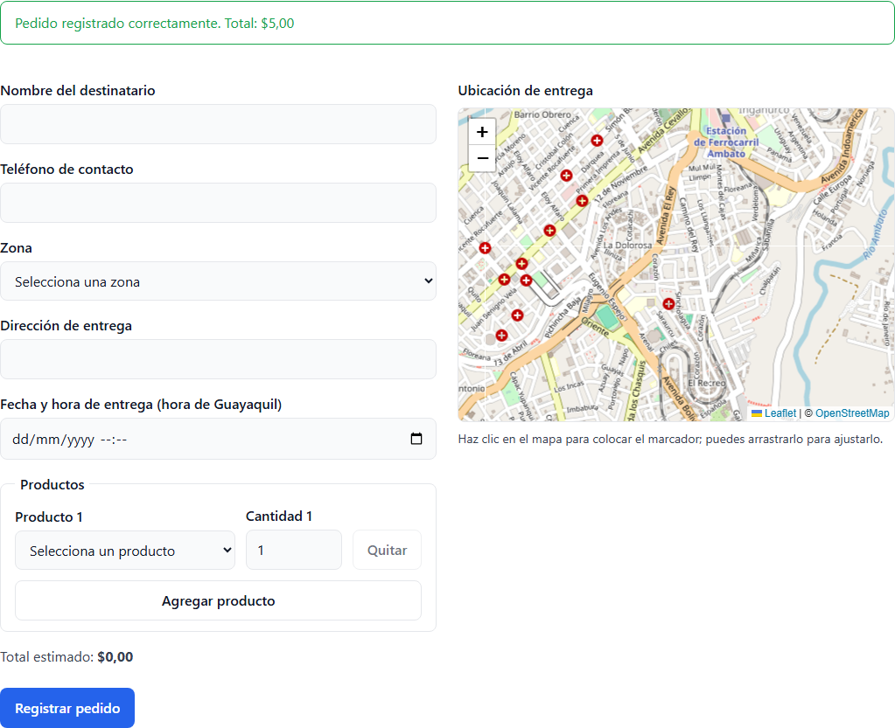 | 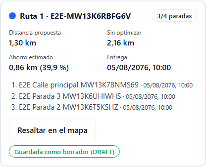 |

| Validaciones del formulario                                      | Rechazo del backend (sin stock)                              |
| ---------------------------------------------------------------- | ------------------------------------------------------------ |
| 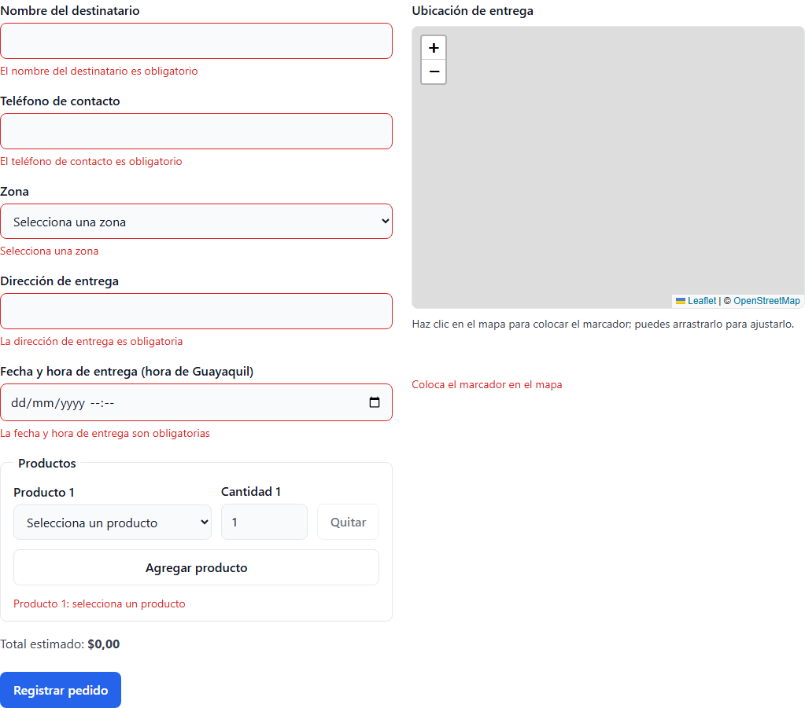 | 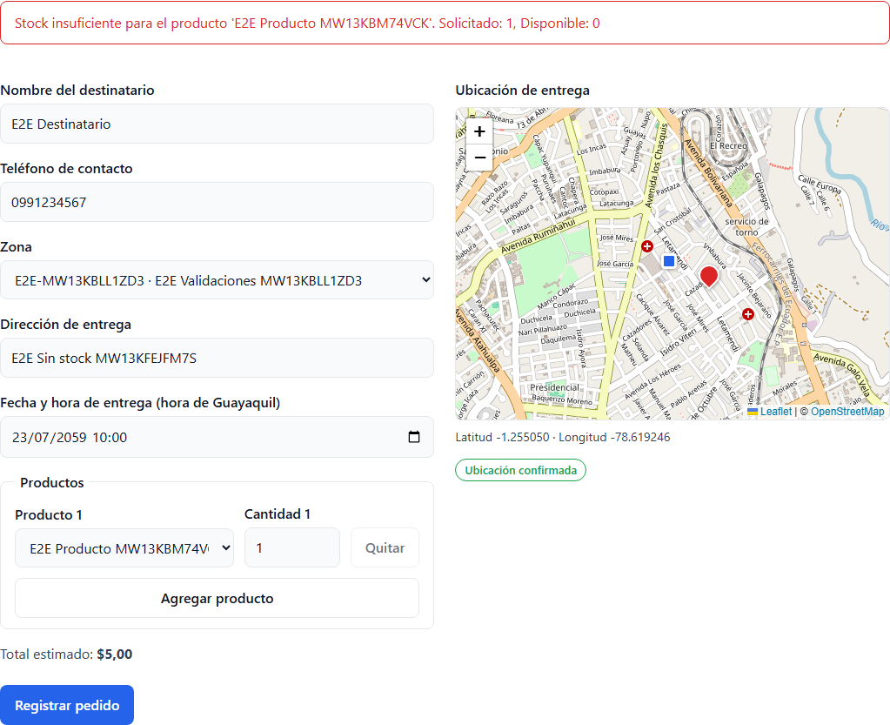 |

| Urgencia sin cupo: salida nueva                                               | R1 en curso, sin acciones                                                     |
| ----------------------------------------------------------------------------- | ----------------------------------------------------------------------------- |
| 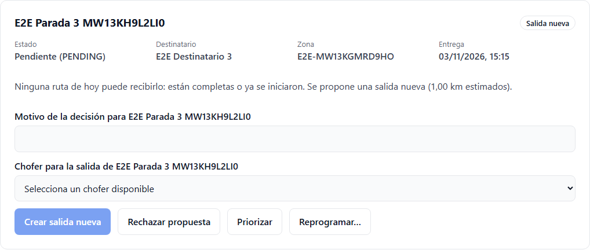 | 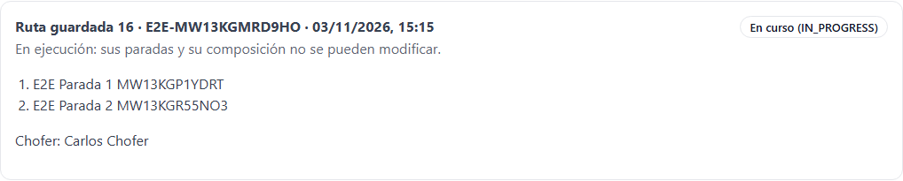 |

| Chofer retornando: todavía no disponible                   | Entrega fallida con acuerdo registrado                               |
| ---------------------------------------------------------- | -------------------------------------------------------------------- |
| 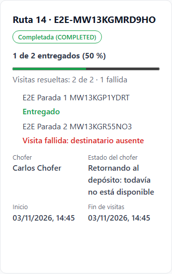 | 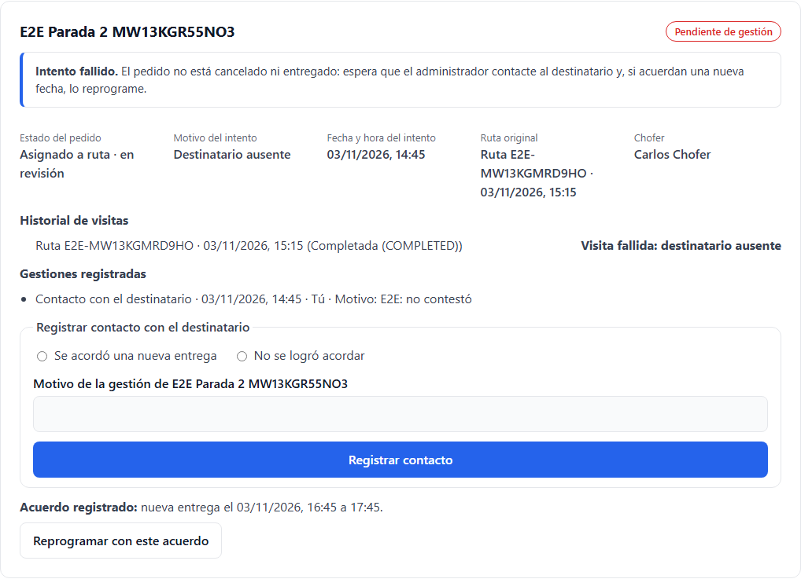 |

| R1: visita fallida                                                            | R2: el mismo pedido entregado                                                 |
| ----------------------------------------------------------------------------- | ----------------------------------------------------------------------------- |
| 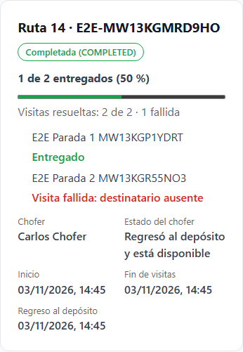 | 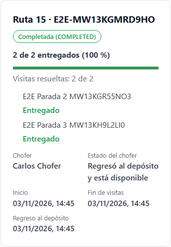 |

| [simulada] 409 al confirmar                                     | [simulada] 403 en la bandeja                                  |
| --------------------------------------------------------------- | ------------------------------------------------------------- |
| 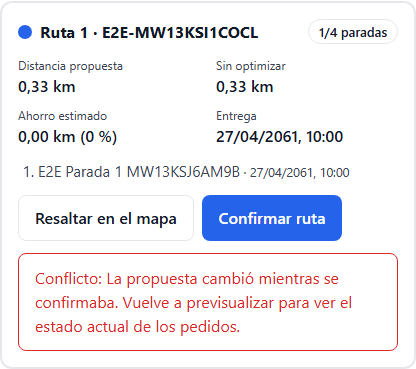 | 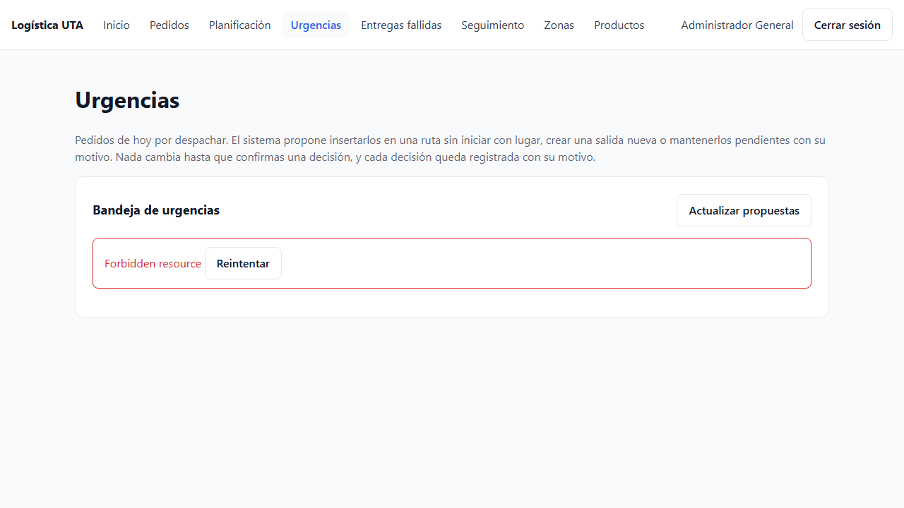 |

| [simulada] Sin conexión al registrar                           | [simulada] Conexión en vivo perdida                                |
| -------------------------------------------------------------- | ------------------------------------------------------------------ |
| 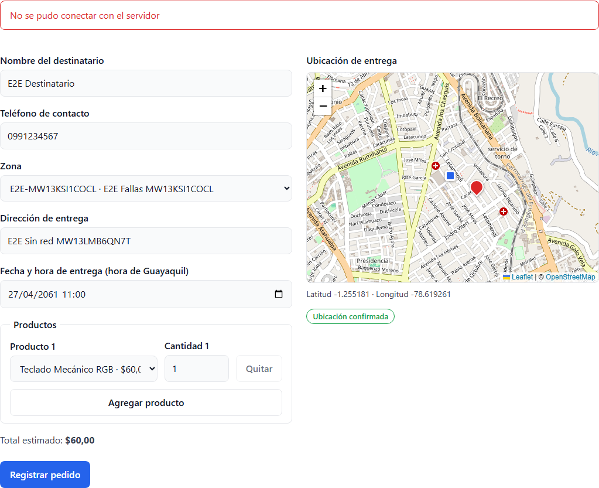 | 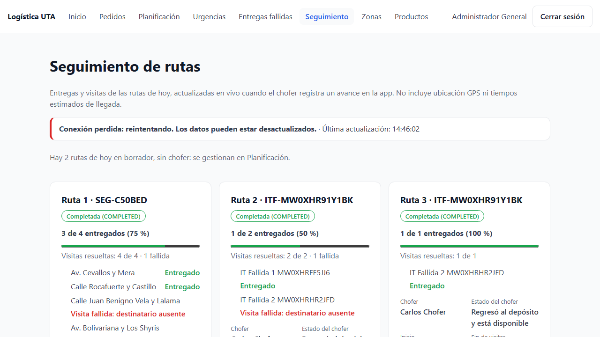 |

## 5. Un fallo deja traza y captura

Para comprobarlo se ejecutó una prueba temporal que falla a propósito (buscaba un título que no existe en _Entregas
fallidas_) y luego se borró. Playwright dejó en `test-results/<prueba>/`:

```
test-failed-1.png   captura del momento del fallo
video.webm          video de la prueba
trace.zip           traza: pasos, red, consola y DOM (pnpm exec playwright show-trace …/trace.zip)
error-context.md    error y estado de la página
```

El reporte HTML (`playwright-report/`) muestra el error, los pasos con su duración, la captura, la traza y el video. Para
reportar el fallo se abre un issue con la plantilla **Fallo de prueba E2E** y se adjuntan esos archivos.

| Reporte HTML del fallo                                      | Captura automática del fallo                                      |
| ----------------------------------------------------------- | ----------------------------------------------------------------- |
| 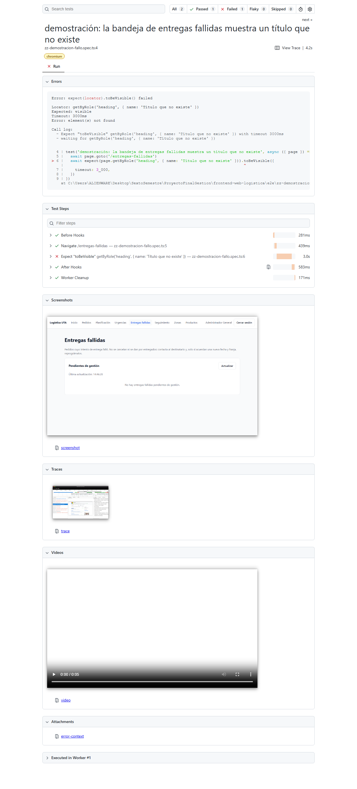 | 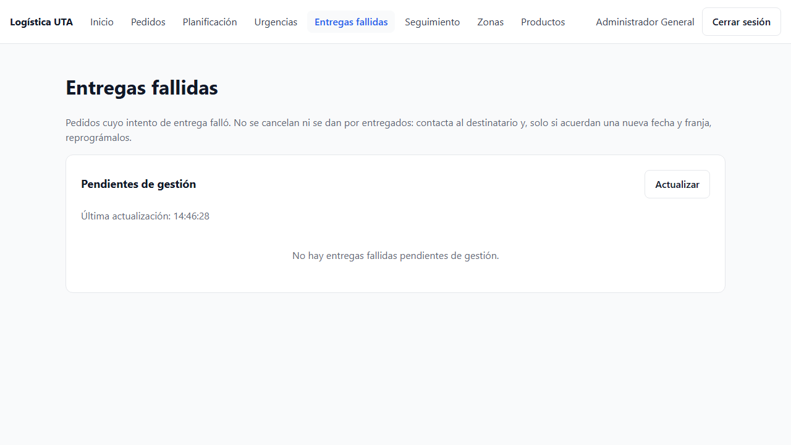 |

## 6. Cobertura restante (manual, Flutter o bloqueada)

| Qué                                         | Estado                                                                                                                               |
| ------------------------------------------- | ------------------------------------------------------------------------------------------------------------------------------------ |
| **App Flutter del chofer**                  | **No cubierta por esta suite.** Playwright prueba solo el panel web; las acciones del chofer se hacen con la API (mismos endpoints). |
| Cambio de chofer de una ruta ASSIGNED       | No incluido: necesita un segundo chofer libre durante la prueba. Cubierto por pruebas de componente y de integración.                |
| _Crear salida nueva_ desde Urgencias        | No incluido: dejaría ocupado al segundo chofer del seed. La prueba rechaza la propuesta en su lugar.                                 |
| Otros navegadores (Firefox, WebKit) y móvil | No incluidos: solo Chromium de escritorio.                                                                                           |
| Operaciones que la API no ofrece            | Ninguna de las pedidas por el issue quedó **BLOQUEADA**: todas tienen endpoint y se probaron reales o, las fallas de red, simuladas. |
| Ejecución en CI                             | No: necesita backend y base de datos. Queda para cuando exista un entorno de pruebas desplegado.                                     |

## 7. Hallazgos

| Hallazgo                                                                                                                       | Tipo                    | Acción                                                                                            |
| ------------------------------------------------------------------------------------------------------------------------------ | ----------------------- | ------------------------------------------------------------------------------------------------- |
| El formulario valida el stock antes de enviar, así que un rechazo del backend por stock solo ocurre si otro pedido lo consume. | Comportamiento esperado | La prueba crea ese pedido mientras el formulario está abierto (caso real de concurrencia).        |
| `setOffline` del navegador no corta el websocket hacia `localhost`.                                                            | Herramienta             | La pérdida de conexión se simula interceptando el websocket de Socket.IO (`page.routeWebSocket`). |
| Playwright exige títulos de prueba estables entre procesos; un día al azar en el título hacía fallar la prueba.                | Herramienta             | El día planificado va como anotación del reporte, no en el título.                                |
| La prueba de tiempo de espera tarda unos 31 s, porque el cliente espera 30 s antes de cancelar.                                | Duración                | Es la única prueba lenta; tiene su propio límite de 2 minutos.                                    |
| El mapa carga sus mosaicos desde OpenStreetMap (necesita internet para verse completo).                                        | Dependencia externa     | Las pruebas solo hacen clic en el mapa; no comprueban los mosaicos.                               |
| Cada ejecución deja en la base local zonas, pedidos y rutas `E2E-…`.                                                           | Datos de prueba         | No interfieren entre ejecuciones (sufijos únicos y días al azar); se eliminan recreando la base.  |

## 8. Cobertura del Issue #10

| Pedido del issue                                                                                                        | Evidencia                                                                                     |
| ----------------------------------------------------------------------------------------------------------------------- | --------------------------------------------------------------------------------------------- |
| Configurar Playwright y fixtures con datos aislados, sin credenciales reales en el repositorio                          | §1; `.env.integration.local` y `e2e/.auth/` ignorados por git                                 |
| Login ADMIN, alta de pedido, confirmación geográfica, planificación y despacho, errores básicos y urgencia sin cupo     | `01`, `02`, `03` y `04` (§4)                                                                  |
| Capturas y trazas en fallos; comandos reproducibles; sin depender de datos ajenos                                       | §2 y §5; datos propios por ejecución                                                          |
| Ejecutar contra backend/PostgreSQL local, diferenciando E2E reales de simuladas                                         | §3–§4: 12 reales y 5 `[simulada]`                                                             |
| Documentar cobertura restante de Flutter/manual y hallazgos                                                             | §6 y §7                                                                                       |
| Suite ejecutable y documentada con al menos un flujo web completo                                                       | `02-pedido-a-ruta` y README                                                                   |
| Un fallo genera traza/captura útil y se vincula a un issue                                                              | §5 y plantilla **Fallo de prueba E2E**                                                        |
| No afirmar cobertura móvil E2E cuando solo se prueba el navegador                                                       | §6                                                                                            |
| Lint, test y build no se rompen                                                                                         | §3 (verificaciones)                                                                           |
| Adenda: Previsualizar sin persistir, confirmar DRAFT una vez y bloquear la doble confirmación                           | `02` (dos previsualizaciones sin rutas; doble clic = una ruta)                                |
| Adenda: acciones válidas sobre DRAFT/ASSIGNED; rechazo y sin cambios sobre IN_PROGRESS                                  | `02` (corrección de DRAFT); `04` (IN_PROGRESS sin acciones y 409 en la API). ASSIGNED: ver §6 |
| Adenda: intento FALLIDO con motivo, distinto de urgencias y no DELIVERED/CANCELLED                                      | `04`, paso "no aparece como urgencia…" y bandeja de entregas fallidas                         |
| Adenda: sin acuerdo no se reprograma; con acuerdo persiste en la API y conserva la ruta original tras la segunda salida | `04`, última prueba (API `PENDING` con la fecha acordada; R1 `FAILED` y R2 `SUCCESSFUL`)      |
| Adenda: chofer con ruta COMPLETED pero retornando sigue no disponible; tras el regreso, disponible                      | `04`, prueba de seguimiento (pantalla y API)                                                  |
| Adenda: 403/409/timeout, reintentos y reconexión sin éxitos falsos                                                      | `05` (simuladas) y 409 real de `04`                                                           |
| Adenda: operaciones sin API marcadas como BLOQUEADAS                                                                    | §6: ninguna quedó bloqueada                                                                   |

El issue nombra **CP-SIS-001**, **CP-RUT-001/005/008/012/013**, **CP-SEG-004/008** y la regresión P0. El catálogo _Casos
v2.0_ no está en el repositorio, así que la trazabilidad se presenta por criterio de aceptación; si se comparte el catálogo,
se agrega el código de cada caso.
