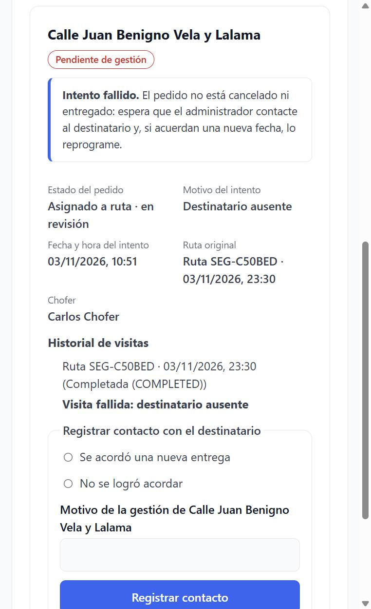
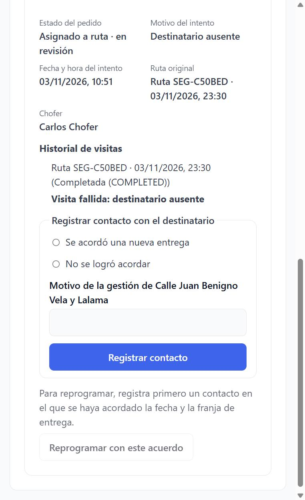
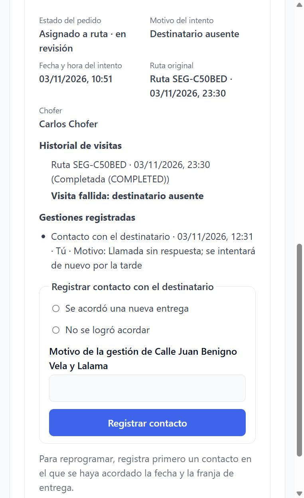
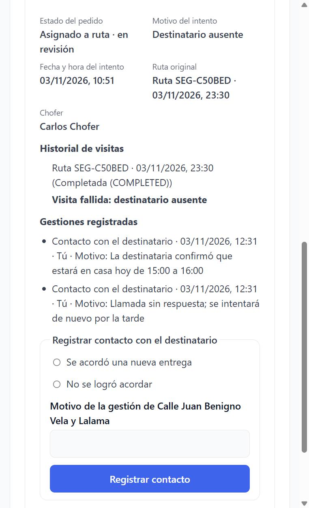
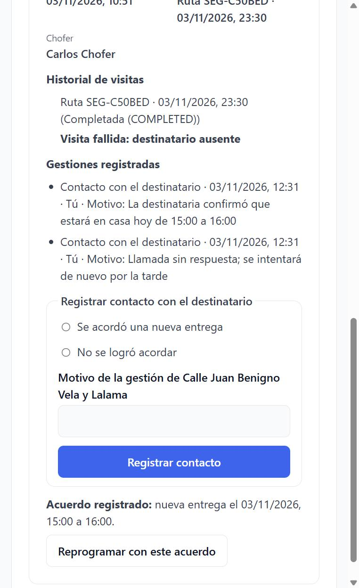
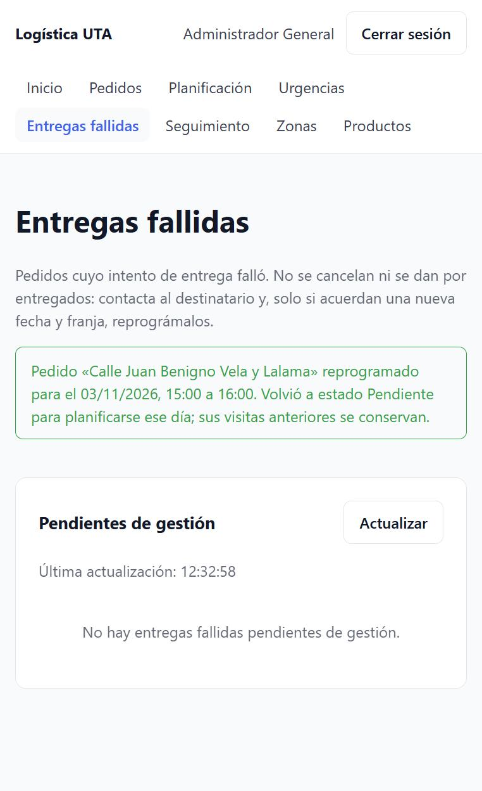

# Evidencia · Issue #13 — Gestionar entregas fallidas y reprogramación confirmada

Pantalla **Entregas fallidas** (`/entregas-fallidas`) para el ADMIN, separada de Urgencias: muestra cada pedido cuyo
último intento falló, con su motivo tipificado, la ruta original, el chofer y el historial de visitas. Permite registrar el
contacto con el destinatario y, **solo si se acordó día y franja**, reprogramarlo con ese acuerdo. Probado contra el backend
real.

- **Issue:** [#13](https://github.com/logistica-gc-uta/frontend-web-logistica/issues/13)
- **Fecha de ejecución:** 03/11/2026
- **Backend:** `logistica-gc-uta/backend` en `main` @ `adfe30c` (incluye visitas e intentos #10 e incidencias #12)
- **Frontend:** rama `feat/13-entregas-fallidas` (desde `main` @ `bbc7a69`)

## 1. Qué se implementó

| Parte                                    | Detalle                                                                                                                                                                                                                                                                            |
| ---------------------------------------- | ---------------------------------------------------------------------------------------------------------------------------------------------------------------------------------------------------------------------------------------------------------------------------------- |
| Bandeja (`incidents/incidentsBoard`)     | Combina `GET /dispatch/inbox` (incidencias), `GET /routes` (visitas) y `GET /dispatch/audit` (gestiones). Para cada pedido muestra el último intento, la ruta que lo contiene, todas sus visitas y las gestiones `CONTACT`/`RESCHEDULE` registradas.                               |
| Intento fallido ≠ cancelado ni entregado | Etiqueta _Pendiente de gestión_ y el aviso "Intento fallido. El pedido no está cancelado ni entregado…". El estado del pedido se muestra tal como lo devuelve la API (por ejemplo, _Asignado a ruta · en revisión_); no se inventa un estado `FAILED`.                             |
| Datos mínimos                            | Pedido, motivo tipificado (destinatario ausente / rechazó la entrega), fecha y hora del intento, ruta original y chofer. No se muestra el texto libre del chofer ni datos personales del destinatario.                                                                             |
| Registro de contacto (`CONTACT`)         | _Se acordó una nueva entrega_ o _No se logró acordar_, más un motivo breve. Con acuerdo pide **día y franja** (hora de Guayaquil), que debe ser futura y con la hora final posterior a la inicial. Se envía el último intento (`attemptId`).                                       |
| Reprogramación (`RESCHEDULE`)            | El botón _Reprogramar con este acuerdo_ solo se habilita si hay un acuerdo registrado **y** la ruta original está completada. Usa el id del contacto como `agreementId`; el servidor valida y devuelve el pedido a `PENDING` con la fecha acordada.                                |
| Historial                                | _Historial de visitas_ lista cada ruta en la que estuvo el pedido con su resultado; _Gestiones registradas_ lista los contactos y reprogramaciones con fecha, responsable y motivo. Nada se oculta ni se reescribe.                                                                |
| Errores (`incidentError`)                | 403 (sin permisos), 409 (el intento, la ruta o el acuerdo cambiaron: actualizar), 400 del servidor y sin conexión. El éxito solo se muestra si el backend devuelve `APPLIED`; mientras guarda, el formulario se bloquea (_Guardando..._), así un doble clic registra una sola vez. |
| Urgencias                                | La nota de entregas fallidas ahora enlaza a esta pantalla. La acción `CONTACT` se llama _Contacto con el destinatario_ en el historial (antes decía "Acuerdo de nueva entrega" aunque no hubiera acuerdo).                                                                         |
| Menú                                     | Nueva entrada _Entregas fallidas_ después de Urgencias. En pantallas angostas el menú pasa a su propia fila y sus enlaces se reparten en varias líneas, sin desbordar la página.                                                                                                   |

No incluye llamadas automáticas, pagos o reembolsos, GPS ni ETA, como indica el issue.

## 2. Verificaciones de calidad

| Comando                                    | Resultado                                                                  |
| ------------------------------------------ | -------------------------------------------------------------------------- |
| `pnpm lint`                                | 0 errores                                                                  |
| `pnpm typecheck`                           | 0 errores                                                                  |
| `pnpm format:check`                        | Sin observaciones                                                          |
| `pnpm test:coverage` (umbral del CI: 80 %) | **478/478** pruebas (60 archivos) · 99,8 % de líneas · 93,4 % de ramas     |
| `pnpm build`                               | Correcto (el aviso de tamaño del bloque ya existía)                        |
| `pnpm test:integration`                    | **43/43** pruebas contra la API real (39 previas + 4 de entregas fallidas) |

> Con el backend, Vite y el navegador abiertos a la vez, dos pruebas de `OrdersPage` (anteriores a este issue) superaron
> el límite de 5 s por falta de CPU. Solas tardan 1,5 s; con `pnpm test:coverage --maxWorkers=4` pasan las 478.

Pruebas unitarias destacadas (`src/features/incidents/`):

- **Bandeja:** intento con motivo, ruta original, chofer y aviso de que no está cancelado ni entregado; estado vacío; error
  de carga con _Reintentar_.
- **Contacto:** exige resultado y motivo; sin acuerdo se envía sin fecha y limpia el formulario; con acuerdo exige franja
  válida y futura y la envía en hora de Guayaquil; si falla conserva lo escrito.
- **Reprogramación:** bloqueada sin acuerdo y mientras la ruta original sigue en curso; con acuerdo y ruta completada se
  reprograma y el pedido sale de la bandeja con aviso; un contacto posterior sin acuerdo anula el anterior.
- **Errores:** 403, 409 y sin conexión muestran su mensaje y no un éxito; doble clic registra una sola vez.

## 3. Pruebas de integración con la API real (`src/integration/incidents.int.test.ts`)

Cada ejecución crea su propia zona y pedidos de **hoy**. Con el chofer del seed (mismos endpoints que la app Flutter,
`src/integration/support/driver.ts`) arma **R1** con una entrega exitosa y una visita fallida (destinatario ausente), la
completa y confirma el regreso. Al final siempre cierra lo que quedó abierto, así el chofer queda disponible. Si no quedan
unas 3 horas en el día de Guayaquil, se omite.

```
 ✓ Integración real · entregas fallidas > el intento fallido aparece en la bandeja con su motivo; el pedido no queda entregado ni cancelado
 ✓ Integración real · entregas fallidas > sin un acuerdo de fecha no se puede reprogramar; una fecha pasada se rechaza
 ✓ Integración real · entregas fallidas > un CLIENT no puede gestionar la entrega fallida y un DRIVER no ve la bandeja (403)
 ✓ Integración real · entregas fallidas > con fecha acordada se reprograma y, tras entregarse en R2, conserva la visita fallida de R1

 Test Files  8 passed (8)
      Tests  43 passed (43)
```

La cuarta prueba recorre el ciclo completo: contacto con acuerdo → reprogramación (`PENDING` con la fecha acordada; el mismo
acuerdo usado otra vez da 409) → **R2** planificada, asignada y entregada → R1 conserva su parada `FAILED`, R2 tiene
`SUCCESSFUL`, el pedido queda `DELIVERED` y el chofer disponible.

## 4. Prueba manual en la pantalla

Realizada el 03/11/2026 como ADMIN, con la visita fallida que dejó la prueba de sistema del #9 (pedido _Calle Juan Benigno
Vela y Lalama_, ruta `SEG-C50BED` completada, destinatario ausente).

| #   | Acción                                                                            | Resultado                                                                                                                                       |
| --- | --------------------------------------------------------------------------------- | ----------------------------------------------------------------------------------------------------------------------------------------------- |
| M1  | Abrir _Entregas fallidas_                                                         | Tarjeta _Pendiente de gestión_ con motivo, fecha y hora del intento, ruta original, chofer y _Asignado a ruta · en revisión_                    |
| M2  | Mirar la reprogramación sin acuerdo                                               | Botón deshabilitado con la indicación de registrar primero un contacto con fecha y franja acordadas                                             |
| M3  | Registrar _No se logró acordar_ ("Llamada sin respuesta; se intentará de nuevo…") | Aparece en _Gestiones registradas_ con fecha, _Tú_ y motivo; la reprogramación sigue bloqueada                                                  |
| M4  | Registrar _Se acordó una nueva entrega_ para hoy de 15:00 a 16:00                 | _Acuerdo registrado: nueva entrega el 03/11/2026, 15:00 a 16:00._ y el botón _Reprogramar con este acuerdo_ habilitado                          |
| M5  | Pulsar _Reprogramar con este acuerdo_                                             | Aviso "Pedido «Calle Juan Benigno Vela y Lalama» reprogramado para el 03/11/2026, 15:00 a 16:00…" y la bandeja queda vacía                      |
| M6  | Consultar la API (`GET /orders/{id}` y `GET /dispatch/audit`)                     | Pedido `PENDING` con `scheduledDeliveryDate` `2026-11-03T20:00:00Z` (15:00 en Guayaquil); auditoría `RESCHEDULE` `APPLIED` con su `agreementId` |

### Capturas

| M1 · Entrega fallida pendiente de gestión                             | M2 · Reprogramación bloqueada sin acuerdo                            |
| --------------------------------------------------------------------- | -------------------------------------------------------------------- |
|  |  |

| M3 · Contacto sin acuerdo                                        | M4 · Contacto con acuerdo                                        |
| ---------------------------------------------------------------- | ---------------------------------------------------------------- |
|  |  |

| M4 · Acuerdo listo para reprogramar                                         | M5 · Reprogramada: bandeja vacía                                       |
| --------------------------------------------------------------------------- | ---------------------------------------------------------------------- |
|  |  |

## 5. Hallazgos

| Hallazgo                                                                                                                   | Tipo                       | Acción                                                                                                                           |
| -------------------------------------------------------------------------------------------------------------------------- | -------------------------- | -------------------------------------------------------------------------------------------------------------------------------- |
| La auditoría no expone el día y la franja de un `CONTACT`; no hay forma de consultar después un acuerdo ya registrado.     | Limitación del backend     | La pantalla guarda el acuerdo mientras está abierta. Si se recarga antes de reprogramar, hay que registrar el contacto de nuevo. |
| `RESCHEDULE` exige que la ruta original esté `COMPLETED` y liberada; antes responde 409.                                   | Regla del backend          | El botón se deshabilita y explica que la ruta original todavía no se completó (con prueba).                                      |
| Tras el fallo, el pedido conserva su estado comercial (por ejemplo, `ASSIGNED`) y queda en revisión.                       | Comportamiento del backend | Se muestra como _Asignado a ruta · en revisión_ junto al aviso de que no está cancelado ni entregado.                            |
| Un acuerdo solo se puede usar una vez (409 si se repite).                                                                  | Regla del backend          | Cubierto en la integración; tras reprogramar, la pantalla descarta el acuerdo.                                                   |
| La etiqueta de `CONTACT` en Urgencias decía "Acuerdo de nueva entrega" aunque no hubiera acuerdo.                          | Corrección del frontend    | Ahora dice _Contacto con el destinatario_.                                                                                       |
| Con 9 entradas, el menú se salía de la pantalla en anchos angostos.                                                        | Corrección del frontend    | El menú se reparte en varias líneas y, por debajo de 900 px, ocupa su propia fila.                                               |
| La prueba manual dejó el pedido de demostración reprogramado (`PENDING`) y las pruebas de integración dejan zonas `ITF-…`. | Datos de prueba            | Se eliminan recreando la base.                                                                                                   |

## 6. Fuera de alcance de este PR

Llamadas automáticas, pagos o reembolsos, GPS y ETA (excluidos por el issue); E2E con Playwright (issue #10, que retoma
este flujo); la app del chofer, que solo reporta el intento.

## 7. Cobertura del Issue #13

| Pedido del issue                                                                                             | Evidencia                                                                                     |
| ------------------------------------------------------------------------------------------------------------ | --------------------------------------------------------------------------------------------- |
| Bandeja de entregas fallidas separada de Urgencias, con pedido, ruta, chofer, fecha/hora y motivo tipificado | M1; pruebas de tarjeta y de página; integración 1                                             |
| ADMIN ve el intento; DRIVER y CLIENT no tienen acceso                                                        | Integración 3 (CLIENT 403 al gestionar, DRIVER 403 en la bandeja); el panel solo admite ADMIN |
| Intento FALLIDO ≠ `CANCELLED` o `DELIVERED`; no se crea una ruta nueva automáticamente                       | M1; integración 1; no se usa un estado `FAILED` del pedido                                    |
| Registrar el contacto con resultado y marca temporal, sin datos personales innecesarios                      | M3–M4; _Gestiones registradas_ con fecha, responsable y motivo                                |
| Sin contacto o fecha acordada no se reprograma; con una fecha válida acordada, sí                            | M2–M5; integración 2 (sin acuerdo 409, fecha pasada 400) y 4                                  |
| Historial de intentos y rutas, incluido el segundo intento, sin reescribir visitas                           | _Historial de visitas_ (M1); integración 4: R1 conserva `FAILED` tras entregarse en R2        |
| Las rutas iniciadas mantienen paradas y orden                                                                | La pantalla no modifica paradas; la reprogramación solo se permite con la ruta completada     |
| Doble envío, 403/409 y desconexión verificables, sin éxito falso                                             | Pruebas de página (doble clic, 403, 409, sin conexión); integración 2 y 4 (409)               |
| Pendiente de guardado frente a confirmación persistida                                                       | _Guardando..._ con el formulario bloqueado; éxito solo con `APPLIED`                          |
| No inventar campos                                                                                           | Tipos de `dispatch/types.ts` según la respuesta real; el acuerdo no se lee de la auditoría    |
| UI, pruebas, integración real y evidencia; lint, typecheck, build y CI                                       | §2–§4                                                                                         |

El issue nombra los casos **CP-SEG-004**, **CP-SEG-008** y la regresión de **CP-RUT-008**. El catálogo _Casos v2.0_ no está
en el repositorio, así que la trazabilidad se presenta por criterio de aceptación; si se comparte el catálogo, se agrega el
código de cada caso.
