# Evidencia · Issue #19 — Shop: inicio, catálogo, filtros y detalle de regalos

Zona pública de **REGALÍA** (`/shop`) en React, separada del panel ADMIN y conectada al backend real:

- inicio con categorías y destacados;
- catálogo paginado en el servidor, con búsqueda, filtros y orden guardados en la URL;
- detalle con galería y selector de cantidad limitado por el stock y por el límite por SKU configurable;
- un carrito compartido mínimo (`addItem` y contador) para el #20.

- **Issue:** [#19](https://github.com/logistica-gc-uta/frontend-web-logistica/issues/19)
- **Fecha de ejecución:** 03/11/2026
- **Backend:** `logistica-gc-uta/backend` en `main` @ `adfe30c` (endpoints del Shop de #32/#34), con claves de Cloudinary de prueba en su `.env` local
- **Frontend:** rama `feat/19-shop-catalogo` (desde `main` @ `cdab1ec`)

## 1. Qué se implementó

| Parte                                     | Detalle                                                                                                                                                                                                                                                                                                                                                                                                                          |
| ----------------------------------------- | -------------------------------------------------------------------------------------------------------------------------------------------------------------------------------------------------------------------------------------------------------------------------------------------------------------------------------------------------------------------------------------------------------------------------------- |
| Rutas y `ShopLayout`                      | `/shop`, `/shop/catalogo` y `/shop/productos/:id` sin sesión, fuera del panel. Cabecera con la marca, Inicio, Catálogo, buscador y contador del carrito; enlace para saltar al contenido. No muestra accesos ADMIN. Las rutas del panel no cambian.                                                                                                                                                                              |
| Servicio (`shopService`)                  | `GET /shop/categories`, `/shop/products`, `/shop/products/:id` y `/shop/settings`. Solo envía los filtros activos y copia solo lo que se muestra (sin `sku`, `publicId` ni fechas). Traduce `PRODUCT_NOT_FOUND`, y también un ID mal formado (400), a "Este regalo no existe o ya no está disponible."                                                                                                                           |
| Inicio                                    | Botón «Ver regalos». Categorías de la API, mostrando solo las que tienen regalos publicados. Muestra los **destacados** o, si no hay, los regalos disponibles. No incluye «Más vendidos»: la API acepta `best_selling`, pero responde `sortApplied: featured`, así que no hay ventas comprobables.                                                                                                                               |
| Catálogo                                  | Paginado en el servidor (12 por página). Búsqueda por nombre y descripción, categoría, precio mínimo y máximo en USD, «Solo disponibles» y orden (destacados, recientes, precio ascendente y descendente). Todo se guarda en la URL: un enlace reproduce la vista y volver desde el detalle la conserva. Cambiar un criterio vuelve a la página 1. Los filtros se aplican al enviar, así que no hay una consulta por cada tecla. |
| Precios                                   | Se convierten a `minPriceCents`/`maxPriceCents` con enteros (`dollarsToCents`), sin pasar por decimales. Un monto inválido o un mínimo mayor que el máximo se explica y no se envía. Los precios se muestran desde `priceCents`.                                                                                                                                                                                                 |
| Tarjeta (`ProductCard`)                   | Imagen principal con `alt` y una imagen de reemplazo si falta o falla; nombre, categoría, precio, _Disponible_/_Agotado_, «Envío gratis — incluido en el precio» y enlace al detalle.                                                                                                                                                                                                                                            |
| Detalle                                   | Ruta de navegación con regreso al catálogo filtrado, galería con miniaturas, categoría, precio, envío, stock y descripción como **texto** (React la escapa, así que el HTML no se ejecuta).                                                                                                                                                                                                                                      |
| Cantidad y carrito                        | El máximo es **min(stock, `maxUnitsPerSkuPerOrder`) − lo que ya está en el carrito**, con el límite leído de `/shop/settings` (no hay un 10 fijo en el código). Explica por qué no se puede añadir: agotado, límite o stock alcanzado, o configuración no disponible (con _Reintentar_). Al añadir, lo confirma y actualiza el contador.                                                                                         |
| Carrito compartido (`features/shop/cart`) | `CartProvider` y `useCart()` con `addItem(productId, quantity)`, `quantityOf` y `count`. Solo guarda productos y cantidades en el navegador; precio y stock se revalidan en el checkout (#20).                                                                                                                                                                                                                                   |
| Móvil                                     | Grilla y filtros adaptables, controles sin hover y sin scroll horizontal a 375 px (se corrigió un desborde de 97 px en los filtros).                                                                                                                                                                                                                                                                                             |

## 2. Preparación del entorno

- **Configuración del Shop:** después de `pnpm prisma db init`, la tabla `shopBusinessSettings` quedó vacía y `GET /shop/settings` respondía 500. Se insertó en la base local la misma fila que trae la migración `20261023T2132_shop_settings_v12` (límite de 10 por SKU, envío `FREE_INCLUDED`). Se reportó al equipo de backend.
- **Imágenes:** un regalo solo es público si tiene una imagen principal subida por Cloudinary. El equipo compartió claves de prueba, que van solo en el `.env` del backend local (ignorado por git).
- **Datos de demostración:** 4 categorías y 26 regalos creados con la API de ADMIN, con imágenes subidas por el backend, para las capturas y la paginación. Se eliminan recreando la base.

## 3. Verificaciones de calidad

| Comando                                    | Resultado                                                                                                                      |
| ------------------------------------------ | ------------------------------------------------------------------------------------------------------------------------------ |
| `pnpm lint`                                | 0 errores                                                                                                                      |
| `pnpm typecheck`                           | 0 errores                                                                                                                      |
| `pnpm format:check`                        | Sin observaciones                                                                                                              |
| `pnpm test:coverage` (umbral del CI: 80 %) | **530/530** pruebas (62 archivos; 52 nuevas del Shop) · 99,6 % de líneas · 93,6 % de ramas · `features/shop`: 98,4 % de líneas |
| `pnpm build`                               | Correcto                                                                                                                       |
| `pnpm test:integration`                    | **49/49** contra la API real (43 previas + 6 del Shop)                                                                         |
| `pnpm test:e2e`                            | **17/17** (sin cambios: regresión del panel)                                                                                   |

Pruebas unitarias destacadas (`ShopPages.test.tsx` y `shopLogic.test.ts`):

- **Navegación:** la cabecera no tiene accesos ADMIN y el buscador lleva al catálogo; Inicio → Catálogo → Detalle; al volver se conservan búsqueda, filtros, orden y página.
- **Búsqueda y filtros combinados:** se leen desde la URL; se aplican al enviar; el cambio de orden vuelve a la página 1; la paginación conserva los criterios; los precios inválidos o invertidos no consultan.
- **Estados:** carga, sin datos, sin coincidencias (con _Quitar filtros_), página inexistente, error con _Reintentar_.
- **Precios en centavos:** `12,50` = 1250, `0.1` = 10, montos inválidos rechazados.
- **Límite configurable:** con límite 10 o 3, con stock 2 y con unidades ya en el carrito; cantidades no enteras; agotado; configuración no disponible.
- **Imágenes:** reemplazo si fallan o faltan; galería con `aria-pressed`; la descripción con HTML no se ejecuta.

## 4. Pruebas de integración con la API real (`src/integration/shop.int.test.ts`)

Cada ejecución crea, como ADMIN:

- su propia categoría;
- 5 regalos publicados;
- 1 agotado;
- 1 sin publicar.

Cada regalo lleva una imagen PNG subida a Cloudinary por el backend. Las consultas se hacen **sin sesión**, como un visitante.

```
 ✓ Integración real · Shop público (/shop) > un visitante ve la categoría con el número real de regalos publicados
 ✓ Integración real · Shop público (/shop) > pagina en el servidor sin repetir ni perder regalos y sin los no publicados
 ✓ Integración real · Shop público (/shop) > cada regalo trae precio en centavos, imagen principal de Cloudinary y disponibilidad
 ✓ Integración real · Shop público (/shop) > combina búsqueda en la descripción, rango de precios, disponibilidad y orden
 ✓ Integración real · Shop público (/shop) > el detalle de un regalo publicado existe; uno sin publicar o inexistente no
 ✓ Integración real · Shop público (/shop) > límite por SKU > un cambio del ADMIN se refleja al volver a consultar la configuración

 Test Files  9 passed (9)
      Tests  49 passed (49)
```

La última prueba cambia el límite por SKU con `PATCH /admin/shop-settings` y, al terminar, restaura el valor original.

## 5. Prueba manual en la pantalla (API real)

Realizada el 03/11/2026 con los datos de demostración. Las capturas son de Chromium en escritorio (1280 px) y en móvil
(375 px, táctil).

| #      | Acción                                                      | Resultado                                                                                           |
| ------ | ----------------------------------------------------------- | --------------------------------------------------------------------------------------------------- |
| M1     | Abrir `/shop`                                               | Portada con _Ver regalos_, 4 categorías con su conteo real y los destacados                         |
| M2     | Catálogo → Flores, de $15 a $45,50, precio de menor a mayor | URL `?categoria=…&min=15&max=45%2C50&orden=price_asc`; 5 regalos ordenados de $16,58 a $39,47       |
| M3     | Abrir un regalo y añadir 2 unidades                         | _Se añadieron 2 unidades al carrito._ y la cabecera pasa a _Carrito: 2 unidades_                    |
| M4     | Volver con la ruta de navegación                            | Regresa a la misma URL con los mismos filtros y el mismo orden                                      |
| M5     | Buscar «dinosaurio»                                         | _No encontramos regalos con esos criterios._ con _Quitar filtros_                                   |
| M6     | Precio mínimo 50 y máximo 10                                | _El precio máximo debe ser mayor o igual al mínimo_; no se consulta                                 |
| M7     | Abrir un regalo agotado                                     | _Agotado_ y _Este regalo está agotado: no se puede añadir al carrito._; botón deshabilitado         |
| M8     | Añadir todas las unidades de un regalo con stock 9          | Máximo 9 = min(stock 9, límite 10); luego _Ya tienes en el carrito todas las unidades disponibles._ |
| M9–M11 | Inicio, catálogo y detalle a 375 px                         | Sin desborde horizontal (0 px) y con los botones visibles                                           |

### Capturas

| M1 · Inicio                           | M2 · Filtros combinados y orden                         |
| ------------------------------------- | ------------------------------------------------------- |
| 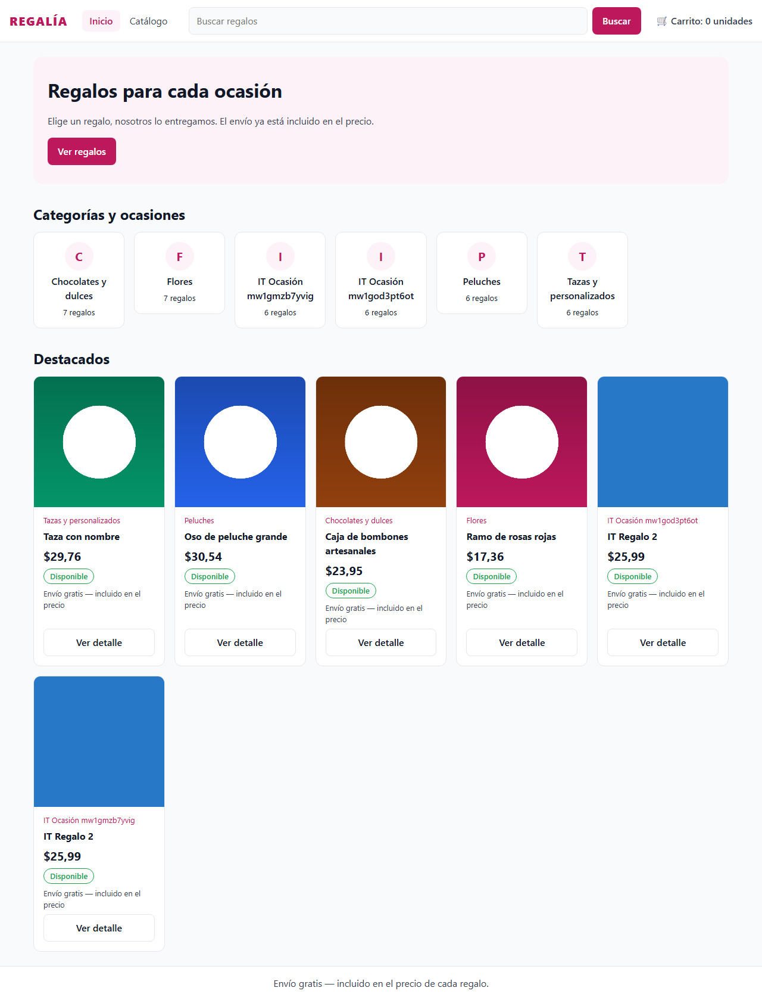 | 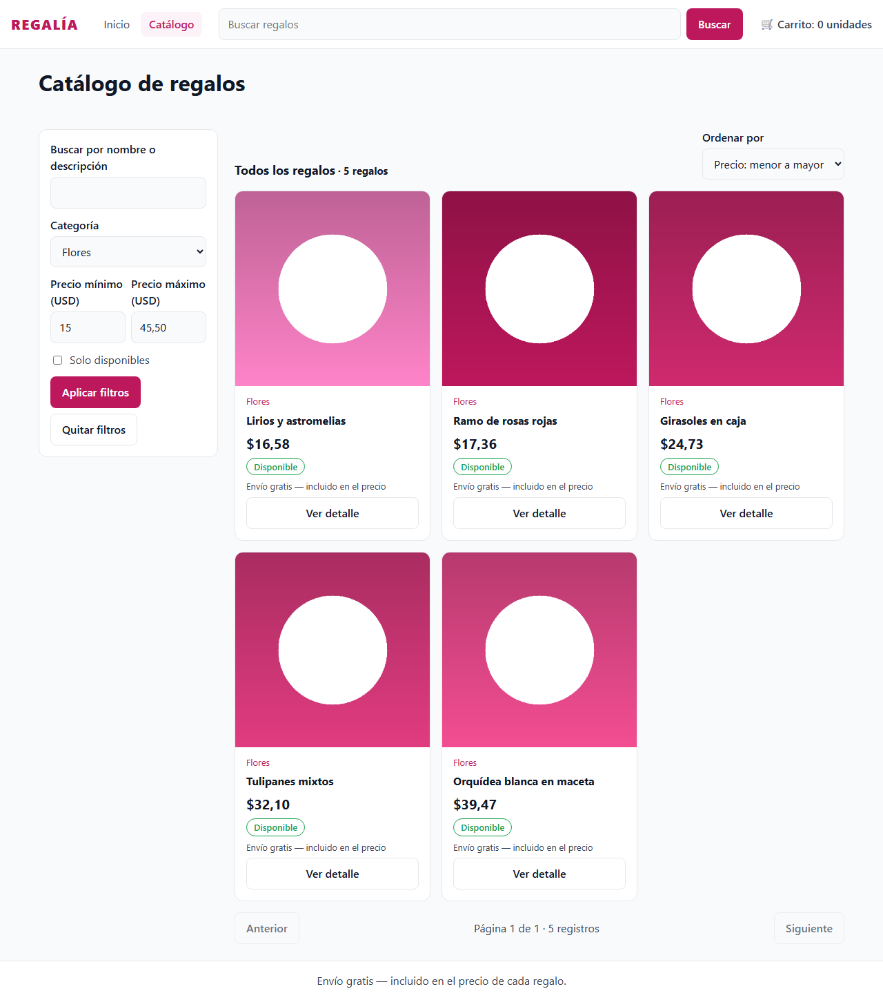 |

| M3 · Añadido al carrito                                   | M4 · Volver conserva los filtros                       |
| --------------------------------------------------------- | ------------------------------------------------------ |
| 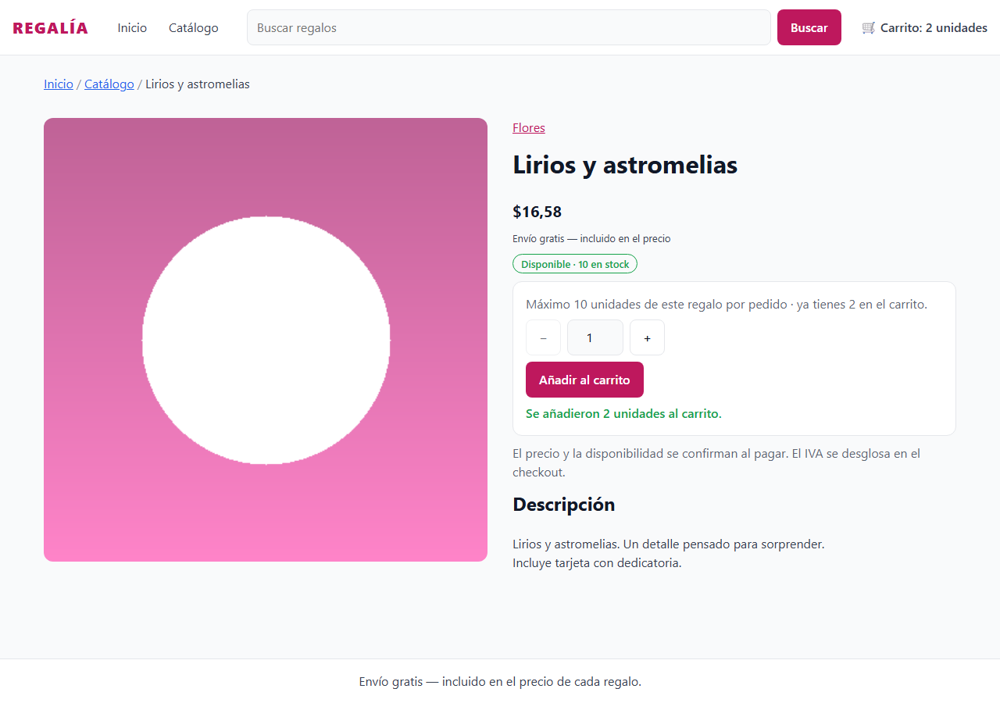 | 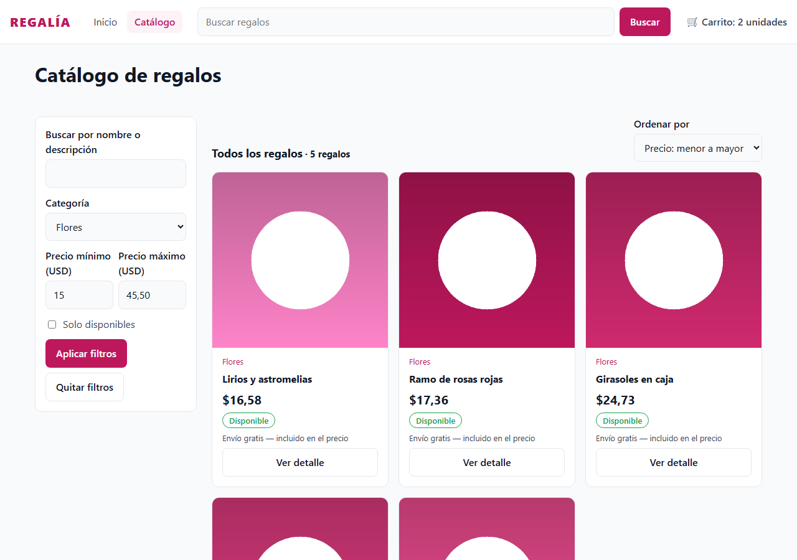 |

| M5 · Búsqueda sin resultados                           | M6 · Precios inválidos                           |
| ------------------------------------------------------ | ------------------------------------------------ |
| 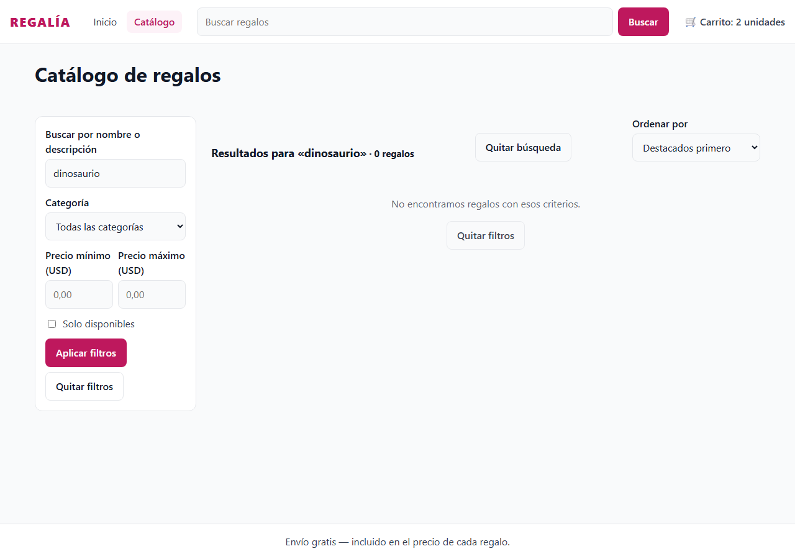 | 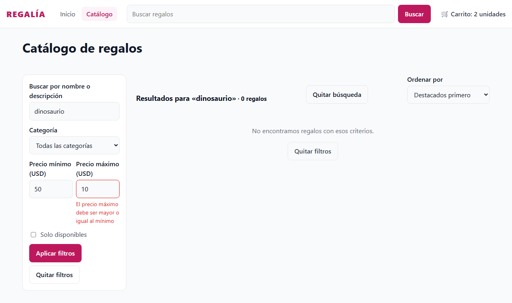 |

| M7 · Regalo agotado                            | M8 · Límite alcanzado                                   |
| ---------------------------------------------- | ------------------------------------------------------- |
| 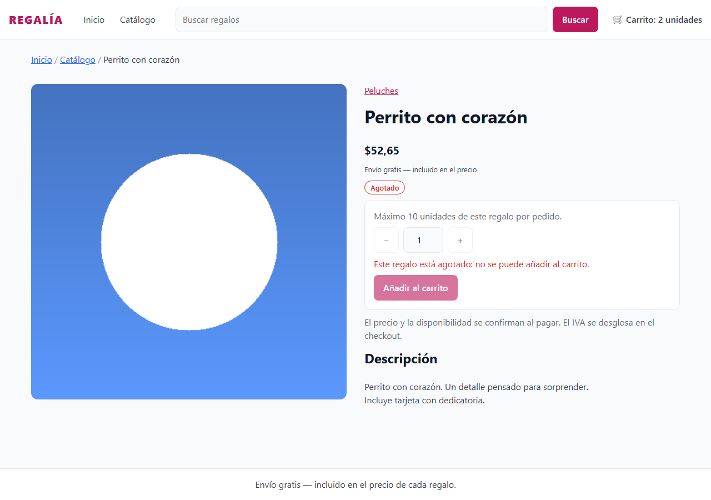 | 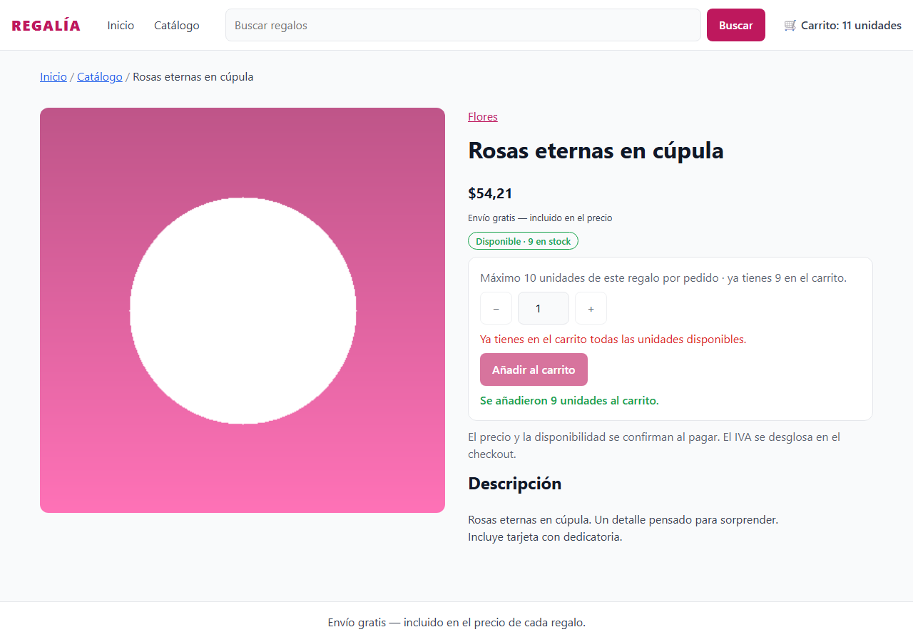 |

| M9 · Móvil: inicio                          | M10 · Móvil: catálogo                          | M11 · Móvil: detalle                          |
| ------------------------------------------- | ---------------------------------------------- | --------------------------------------------- |
| 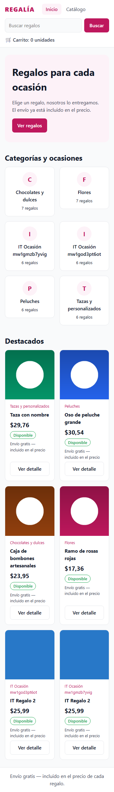 | 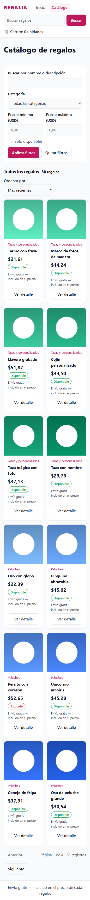 | 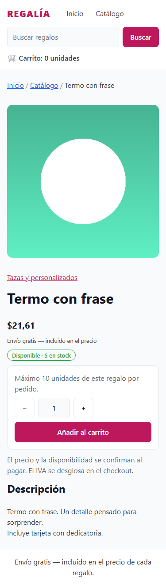 |

## 6. Hallazgos

| Hallazgo                                                                                                           | Tipo                             | Acción                                                                                                                                                    |
| ------------------------------------------------------------------------------------------------------------------ | -------------------------------- | --------------------------------------------------------------------------------------------------------------------------------------------------------- |
| Después de `pnpm prisma db init`, la tabla `shopBusinessSettings` queda vacía y `GET /shop/settings` responde 500. | Backend (preparación de la base) | Se insertó la fila de la migración en la base local y se reportó al equipo. Mientras falte, el detalle explica que no puede añadir y ofrece _Reintentar_. |
| Un regalo solo es público con una imagen principal subida por Cloudinary; sin claves, el catálogo queda vacío.     | Dependencia del backend          | Claves de prueba en el `.env` local del backend; las pruebas suben un PNG por regalo.                                                                     |
| `sort=best_selling` responde `sortApplied: featured`: todavía no hay ventas comprobables.                          | Contrato                         | No se ofrece «Más vendidos».                                                                                                                              |
| Las categorías no traen imagen.                                                                                    | Contrato                         | La tarjeta usa la inicial de la categoría.                                                                                                                |
| El seed de 200 regalos (backend #35) todavía no existe.                                                            | Pendiente del backend            | La paginación se verificó con 44 regalos reales publicados (4 páginas de 12) y con la integración. El frontend no tiene un catálogo local.                |
| La cuenta del cliente (login CLIENT y su menú) es parte del checkout.                                              | Alcance                          | Queda para el #20, que también amplía el carrito compartido.                                                                                              |
| A 375 px los filtros del catálogo desbordaban 97 px.                                                               | Corrección del frontend          | Los campos de precio se encogen; quedó en 0 px.                                                                                                           |

## 7. Cobertura del Issue #19

| Pedido del issue                                                                                                                                                                        | Evidencia                                                                               |
| --------------------------------------------------------------------------------------------------------------------------------------------------------------------------------------- | --------------------------------------------------------------------------------------- |
| 01 · Cabecera pública sin ADMIN, «Ver regalos», categorías de la API, destacados reales, tarjeta completa, estados                                                                      | M1; pruebas de cabecera, inicio y tarjeta                                               |
| 02 · Paginación en el servidor sin catálogo local; búsqueda con término visible; filtros combinables; orden; precios en centavos; URL; estados                                          | M2, M4–M6; §4 (paginación y filtros reales); pruebas del catálogo                       |
| 03 · Detalle por ID, ruta de navegación, galería, stock; cantidad 1…min(stock, límite); añadir con confirmación y contador; agotado/404; HTML seguro; envío gratis sin IVA en el precio | M3, M7, M8; pruebas del detalle; §4 (detalle e inexistente)                             |
| 05 · Móvil: mismos flujos, sin superposición ni scroll horizontal                                                                                                                       | M9–M11 (0 px de desborde)                                                               |
| Rutas del panel sin cambios; `ShopLayout` separado; componentes reutilizables                                                                                                           | §1; E2E 17/17                                                                           |
| Integrar `/shop/categories`, `/shop/products`, `/shop/products/:id` y `/shop/settings` sin usar `GET /products` antiguo                                                                 | `shopService`; §4                                                                       |
| Un único carrito `addItem(productId, quantity)` para el #20                                                                                                                             | `features/shop/cart`                                                                    |
| Un cambio ADMIN del límite se refleja al refrescar settings                                                                                                                             | §4, última prueba                                                                       |
| Con ≥200 registros, la paginación y los filtros devuelven todo                                                                                                                          | Pendiente del seed del backend (#35); verificado con 44 regalos reales y la integración |
| Pruebas de navegación, filtros, paginación, vacíos, límite configurable, imágenes y centavos                                                                                            | §3                                                                                      |
| typecheck, lint, test y build                                                                                                                                                           | §3                                                                                      |
