# Evidencia · Issue #20 — Shop: carrito, cuenta CLIENT, checkout, pago ficticio y comprobante

Experiencia de compra CLIENT de **REGALÍA** contra el backend real:

- registro y login CLIENT separados del panel ADMIN;
- carrito persistente, aislado por cuenta, con sus estados vacío (06A) y agotado (06B);
- checkout con mapa, horario de Ecuador y cotización del servidor;
- pago con tarjetas ficticias, rechazo (07A) y verificación de un resultado incierto (07B) con idempotencia;
- confirmación, historial, seguimiento y comprobante simulado.

- **Issue:** [#20](https://github.com/logistica-gc-uta/frontend-web-logistica/issues/20)
- **Fecha de ejecución:** 03/11/2026
- **Backend:** `logistica-gc-uta/backend` en `main` @ `adfe30c` (registro CLIENT, cotización, pago, intentos, pedidos y comprobantes del Shop)
- **Frontend:** rama `feat/20-shop-checkout` (desde `main` @ `627f33a`)

## 1. Qué se implementó

| Pantalla / parte                                 | Detalle                                                                                                                                                                                                                                                                                                                                                                                                                                                                                                 |
| ------------------------------------------------ | ------------------------------------------------------------------------------------------------------------------------------------------------------------------------------------------------------------------------------------------------------------------------------------------------------------------------------------------------------------------------------------------------------------------------------------------------------------------------------------------------------- |
| **10 · Registro** (`/shop/registro`)             | Nombre, correo, contraseña (8 a 128) y confirmación, con errores por campo. Envía **solo** `{name, email, password}`. `EMAIL_ALREADY_EXISTS` se explica por su código. Después lleva al login con el correo ya escrito, conservando el paso de compra pendiente. No promete correos de confirmación.                                                                                                                                                                                                    |
| **11 · Login** (`/shop/login`)                   | Sesión CLIENT **propia del Shop** (`regalia.session`), independiente de la del panel (`logistica.*`). Solo acepta el rol CLIENT: una cuenta ADMIN o DRIVER se rechaza con un aviso. El login y el registro usan un cliente HTTP propio, así que una contraseña incorrecta nunca cierra la sesión ADMIN abierta en el mismo navegador.                                                                                                                                                                   |
| Guardas (`RequireCustomer`)                      | Checkout, pago, confirmación, pedidos y comprobantes exigen sesión CLIENT. Sin ella, llevan al login y, al ingresar, vuelven a la **ruta exacta**. Un 401 cierra la sesión y avisa _Tu sesión terminó_. Un CLIENT no puede entrar al panel. No hay enlaces a funciones inexistentes (recuperar contraseña).                                                                                                                                                                                             |
| Cabecera                                         | _Ingresar_ / _Crear cuenta_ o, con sesión, _Hola, nombre_, _Mis pedidos_ y _Cerrar sesión_. El contador del carrito enlaza a `/shop/carrito`.                                                                                                                                                                                                                                                                                                                                                           |
| **06 · Carrito** (`/shop/carrito`)               | Guarda solo `productId` y cantidad. Al abrirlo **revalida** precio, stock y publicación con la API, y el límite por SKU con `/shop/settings`. Cada línea muestra foto, nombre, precio unitario actual, selector de cantidad de 1 a min(stock, límite), _Eliminar_ y _Seguir comprando_. El **resumen estimado** (subtotal, «Envío gratis $0,00», «IVA simulado X %» con el redondeo del backend y total) está rotulado como estimación.                                                                 |
| **06A · Vacío**                                  | Mensaje, _Explorar regalos_, resumen en cero y _Ir al checkout_ deshabilitado.                                                                                                                                                                                                                                                                                                                                                                                                                          |
| **06B · Agotado**                                | Marca la línea (_Agotado por ahora_, _Solo quedan N_, _Máximo N por pedido_, _ya no está disponible_), conserva las demás y bloquea el checkout mientras haya líneas inválidas. Se activa también cuando el servidor responde `STOCK_UNAVAILABLE` al cotizar o al pagar (con el aviso de que no hubo cobro).                                                                                                                                                                                            |
| Carrito por cuenta                               | El carrito del visitante pasa a su cuenta al iniciar sesión; el de otra cuenta no se muestra; al cerrar sesión se vacía.                                                                                                                                                                                                                                                                                                                                                                                |
| **04 · Checkout** (`/shop/checkout`)             | Destinatario, teléfono, zona (`GET /zones`, solo con depósito), dirección, `LocationPicker` con ubicación **confirmada** (cambiar de zona la invalida), día, hora e indicaciones. Muestra _Horario de Ecuador (Ambato)_ con la ventana leída de `/shop/settings` (extremos incluidos). Envía la fecha en ISO con `-05:00`. Cualquier cambio después de cotizar obliga a volver a cotizar.                                                                                                               |
| Cotización                                       | `POST /shop/checkout/quote`: muestra las líneas, el subtotal, el envío gratis, el IVA simulado, el total, la vigencia y la versión **tal como las devuelve el servidor** (React no suma nada). Si el total cambió respecto del aceptado antes, exige marcar _Acepto el nuevo total_. Una cotización vencida no avanza.                                                                                                                                                                                  |
| **07 · Pago** (`/shop/pago`)                     | Número, nombre, mes, año y CVV, con el aviso _Solo tarjetas ficticias de demostración_. Usa una `Idempotency-Key` UUIDv4 por intento, **guardada antes de enviar**; el botón se bloquea mientras procesa. La tarjeta solo viaja en la petición y nunca se guarda. Solo un `201 SUCCEEDED` lleva a la confirmación.                                                                                                                                                                                      |
| **07A · Rechazo**                                | `INSUFFICIENT_DEMO_FUNDS`, `CARD_INVALID` y `CARD_EXPIRED` se explican **por código**. Conserva el formulario (sin el CVV), los productos, el total y el carrito. El siguiente intento usa una **clave nueva**.                                                                                                                                                                                                                                                                                         |
| **07B · Verificación**                           | Sin respuesta, con tiempo agotado o con 5xx: _Verificando el resultado del pago..._, sin afirmar rechazo ni aprobación y sin permitir otro pago. Consulta `GET /shop/checkout-attempts/{clave original}`: `SUCCEEDED` → confirmación; `REJECTED` → 07A; `FAILED` o intento no registrado → avisa que no hubo cobro y permite reintentar. Tras 5 consultas en `PROCESSING`, ofrece _Consultar de nuevo_. Si se recarga la página con un pago en curso, verifica ese intento en lugar de cobrar otra vez. |
| Re-cotizar                                       | `PRICE_CHANGED`, `SHOP_SETTINGS_CHANGED`, `QUOTE_EXPIRED` (y los de token o carrito distinto) vuelven al checkout con el aviso, para cotizar y aceptar el nuevo total.                                                                                                                                                                                                                                                                                                                                  |
| **12 · Confirmación** (`/shop/confirmacion/:id`) | Consulta el pedido propio en el servidor (abrirla a mano con un ID ajeno no muestra éxito). Muestra número, pago ficticio aprobado, total con IVA simulado, entrega, destinatario, productos y desglose. **El carrito se vacía aquí**, recién cuando el servidor devuelve el pedido guardado.                                                                                                                                                                                                           |
| **08 · Mis pedidos** (`/shop/mis-pedidos`)       | Lista paginada (`GET /shop/orders`) con número, fecha de compra, entrega prevista, estado del backend, total histórico y cantidad de productos, con enlaces a detalle y comprobante. Tiene estados vacío, cargando y error con reintento.                                                                                                                                                                                                                                                               |
| **14 · Detalle y seguimiento**                   | Destinatario, dirección, ubicación confirmada, zona, fecha, productos con precio congelado, desglose y la **línea de tiempo del backend** (sin GPS). No permite cambiar estados. Un pedido ajeno o inexistente responde _No encontramos este pedido en tu cuenta._                                                                                                                                                                                                                                      |
| **13 · Comprobante**                             | _COMPROBANTE DE COMPRA SIMULADO — SIN VALIDEZ TRIBUTARIA_ destacado. Número, fecha, comprador, destinatario, entrega, ítems, subtotal, IVA simulado **con la tasa de la compra**, envío, total histórico y referencia del pago con los últimos 4 dígitos. Botón _Imprimir_ (al imprimir se ocultan la cabecera y los botones).                                                                                                                                                                          |

## 2. Preparación del entorno local (sin tocar código del backend)

- `.env` del backend (ignorado por git): `NODE_ENV=demo` y `SIMULATED_PAYMENTS_ENABLED=true`. Sin ellos, el pago responde 503 `PAYMENT_SIMULATION_DISABLED`.
- Base local: se insertaron las **3 tarjetas de demostración** del contrato (`DEMO_APPROVED` $500, `DEMO_LIMITED` $20, `DEMO_EMPTY` $0). Ningún seed ni migración las crea todavía (pendiente del backend #35).
- Las claves de Cloudinary del #19 siguen en el `.env` del backend: los regalos de prueba necesitan una imagen principal.

## 3. Verificaciones de calidad

| Comando                                    | Resultado                                                                                                                          |
| ------------------------------------------ | ---------------------------------------------------------------------------------------------------------------------------------- |
| `pnpm lint`                                | 0 errores ni advertencias                                                                                                          |
| `pnpm typecheck`                           | 0 errores                                                                                                                          |
| `pnpm format:check`                        | Sin observaciones                                                                                                                  |
| `pnpm test:coverage` (umbral del CI: 80 %) | **614/614** pruebas (68 archivos; 84 nuevas del #20) · 99,2 % de líneas · 91,9 % de ramas · `features/shop`: 98,5 % de líneas      |
| `pnpm build`                               | Correcto                                                                                                                           |
| `pnpm test:integration`                    | **60/60** contra la API real (15 nuevas de compra). Se omiten las 4 de entregas fallidas porque necesitan 3 horas libres en el día |
| `pnpm test:e2e`                            | **17/17** (3 nuevas de compra). Se omiten las 3 de la operación del día por el mismo motivo                                        |

Pruebas unitarias destacadas:

- **Cuenta:** validaciones del registro; envío sin rol; correo repetido; credenciales incorrectas; cuenta ADMIN rechazada; sesiones aisladas del panel; 401 → sesión terminada; rutas protegidas; carrito por cuenta.
- **Carrito:** $73,00 → $10,95 → $83,95; tasa cambiada o desactivada; redondeo HALF_UP igual al backend; 06A, 06B (agotado, poco stock, límite configurable, despublicado); error con reintento.
- **Checkout:** 06:59 y 17:01 rechazadas, 07:00 y 17:00 aceptadas; día u hora pasados; ventana del ADMIN; ISO con `-05:00`; cotización exacta del servidor; invalidación al cambiar datos o zona; errores por código; aceptar el nuevo total; cotización vencida.
- **Pago:** doble clic = un pago; clave guardada y tarjeta nunca guardada; carrito vaciado solo en la confirmación; 07A con clave nueva; re-cotizar; 06B; 07B (sin respuesta, `PROCESSING` y _Consultar de nuevo_, intento no registrado, recarga con pago en curso).
- **Pedidos:** confirmación abierta a mano; historial; seguimiento; pedido ajeno; comprobante con la tasa histórica e impresión.

## 4. Pruebas de integración con la API real (`src/integration/shopCheckout.int.test.ts`)

Cada ejecución crea, como ADMIN, una categoría y 3 regalos con imagen:

- uno de $36,50;
- uno de $1,00;
- uno con **1 unidad** de stock.

También registra 2 clientes nuevos. Fija el IVA simulado en 15 % y al final restaura el valor que había.

```
 ✓ registro y acceso > el registro público no acepta un rol y crea la cuenta como CLIENT
 ✓ registro y acceso > un correo repetido se rechaza con su código
 ✓ registro y acceso > el Shop no acepta cuentas ADMIN y un CLIENT no accede a la administración (403)
 ✓ cotización > $73,00 → IVA simulado 15 % $10,95 → envío $0 → total $83,95
 ✓ cotización > si el ADMIN cambia o desactiva el IVA, el desglose cambia y la cotización anterior ya no se cobra
 ✓ cotización > un precio cambiado después de cotizar exige volver a cotizar (PRICE_CHANGED), sin cobro
 ✓ cotización > hora de Ecuador 06:59 → DELIVERY_OUTSIDE_HOURS
 ✓ cotización > hora de Ecuador 07:00 → null
 ✓ cotización > hora de Ecuador 17:00 → null
 ✓ cotización > hora de Ecuador 17:01 → DELIVERY_OUTSIDE_HOURS
 ✓ pago ficticio > una tarjeta sin saldo se rechaza sin crear pedido
 ✓ pago ficticio > una tarjeta con saldo aprueba; repetir la misma clave no cobra ni crea otro pedido
 ✓ pago ficticio > con 1 unidad y 2 compradores solo uno confirma; el otro recibe STOCK_UNAVAILABLE sin cargo
 ✓ historial y comprobante > detalle con seguimiento y comprobante simulado, con importes históricos aunque cambie el IVA
 ✓ historial y comprobante > un CLIENT no ve los pedidos ni comprobantes de otro

 Tests  15 passed (15)
```

Con IVA al 12 % la misma compra da $81,76, y con el IVA desactivado, $73,00. La cotización hecha antes del cambio responde
`SHOP_SETTINGS_CHANGED` al pagar. El comprobante conserva la tasa del 15 % aunque el ADMIN la cambie después.

## 5. Pruebas E2E en el navegador (`e2e/06-compra-shop.spec.ts`)

```
 ok [chromium] › 06-compra-shop.spec.ts › un visitante compra: se registra, cotiza, un pago se rechaza y el siguiente se confirma
 ok [chromium] › 06-compra-shop.spec.ts › [simulada] 07B · si la respuesta del pago se pierde, verifica el mismo intento sin cobrar dos veces
 ok [chromium] › 06-compra-shop.spec.ts › una cuenta CLIENT no entra al panel administrativo
```

En la prueba **[simulada]**, el pago llega al servidor y se procesa, pero Playwright corta la respuesta. La pantalla verifica
el intento original y confirma la compra. Se comprobó que hubo **1 solo pago enviado** y **1 solo pedido** del cliente.

### Capturas

| E2E · Carrito                                     | E2E · Checkout cotizado                                     |
| ------------------------------------------------- | ----------------------------------------------------------- |
| 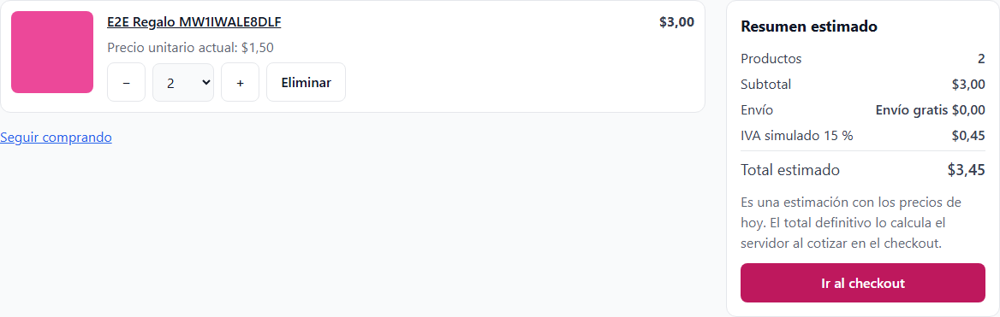 | 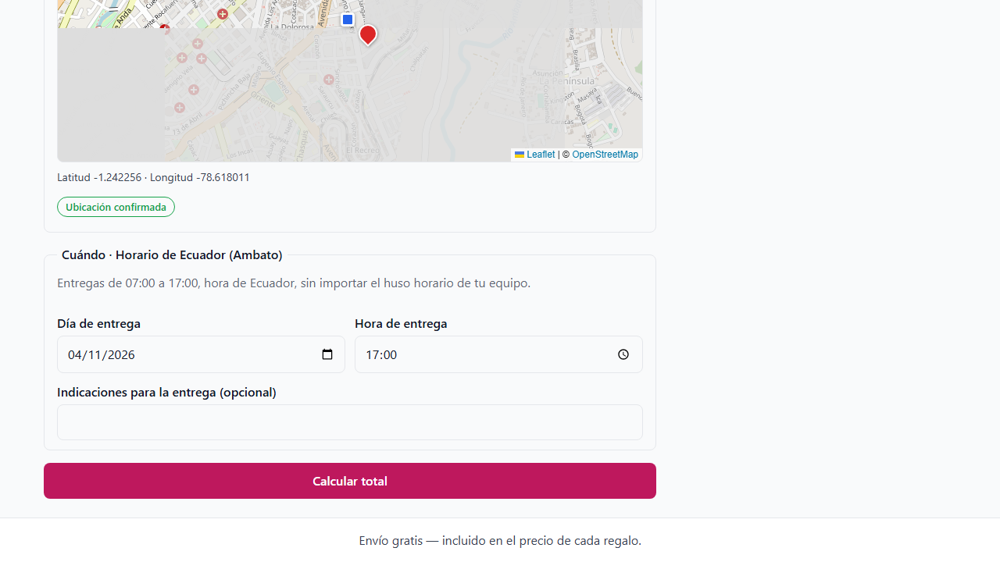 |

| E2E · 07A pago rechazado                                 | E2E · 12 compra confirmada                             |
| -------------------------------------------------------- | ------------------------------------------------------ |
| 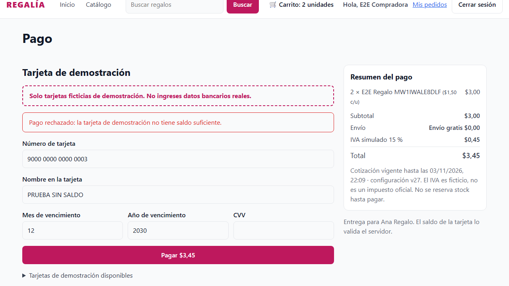 | 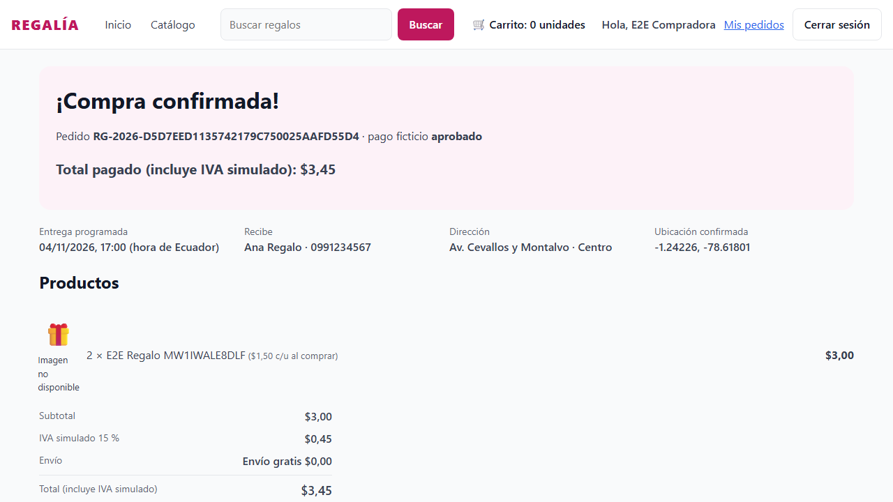 |

| E2E · 13 comprobante simulado                         | E2E · 08 mis pedidos                                  |
| ----------------------------------------------------- | ----------------------------------------------------- |
| 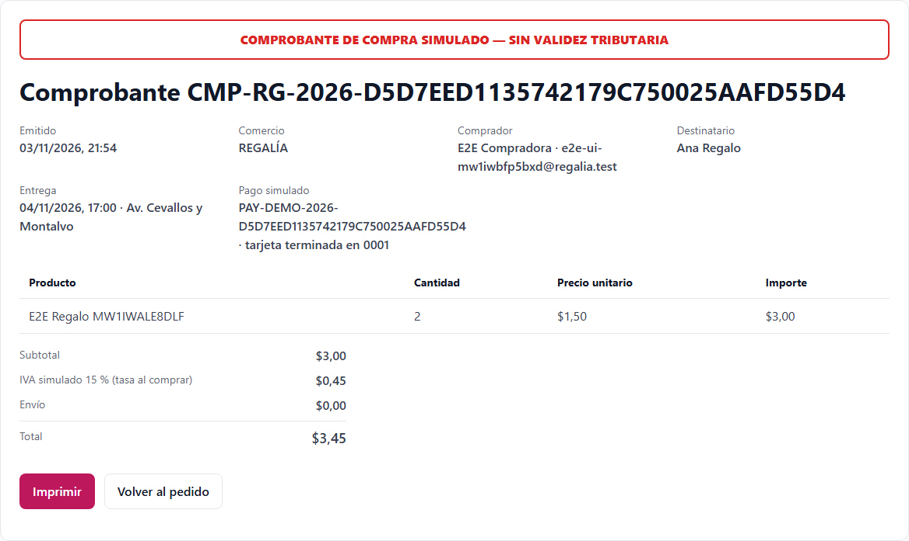 | 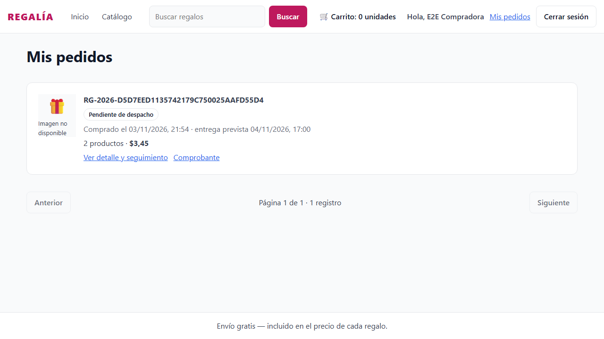 |

| E2E · 14 detalle y seguimiento                                | E2E · [simulada] 07B confirmada tras verificar                             |
| ------------------------------------------------------------- | -------------------------------------------------------------------------- |
| 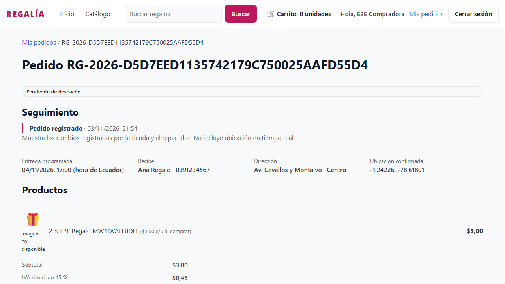 | 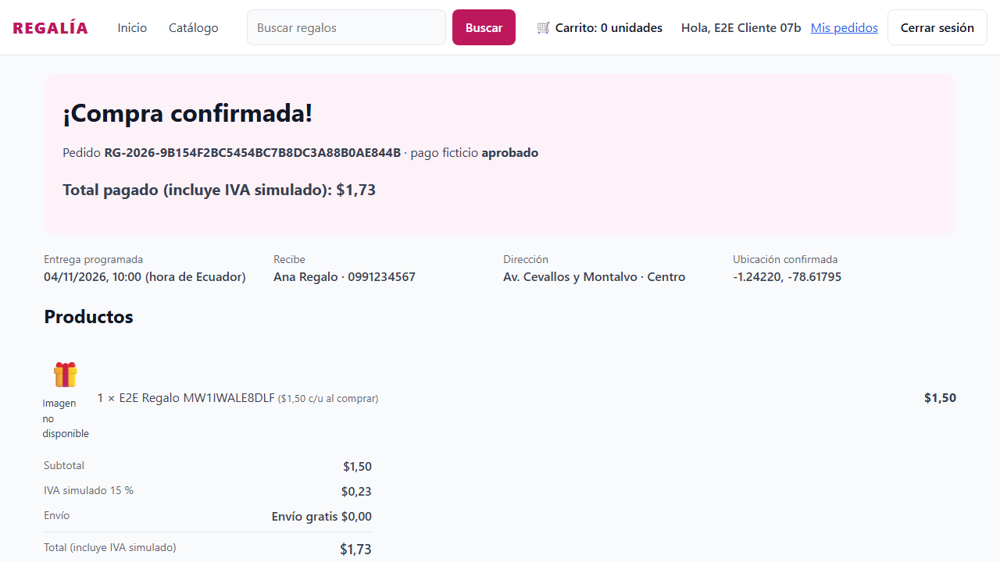 |

Capturas adicionales con la API real:

| 06A · Carrito vacío                                 | 06B · Carrito con agotado                                 |
| --------------------------------------------------- | --------------------------------------------------------- |
| 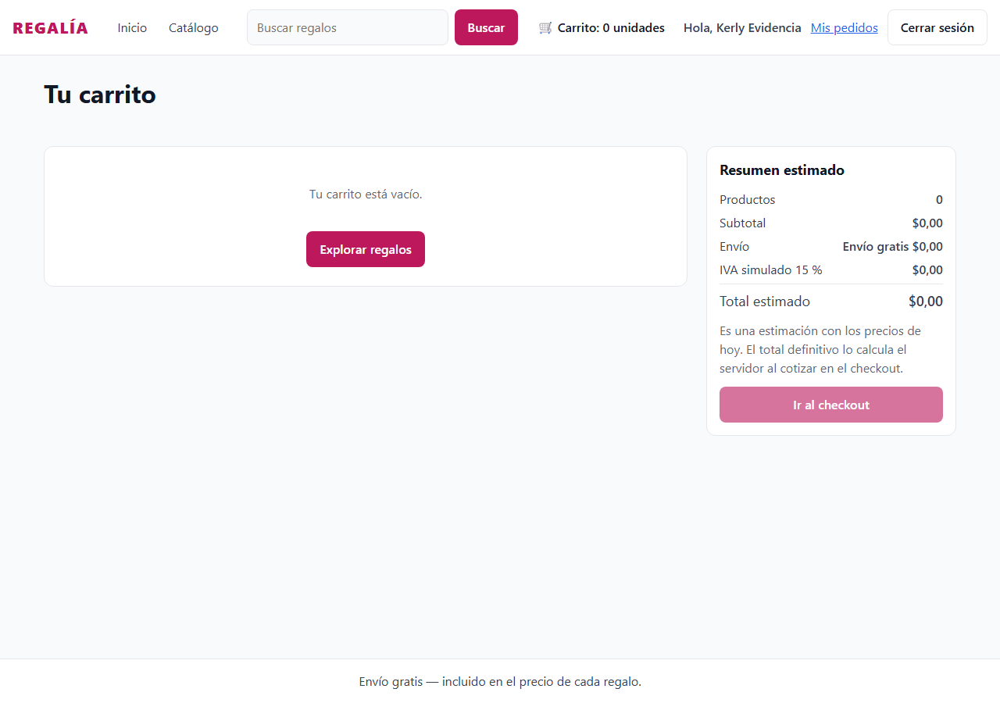 | 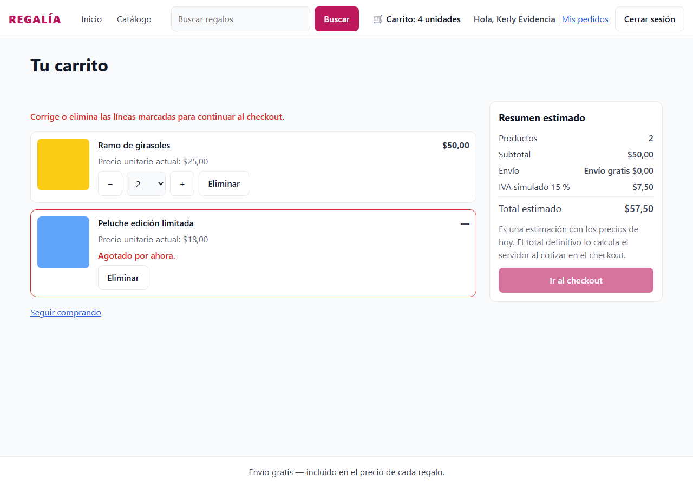 |

| 04 · 06:59 fuera de la ventana                                       | 04 · El ADMIN cambió el IVA: aceptar el nuevo total                   |
| -------------------------------------------------------------------- | --------------------------------------------------------------------- |
| 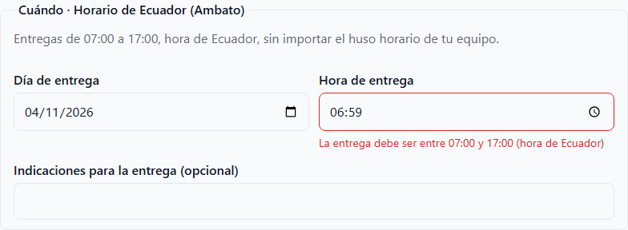 | 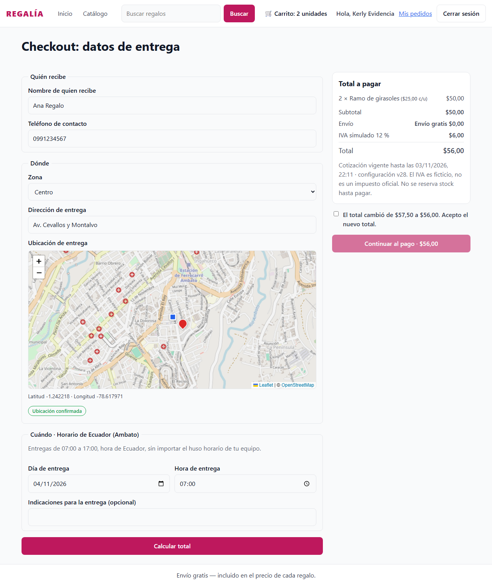 |

| [simulada] 07B · Verificando el pago                            | Móvil · Carrito                                     |
| --------------------------------------------------------------- | --------------------------------------------------- |
| 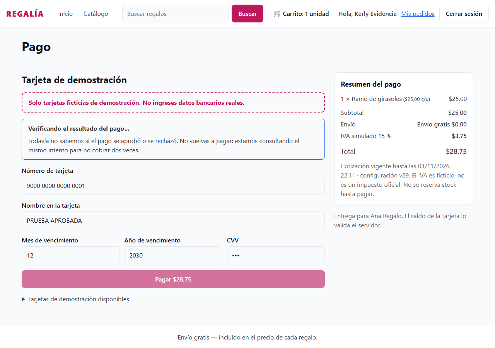 | 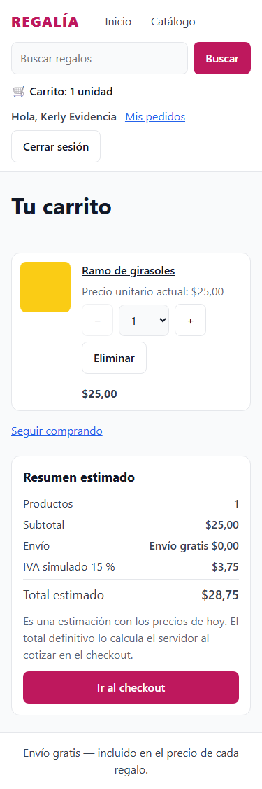 |

| Móvil · Checkout                                     | Móvil · Mis pedidos                                     | Móvil · Comprobante                                     |
| ---------------------------------------------------- | ------------------------------------------------------- | ------------------------------------------------------- |
| 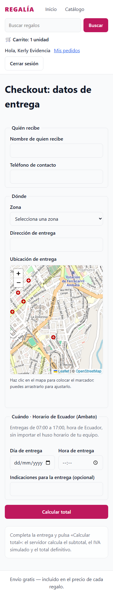 | 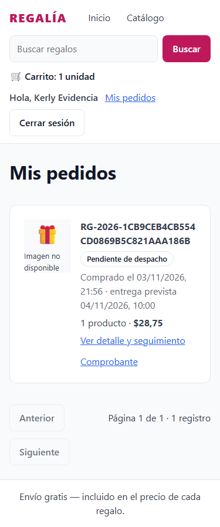 | 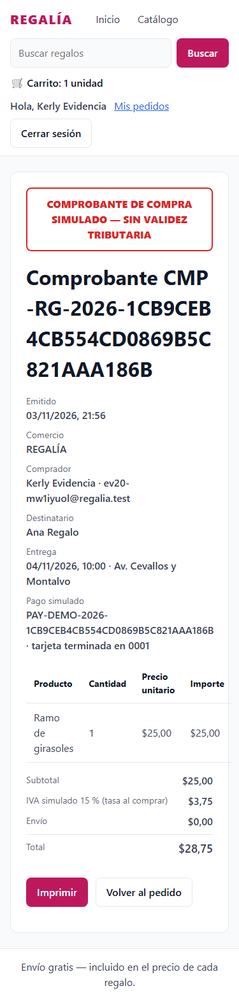 |

A 375 px, el carrito, el checkout, los pedidos y el comprobante no tienen desborde horizontal (0 px).

## 6. Hallazgos

| Hallazgo                                                                                                                            | Tipo                       | Acción                                                                                                       |
| ----------------------------------------------------------------------------------------------------------------------------------- | -------------------------- | ------------------------------------------------------------------------------------------------------------ |
| La tabla `simulatedCard` queda vacía: ningún seed crea las 3 tarjetas, así que ningún pago funciona.                                | Backend (#35)              | Se insertaron en la base local; se informa al equipo.                                                        |
| El simulador de pagos exige `NODE_ENV=demo` (o `test`) y `SIMULATED_PAYMENTS_ENABLED=true`.                                         | Configuración del backend  | Agregado al `.env` local; hay que documentarlo en el README del backend.                                     |
| La cotización exige los datos de entrega y una sesión CLIENT.                                                                       | Contrato                   | El carrito muestra un **resumen estimado** rotulado como tal; el total definitivo es el del checkout.        |
| Vaciar el carrito al recibir el `201` hacía que la página de pago se volviera a dibujar antes de navegar y redirigiera al checkout. | Corrección del frontend    | El carrito se vacía en la confirmación, cuando el servidor devuelve el pedido guardado (como pide el issue). |
| El backend rechaza un cambio de configuración que no cambia nada (`No modifications detected`).                                     | Comportamiento del backend | Las pruebas solo cambian el IVA si es distinto.                                                              |
| El comprobante no trae la entrega.                                                                                                  | Contrato                   | La pantalla la toma del detalle del pedido propio.                                                           |
| Los pagos de prueba descuentan del saldo ficticio de `DEMO_APPROVED` ($500).                                                        | Datos de prueba            | Las pruebas pagan regalos de $1,00 y $1,50; el saldo se repone recreando la base o con el seed del backend.  |
| La prueba con 2 compradores necesita que cada uno use su propio token.                                                              | Prueba                     | Se envían en paralelo con un cliente HTTP sin la sesión guardada.                                            |

## 7. Cobertura del Issue #20

| Criterio                                                                                                           | Evidencia                                      |
| ------------------------------------------------------------------------------------------------------------------ | ---------------------------------------------- |
| Invitado explora; al comprar va a registro/login CLIENT y vuelve; CLIENT nunca entra al ADMIN                      | E2E 1 y 3; pruebas de cuenta                   |
| Carrito sobrevive la recarga y está aislado por usuario; selector por SKU con límite configurable y stock          | §1; pruebas de carrito y cuenta                |
| $73,00 → IVA simulado 15 % $10,95 → envío $0 → total $83,95; tasas cambiadas o desactivadas dan otro desglose      | §4 (cotización); pruebas de carrito y checkout |
| 06:59 y 17:01 rechazadas; 07:00 y 17:00 aceptadas; el cambio de horario del ADMIN se refleja                       | §4; pruebas de horario                         |
| Con 1 unidad y 2 compradores solo uno confirma; el perdedor ve 06B sin cargo ni comprobante                        | §4; pruebas de pago (06B)                      |
| Tarjeta con saldo aprueba; sin saldo o incorrecta → 07A sin borrar el carrito                                      | §4, §5; pruebas 07A                            |
| Doble clic, recarga, tiempo agotado o respuesta incierta → 07B con la consulta original, sin duplicar              | §5 [simulada]; §4 (misma clave); pruebas 07B   |
| `PRICE_CHANGED`, `SHOP_SETTINGS_CHANGED` o `QUOTE_EXPIRED` obligan a recotizar y re-aceptar                        | §4; captura 04; pruebas de pago y checkout     |
| Confirmación, historial y comprobante con totales históricos, sin acceso ajeno, con los estados reales del backend | §4 (historial y comprobante); §5               |
| Escritorio y móvil, guardas, formularios accesibles, carga, vacío, error y reintento                               | §5 (375 px); pruebas unitarias                 |
| typecheck, lint, test, build y CI                                                                                  | §3                                             |

**Fuera de alcance**, como indica el issue: recuperar contraseña, correos, facturación SRI, GPS y reembolsos. Los
estados ASSIGNED, IN_TRANSIT y DELIVERED aparecen en la línea de tiempo cuando el ADMIN y el chofer los registran. La prueba
conjunta CLIENT → ADMIN → DRIVER queda para la validación de la plataforma.
