# Evidencia · Issue #21 — Administración del catálogo, categorías, imágenes Cloudinary y configuración del Shop

El panel ADMIN existente se **amplía** (mismo menú y mismo estilo, sin una administración aparte) para gestionar el Shop
REGALÍA contra el backend real:

- productos, incluidos los agotados y despublicados;
- alta y edición de productos, y su publicación;
- categorías;
- galería de imágenes subidas a Cloudinary a través del backend;
- la nueva sección **Configuración Shop**: IVA simulado, máximo por SKU y horario de entregas, con control de versión.

- **Issue:** [#21](https://github.com/logistica-gc-uta/frontend-web-logistica/issues/21)
- **Fecha de ejecución:** 03/11/2026
- **Backend:** `logistica-gc-uta/backend` en `main` @ `adfe30c` (catálogo ADMIN, imágenes por proxy Cloudinary y `admin/shop-settings` versionado)
- **Frontend:** rama `feat/21-admin-catalogo` (desde `main` @ `0ea7d2b`)

## 1. Qué se implementó

| Pantalla                                                                    | Detalle                                                                                                                                                                                                                                                                                                                                                                                                                                                                                                                                                                                                                                                                                                                                                                                               |
| --------------------------------------------------------------------------- | ----------------------------------------------------------------------------------------------------------------------------------------------------------------------------------------------------------------------------------------------------------------------------------------------------------------------------------------------------------------------------------------------------------------------------------------------------------------------------------------------------------------------------------------------------------------------------------------------------------------------------------------------------------------------------------------------------------------------------------------------------------------------------------------------------- |
| **ADMIN-01 · Productos** (`/productos`)                                     | Reemplaza el listado anterior, que solo mostraba productos con stock. Usa `GET /admin/catalog/products` y muestra **todos** los productos: agotados, despublicados y antiguos sin categoría (SKU `LEGACY-…`). Cada fila tiene miniatura, nombre, SKU, categoría, precio en USD, stock (_Agotado (0)_), estado y las acciones _Editar_ y _Publicar/Despublicar_ **con confirmación**. Hay búsqueda por nombre, SKU o descripción, y filtros por categoría (incluidas las inactivas) y por estado (publicados, despublicados, agotados). La paginación y el contador vienen del servidor. Tiene estados de carga, sin resultados y error con reintento.                                                                                                                                                 |
| **ADMIN-02 · Alta y edición** (`/productos/nuevo`, `/productos/:id`)        | SKU, nombre, descripción, categoría (las inactivas no se pueden elegir), precio en dólares con conversión **exacta a centavos**, stock entero ≥ 0 y destacado. Valida con los límites del backend. `SKU_ALREADY_EXISTS` se muestra **junto al campo**. Los productos se crean **despublicados**. Al editar, el SKU es de **solo lectura** y se envía **solo lo que cambió**; después se vuelve a cargar el producto real. Avisa _Hay cambios sin guardar_ y también al cerrar la pestaña. El panel de publicación explica qué falta (categoría activa, descripción, precio, imagen principal) y muestra el rechazo `PRODUCT_PUBLICATION_INVALID` del backend.                                                                                                                                         |
| **ADMIN-03 · Categorías** (`/categorias`, nuevo en el menú)                 | Nombre, slug (generado sin tildes, editable al crear y fijo después), descripción, estado y **cantidad de productos**. Se puede crear, editar, desactivar y activar. Antes de desactivar avisa: _Tiene N productos: dejarán de verse en el Shop hasta reactivarla. Los pedidos ya hechos no cambian._ No hay borrado físico. `CATEGORY_ALREADY_EXISTS` se explica.                                                                                                                                                                                                                                                                                                                                                                                                                                    |
| **ADMIN-04 · Imágenes** (en el editor)                                      | Archivo JPEG, PNG o WebP de hasta 5 MiB (validado en el navegador y otra vez en el backend), con **vista previa** y texto alternativo obligatorio. Se sube en `multipart` a `POST /admin/catalog/uploads` con el JWT ADMIN, mostrando el avance. El navegador solo recibe el `uploadId`: **nunca** credenciales, firma ni secret de Cloudinary, y no acepta URLs ni `publicId` escritos a mano. Luego se asocia (`POST …/images`). Se puede marcar la principal, reordenar, editar el texto alternativo y quitar con confirmación (hasta 6 imágenes). Los errores 413, 415 y 502 se explican. **Si la subida funciona pero la asociación falla, no se da por guardada**: _Reintentar asociación_ reutiliza el mismo `uploadId`, sin volver a subir.                                                   |
| **ADMIN-05 · Configuración Shop** (`/configuracion-shop`, nuevo en el menú) | `GET /admin/shop-settings` muestra los valores **actuales** y la versión. Se puede editar el IVA simulado (activar o desactivar y fijar la tasa en %, convertida a puntos básicos con enteros; _No es un tributo oficial ni del SRI_), el máximo por SKU (1 a 100, por producto y no por carrito) y el horario de entregas en Ecuador (extremos incluidos; el inicio debe ser anterior al fin, sin franjas nocturnas). El envío gratis y la zona horaria `America/Guayaquil (Ambato)` son de **solo lectura**. Muestra la versión, la fecha y si la actualizaste tú u otro administrador. Al guardar envía `expectedVersion` con **solo los grupos que cambiaron** y confirma la nueva versión. Ante `SETTINGS_VERSION_CONFLICT` **no sobrescribe nada**: avisa y ofrece _Recargar valores actuales_. |
| Menú y permisos                                                             | Se agregan _Categorías_ y _Configuración Shop_ al menú; el resto del menú logístico no cambia. Las rutas siguen protegidas por la sesión ADMIN del panel: un CLIENT del Shop o un DRIVER no entran (van al login del panel) y el backend responde 401 o 403.                                                                                                                                                                                                                                                                                                                                                                                                                                                                                                                                          |
| Compatibilidad                                                              | El servicio antiguo `productsService` (`GET/POST /products`) sigue igual: lo usan el alta de pedidos y su prueba de integración. Solo se retiró el formulario antiguo de `/productos`, porque creaba productos sin SKU ni categoría que el Shop no puede mostrar.                                                                                                                                                                                                                                                                                                                                                                                                                                                                                                                                     |

## 2. Verificaciones de calidad

| Comando                                    | Resultado                                                                                                                             |
| ------------------------------------------ | ------------------------------------------------------------------------------------------------------------------------------------- |
| `pnpm lint`                                | 0 errores ni advertencias                                                                                                             |
| `pnpm typecheck`                           | 0 errores                                                                                                                             |
| `pnpm format:check`                        | Sin observaciones                                                                                                                     |
| `pnpm test:coverage` (umbral del CI: 80 %) | **661/661** pruebas (69 archivos; 53 nuevas del catálogo) · 98,6 % de líneas · 91,2 % de ramas · `features/catalog`: 96,2 % de líneas |
| `pnpm build`                               | Correcto                                                                                                                              |
| `pnpm test:integration`                    | **69/69** contra la API real (9 nuevas). Se omiten las 4 de entregas fallidas porque necesitan 3 horas libres en el día               |
| `pnpm test:e2e`                            | **20/20** (3 nuevas del panel). Se omiten las 3 de la operación del día por el mismo motivo                                           |

Pruebas unitarias destacadas (`catalogLogic.test.ts` y `CatalogPages.test.tsx`):

- **Conversiones:** porcentaje ↔ puntos básicos (15 % = 1500, 12,5 % = 1250, 12,05 % = 1205, ida y vuelta) y centavos ↔ dólares.
- **Validaciones:** producto, categoría (slug), imagen (tipo y 5 MiB) y configuración (0–100 %, 1–100 unidades, inicio < fin).
- **Envíos:** al editar va solo lo que cambió y nunca el SKU; la configuración envía solo los grupos cambiados.
- **Listado:** agotados, despublicados y antiguos; filtros y paginación en el servidor; publicación con confirmación y rechazo del backend.
- **Editor:** creación despublicada; SKU repetido junto al campo; recarga del servidor; avisos de qué falta para publicar.
- **Imágenes:** formato y tamaño; subida y asociación; 502; asociación fallida con reintento **sin volver a subir**; principal, orden, texto alternativo y quitar.
- **Categorías:** conteo; slug generado; aviso al desactivar; editar sin slug; activar; duplicado.
- **Configuración:** valores actuales y fijos; guardado con versión; validaciones; **conflicto sin sobrescribir** y recarga.
- **Permisos:** menú ADMIN completo; un CLIENT o un DRIVER no entran.

## 3. Pruebas de integración con la API real (`src/integration/adminCatalog.int.test.ts`)

Usan el mismo `catalogService` del panel. Las imágenes son PNG reales subidas a Cloudinary por el backend.

```
 ✓ administración del catálogo (ADMIN) > un producto nuevo queda despublicado y el ADMIN lo ve aunque tenga stock 0
 ✓ administración del catálogo (ADMIN) > el SKU y la categoría repetidos se rechazan con su código
 ✓ administración del catálogo (ADMIN) > sin imagen principal no se publica; con una imagen subida por el backend sí y el Shop la muestra
 ✓ administración del catálogo (ADMIN) > un archivo que no es imagen se rechaza en el backend (415)
 ✓ administración del catálogo (ADMIN) > despublicar o desactivar la categoría lo oculta del Shop sin borrarlo
 ✓ administración del catálogo (ADMIN) > un cambio de precio posterior a una compra no reescribe su comprobante
 ✓ configuración del Shop (ADMIN) > guardar con la versión leída la incrementa y el Shop público ve el nuevo valor
 ✓ configuración del Shop (ADMIN) > dos ADMIN con la misma versión: el segundo recibe SETTINGS_VERSION_CONFLICT y no sobrescribe
 ✓ permisos del catálogo y la configuración > un visitante recibe 401 y un CLIENT 403 en las mutaciones de productos, imágenes y configuración
```

La prueba de compra cambia el precio a $99,99 **después** de pagar: el comprobante conserva $12,34. La de configuración
restaura al final el límite que había.

## 4. Pruebas E2E (`e2e/07-admin-catalogo.spec.ts`)

```
 ok › 07-admin-catalogo.spec.ts › el ADMIN crea, ilustra y publica un regalo, y el Shop lo muestra
 ok › 07-admin-catalogo.spec.ts › un cambio del límite por SKU en Configuración Shop se refleja en el Shop
 ok › 07-admin-catalogo.spec.ts › un CLIENT no ve ni abre la administración del catálogo
```

## 5. Prueba manual en el panel (API real)

| #   | Acción                                                          | Resultado                                                                                                                        |
| --- | --------------------------------------------------------------- | -------------------------------------------------------------------------------------------------------------------------------- |
| M1  | Abrir _Productos_                                               | 155 productos (dato del servidor), con agotados, despublicados y antiguos sin categoría                                          |
| M2  | _Nuevo producto_ vacío → _Crear producto_                       | Un error por campo; no se envía nada                                                                                             |
| M3  | Crear «Caja de whisky y chocolates»                             | Queda despublicado; _Para publicarlo falta: una imagen principal._                                                               |
| M4  | Publicar sin imagen                                             | _No se puede publicar: necesita una categoría activa, descripción, precio e imagen principal._                                   |
| M5  | Elegir un archivo que no es imagen                              | _Formato no admitido: usa una imagen JPEG, PNG o WebP._ (sin subir)                                                              |
| M6  | Subir 2 imágenes y marcar la segunda como principal             | _Imagen subida y asociada al producto._; la galería muestra la principal                                                         |
| M7  | Publicar y luego cambiar el precio a $29,90                     | El Shop público muestra el producto a $29,90 con sus 2 imágenes                                                                  |
| M8  | Crear otro producto con el mismo SKU                            | _Ya existe un producto con ese SKU._ junto al campo                                                                              |
| M9  | Desactivar su categoría                                         | Aviso con la cantidad de productos; después, el Shop responde 404 para el producto                                               |
| M10 | Guardar el máximo por SKU en 8                                  | _Configuración guardada (versión 37)_                                                                                            |
| M11 | Otro ADMIN guarda a la vez (9) y aquí se guarda la tasa en 12 % | _Otro administrador guardó la configuración… (ahora es la versión 38). No se guardó nada._ El Shop conserva 9; _Recargar_ trae 9 |
| M12 | Productos, categorías, configuración y editor a 375 px          | Sin desborde horizontal (0 px)                                                                                                   |

### Antes y después

| Antes (issue #4): solo productos con stock, sin SKU, categoría, imágenes ni publicación | Después: catálogo completo del Shop                             |
| --------------------------------------------------------------------------------------- | --------------------------------------------------------------- |
| 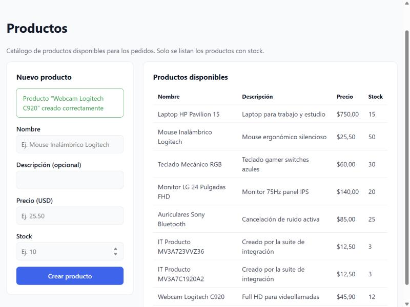                                                | 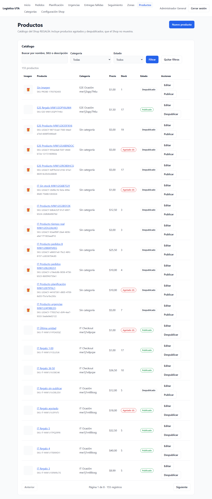 |

### Capturas

| M3–M7 · Editor con galería y publicación               | M9 · Aviso antes de desactivar una categoría                |
| ------------------------------------------------------ | ----------------------------------------------------------- |
| 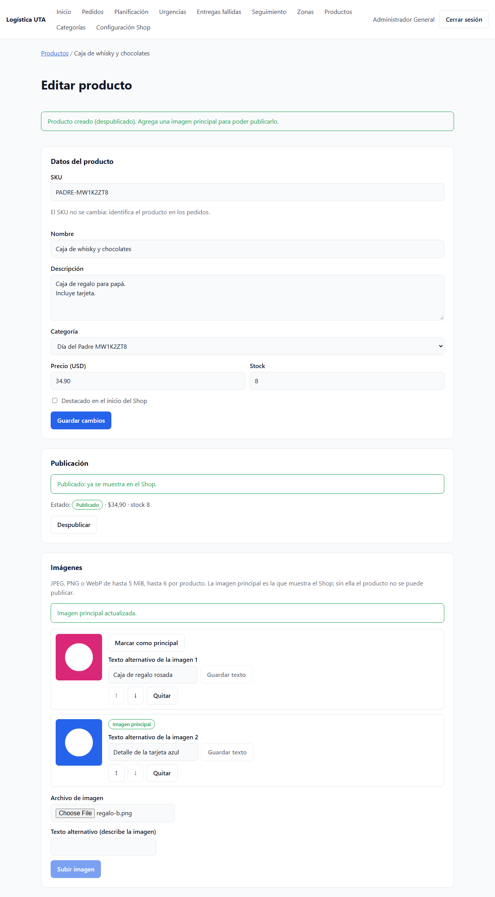 | 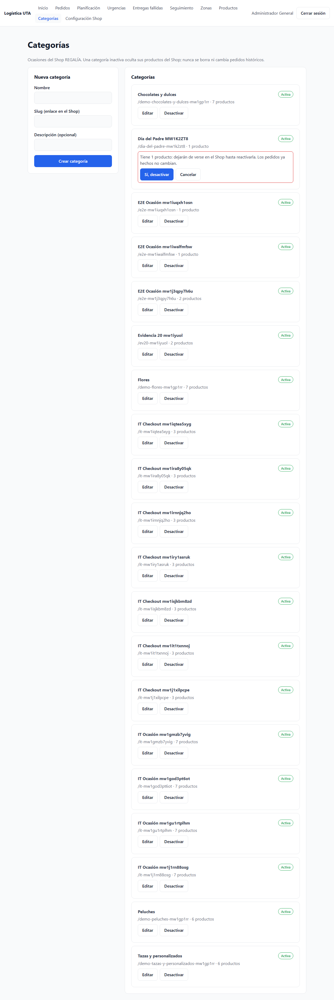 |

| ADMIN-03 · Categorías                             | ADMIN-05 · Configuración Shop                             |
| ------------------------------------------------- | --------------------------------------------------------- |
| 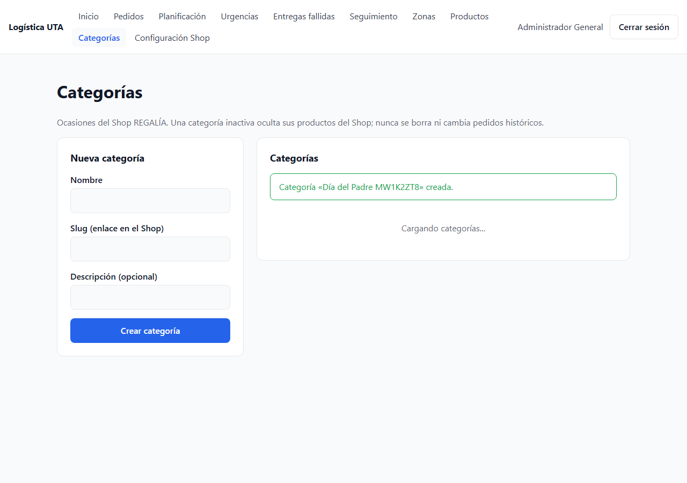 | 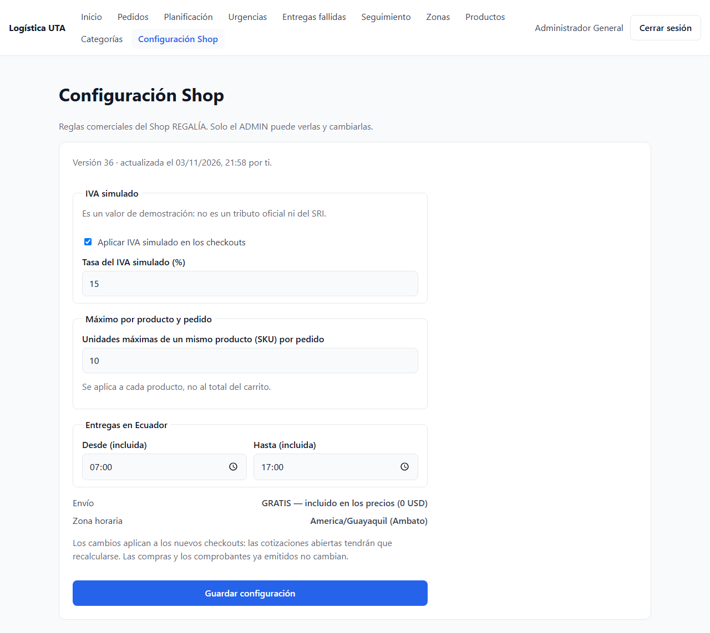 |

| M11 · Conflicto de versión                               | E2E · Publicado desde el panel                              |
| -------------------------------------------------------- | ----------------------------------------------------------- |
| 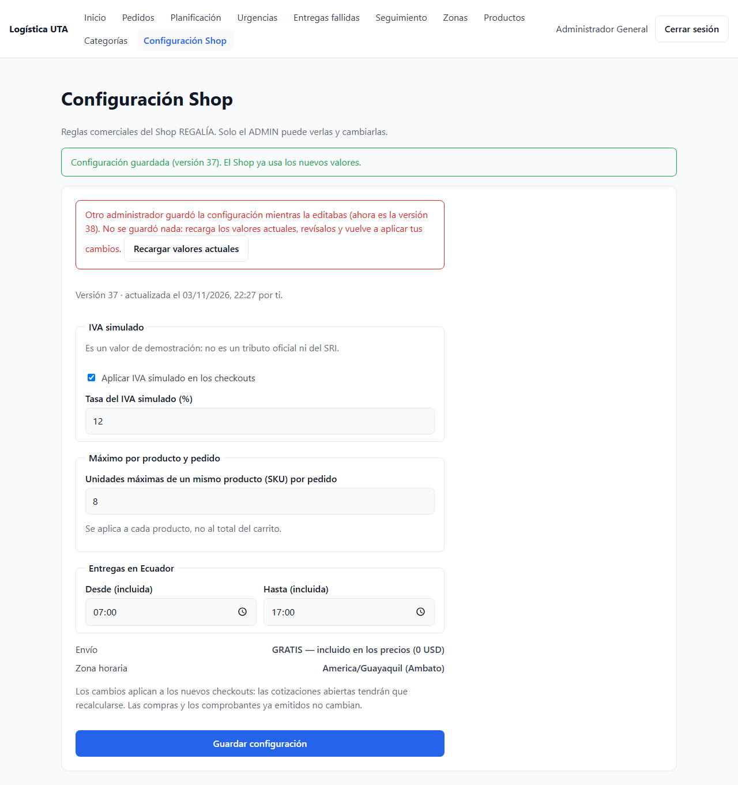 | 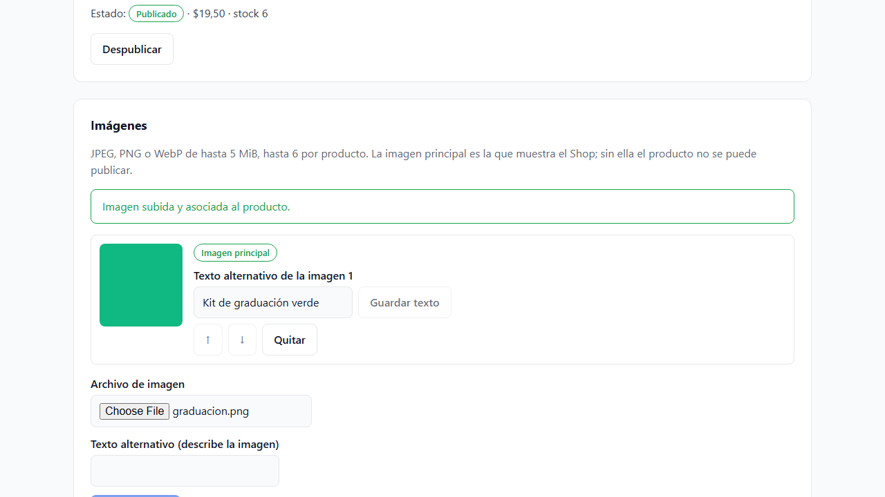 |

| E2E · Visible en el Shop                                      | E2E · Configuración guardada                                      |
| ------------------------------------------------------------- | ----------------------------------------------------------------- |
| 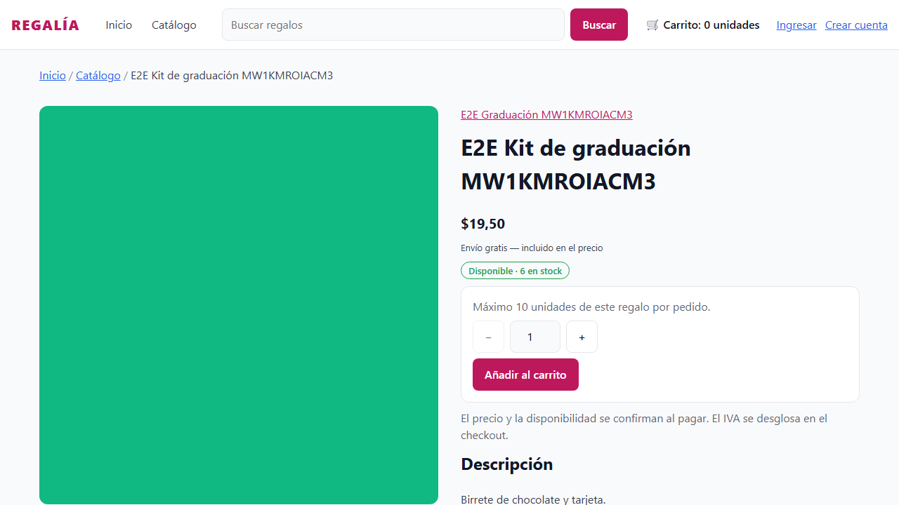 | 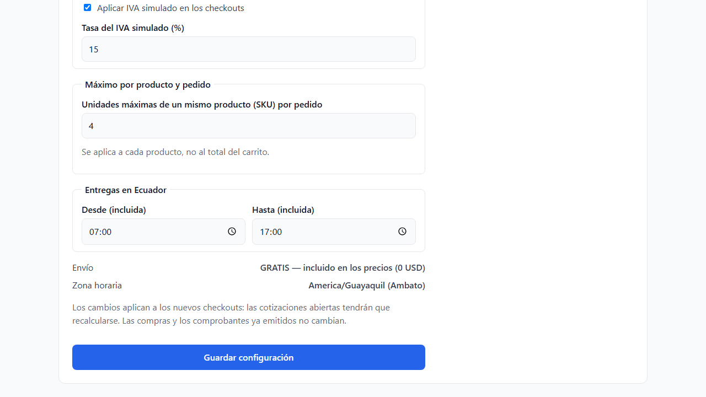 |

| Móvil · Productos                                      | Móvil · Categorías                                      | Móvil · Configuración                                      |
| ------------------------------------------------------ | ------------------------------------------------------- | ---------------------------------------------------------- |
| 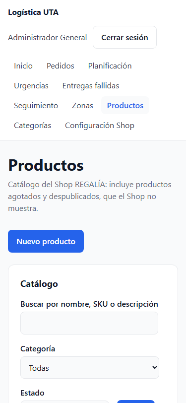 | 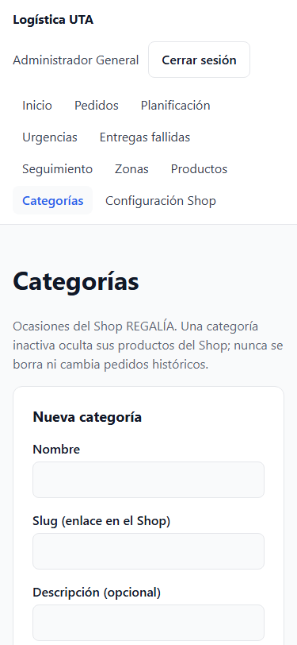 | 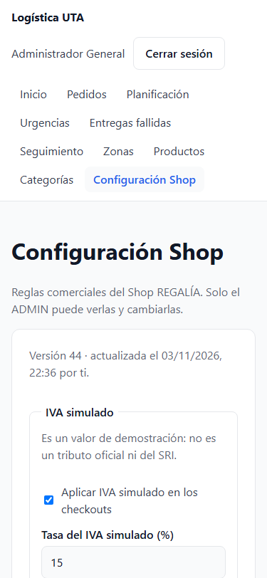 |

## 6. Hallazgos

| Hallazgo                                                                                                                                                       | Tipo                       | Acción                                                                                                             |
| -------------------------------------------------------------------------------------------------------------------------------------------------------------- | -------------------------- | ------------------------------------------------------------------------------------------------------------------ |
| A 375 px el listado de productos desbordaba 522 px: los textos ocultos de los botones (`position: absolute`) se ubicaban respecto a la página y no a la tabla. | Corrección del frontend    | La tabla tiene su propio contenedor posicionado y desplazable; quedó en 0 px.                                      |
| El listado antiguo de `/productos` solo mostraba stock > 0 y creaba productos sin SKU ni categoría, que el Shop no muestra.                                    | Compatibilidad             | La pantalla se reemplazó; el servicio antiguo `GET/POST /products` se conserva (alta de pedidos y su integración). |
| Los productos creados antes del catálogo aparecen con SKU `LEGACY-…`, sin categoría y a veces sin precio.                                                      | Datos existentes           | Se muestran como _Sin categoría_ / _Sin precio_ y el panel explica qué les falta para publicarse.                  |
| El backend no devuelve el nombre de quien actualizó la configuración, solo su ID.                                                                              | Contrato                   | Se muestra _por ti_ o _por otro administrador_.                                                                    |
| El backend no incluye la cantidad de productos en `GET /admin/catalog/categories`.                                                                             | Contrato                   | Se consulta por categoría con `pageSize=1` y se usa el `total` del servidor.                                       |
| El backend rechaza un guardado de configuración sin cambios.                                                                                                   | Comportamiento del backend | El panel avisa _No hay cambios para guardar_ sin enviar.                                                           |
| El seed de 200 productos (backend #35) todavía no existe.                                                                                                      | Pendiente del backend      | El listado se verificó con 155 productos reales (8 páginas).                                                       |

## 7. Cobertura del Issue #21

| Criterio                                                                                                                                                          | Evidencia                                                                      |
| ----------------------------------------------------------------------------------------------------------------------------------------------------------------- | ------------------------------------------------------------------------------ |
| ADMIN lista stock 0 y despublicados; crea/edita productos y categorías, publica/despublica y el Shop se actualiza                                                 | Integración (1, 3, 5); M1–M9; E2E 1                                            |
| Subida real ADMIN por proxy backend → Cloudinary → PostgreSQL; imagen visible en el Shop; errores y reintento seguros sin credenciales en el navegador            | Integración (3, 4); E2E 1; pruebas de imágenes                                 |
| CLIENT y visitante reciben 401/403 en mutaciones de productos, imágenes y configuración, y no tienen menú ADMIN                                                   | Integración (permisos); E2E 3; pruebas de permisos                             |
| Un precio, stock o tasa cambiados después de una compra no reescriben el comprobante                                                                              | Integración (6); #20 (tasa del 15 % conservada)                                |
| Configuración inicial 15 %, máximo 10, 07:00–17:00 y envío gratis; el ADMIN cambia tasa, límite u horario y el Shop refleja el valor del servidor                 | Integración (7); E2E 2; captura 05                                             |
| Desactivar el IVA da importe 0; un cambio de configuración durante el checkout obliga a recotizar; dos ADMIN con la misma versión generan un conflicto controlado | #20 (IVA desactivado = $73,00 y `SHOP_SETTINGS_CHANGED`); integración (8); M11 |
| Pruebas de editor, validaciones, publicación, subida, roles, configuración y conflicto, estados vacío/error y regresiones                                         | §2                                                                             |
| Tests, typecheck, lint, build, CI y capturas del panel antes y después                                                                                            | §2 y §5                                                                        |
