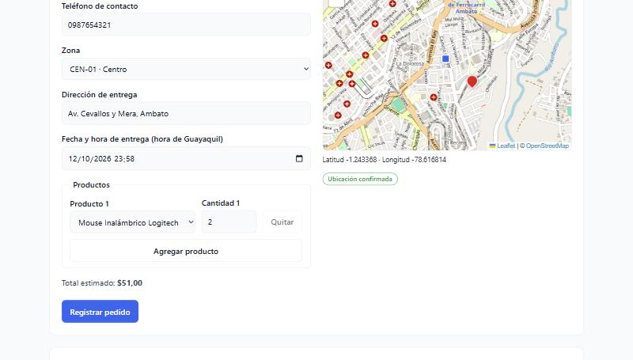
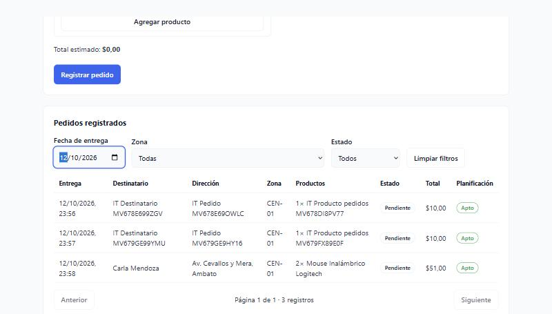
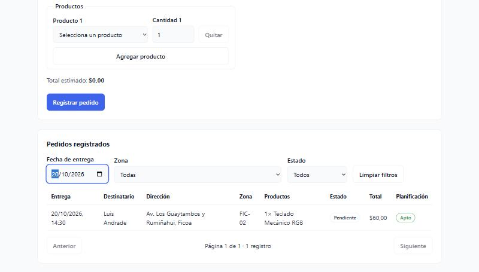
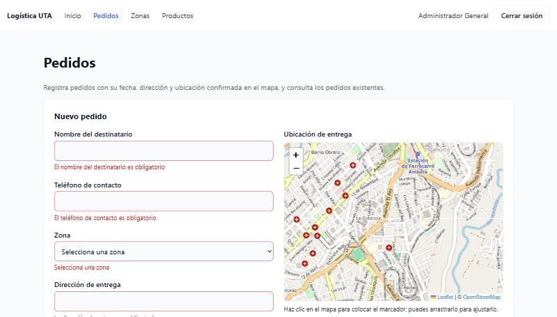

# Evidencia · Issue #6 — Formulario administrativo de pedidos con Leaflet

Listado y registro de pedidos para el ADMIN, con selección de productos, zona, fecha y hora de entrega, dirección
textual y **ubicación confirmada en un mapa Leaflet**, contra el backend real (NestJS + PostgreSQL).

- **Issue:** [#6](https://github.com/logistica-gc-uta/frontend-web-logistica/issues/6)
- **Fecha de ejecución:** 12/10/2026
- **Backend:** `logistica-gc-uta/backend` en `main` @ `09d4621` (incluye `POST /orders/admin`, backend #11)
- **Frontend:** rama `feat/6-pedidos-leaflet`

## 1. Qué se implementó

| Parte                                         | Detalle                                                                                                                                                                                                                                |
| --------------------------------------------- | -------------------------------------------------------------------------------------------------------------------------------------------------------------------------------------------------------------------------------------- |
| Formulario `POST /orders/admin`               | Destinatario invitado (`GUEST`: nombre y teléfono), zona, dirección, fecha y hora, una o varias líneas de producto con cantidad y total estimado.                                                                                      |
| Mapa (`components/map/LocationPicker`)        | Leaflet + OpenStreetMap. Clic para colocar el marcador, arrastrarlo para ajustarlo y botón **Confirmar ubicación**. Mover el marcador anula la confirmación. Muestra el depósito de la zona y centra la vista en él.                   |
| Reglas del backend aplicadas en el formulario | Zona con depósito; coordenadas obligatorias y confirmadas; fecha y hora futuras (hora de Guayaquil, enviada con `-05:00`); cantidad entera ≥ 1 y dentro del stock (sumando líneas repetidas); nombre ≤ 120 y teléfono ≤ 40 caracteres. |
| Listado `GET /orders`                         | Paginado (10 por página) con filtros por día de entrega, zona y estado; muestra destinatario, productos, estado, total y si el pedido es **apto para planificación** (con el motivo si no lo es).                                      |
| Estados de carga, error y éxito               | Cargando, error con **Reintentar**, errores del backend mostrados al operador sin perder lo escrito, y aviso de éxito que se oculta al intentar registrar otro pedido.                                                                 |

**Sin coordenadas confirmadas no se envía el pedido**: el formulario bloquea el envío y, además, el backend lo rechaza (400)
al exigir `deliveryLat` y `deliveryLng` (verificado en las pruebas de integración).

## 2. Preparación del entorno

Backend (repositorio `backend`): base recreada para incluir las migraciones de pedidos de ADMIN y despacho.

```bash
docker compose down -v
docker compose up -d
pnpm install
pnpm prisma db init
pnpm run seed
pnpm run seed:planning-demo   # pedidos de demostración con coordenadas
pnpm run start:dev            # http://localhost:3000/api/v1
```

Frontend (este repositorio):

```bash
pnpm install
cp .env.integration.example .env.integration.local   # contraseñas del seed (README del backend)
pnpm dev                                              # http://localhost:5173
pnpm test:integration
```

## 3. Verificaciones de calidad

| Comando                                    | Resultado                                                              |
| ------------------------------------------ | ---------------------------------------------------------------------- |
| `pnpm lint`                                | 0 errores                                                              |
| `pnpm typecheck`                           | 0 errores                                                              |
| `pnpm format:check`                        | Sin observaciones                                                      |
| `pnpm test:coverage` (umbral del CI: 80 %) | **220/220** pruebas (36 archivos) · 99,8 % de líneas · 97,5 % de ramas |
| `pnpm build`                               | Correcto                                                               |
| `pnpm test:integration`                    | **21/21** pruebas contra la API real (13 previas + 8 de pedidos)       |

En las pruebas de componentes el mapa se simula (Leaflet no se dibuja en jsdom); el mapa real se verificó en el navegador (§5).

## 4. Pruebas de integración con la API real (`src/integration/orders.int.test.ts`)

Cada ejecución crea **su propio producto de prueba** (stock 10), de modo que los pedidos no consumen el stock del seed.

```
 ✓ lista los pedidos paginados con el formato que usa la interfaz
 ✓ registra un pedido futuro a nombre de un invitado, descuenta el stock y aparece en el listado del día
 ✓ registra un pedido de hoy cuando la hora de entrega todavía no pasó
 ✓ rechaza una fecha pasada con 400 y no descuenta stock
 ✓ rechaza el stock insuficiente con 400 y no deja un pedido a medias
 ✓ no acepta un pedido sin coordenadas confirmadas
 ✓ rechaza una zona sin depósito configurado con 400
 ✓ un CLIENT no puede usar el registro administrativo de pedidos (403)

 Test Files  4 passed (4)
      Tests  21 passed (21)
```

## 5. Pruebas manuales en el navegador

Realizadas con el backend real y el usuario ADMIN del seed.

| #   | Caso                                                          | Resultado                                                                                                                                                                      |
| --- | ------------------------------------------------------------- | ------------------------------------------------------------------------------------------------------------------------------------------------------------------------------ |
| M1  | Elegir la zona **Centro** y completar el formulario           | ✅ El mapa se centra en el depósito de la zona (cuadro azul). Clic en el mapa coloca el marcador y **Confirmar ubicación** lo confirma. El total estimado se calcula ($51,00). |
| M2  | Registrar un **pedido de hoy** (hoy 23:58, hora de Guayaquil) | ✅ _"Pedido registrado correctamente. Total: $51,00"_; el formulario se limpia; el listado filtrado por hoy lo muestra como _Pendiente_ y _Apto_.                              |
| M3  | Registrar un **pedido futuro** (20/10/2026 14:30)             | ✅ _"Pedido registrado correctamente. Total: $60,00"_; el listado filtrado por esa fecha lo muestra.                                                                           |
| M4  | Enviar el formulario vacío                                    | ✅ Siete mensajes de validación junto a cada campo, sin llamar al backend.                                                                                                     |

### Persistencia comprobada en la API

Tras M2 y M3 se consultó la API directamente (sin pasar por el frontend):

```
GET /orders?date=2026-10-12 → Carla Mendoza | 2026-10-13T04:58:00Z (23:58 Guayaquil) | CEN-01 | -1.243368, -78.616814 | PENDING | total 51 | apto
GET /orders?date=2026-10-20 → Luis Andrade  | 2026-10-20T19:30:00Z (14:30 Guayaquil) | FIC-02 | -1.248774, -78.628445 | PENDING | total 60 | apto
Stock: Mouse Inalámbrico Logitech 50 → 48 · Teclado Mecánico RGB 30 → 29
```

### Capturas

| M1 · Formulario completo y ubicación confirmada      | M2 · Pedido de hoy en el listado del día                  |
| ---------------------------------------------------- | --------------------------------------------------------- |
|  |  |

| M3 · Pedido futuro en el listado                          | M4 · Validaciones del formulario              |
| --------------------------------------------------------- | --------------------------------------------- |
|  |  |

## 6. Hallazgos

| Hallazgo                                                                                                                                                                                                                                         | Tipo                                   | Acción                                                                                                       |
| ------------------------------------------------------------------------------------------------------------------------------------------------------------------------------------------------------------------------------------------------ | -------------------------------------- | ------------------------------------------------------------------------------------------------------------ |
| `POST /orders/admin` devuelve un **resumen** del pedido (sin `items`, `zone` ni `planningEligibility`), distinto del que devuelve `GET /orders`. Las pruebas unitarias con datos simulados no lo detectaron; lo reveló la prueba de integración. | Defecto del frontend (tipo incorrecto) | Corregido: tipo `CreatedOrder` para la respuesta de creación y `Order` (que lo extiende) para el listado.    |
| El aviso de éxito del pedido anterior seguía visible al llenar uno nuevo (visto en la prueba manual).                                                                                                                                            | Defecto del frontend                   | Corregido: el aviso vive en el formulario y se oculta al intentar registrar otro pedido (con prueba).        |
| No existe un endpoint para **listar clientes registrados**, por lo que el ADMIN no puede elegir uno.                                                                                                                                             | Limitación del backend                 | Este PR registra solo destinatarios invitados (`GUEST`); se sugiere pedir un listado de clientes al backend. |
| Algunos mensajes de error del backend están en inglés (p. ej. _"Confirmed delivery coordinates and configured zone depot are required"_) y se muestran tal cual.                                                                                 | Observación para el backend            | El formulario evita llegar a esos casos (zona con depósito y ubicación confirmada).                          |
| El mapa se maneja solo con mouse (clic y arrastre).                                                                                                                                                                                              | Limitación de accesibilidad            | Posible mejora: campos de latitud y longitud sincronizados con el marcador.                                  |
| Las teselas del mapa vienen de OpenStreetMap: se necesita internet.                                                                                                                                                                              | Limitación conocida                    | Documentado en el README.                                                                                    |
| Al cambiar de zona se conservaba la ubicación confirmada de la zona anterior y se podía enviar (revisión del PR).                                                                                                                                | Defecto del frontend                   | Corregido: el cambio de zona borra el punto y su confirmación (con prueba de regresión, §8).                 |
| Una sesión guardada en `localStorage` con rol CLIENT o DRIVER se restauraba y mostraba el panel (revisión del PR, RF-TEC-01).                                                                                                                    | Defecto del frontend (seguridad)       | Corregido: solo se restaura una sesión ADMIN; las demás se borran (con prueba de regresión, §8).             |
| Las pruebas de integración dejan zonas, productos y pedidos con prefijo `IT` en la base local (los filtros de zona de la pantalla los muestran).                                                                                                 | Datos de prueba                        | Se eliminan recreando la base (`docker compose down -v`).                                                    |

No se encontraron defectos del backend para el registro y el listado de pedidos.

## 7. Fuera de alcance de este PR

Ventana de entrega opcional (`deliveryWindowStart` y `End`), cliente registrado como destinatario, edición o cancelación de pedidos
y el panel de planificación de rutas (issue #7).

## 8. Ajustes de la revisión del PR (13/10/2026)

Cambios hechos sobre la misma rama a pedido de los revisores. La sección 3 refleja la ejecución original (12/10/2026);
la de esta ronda está en la tabla siguiente.

| Ajuste                                       | Cambio                                                                                                                                           | Prueba                                                                                                                                                        |
| -------------------------------------------- | ------------------------------------------------------------------------------------------------------------------------------------------------ | ------------------------------------------------------------------------------------------------------------------------------------------------------------- |
| Cambio de zona con ubicación confirmada      | `OrderForm`: al elegir otra zona se reinician `location` y `locationConfirmed`.                                                                  | `OrdersPage.test.tsx` · _"al cambiar de zona descarta la ubicación confirmada y exige ubicarla de nuevo"_ (falla sin la corrección).                          |
| RF-TEC-01 · rol ADMIN al restaurar la sesión | `canAccessPanel` (en `authService`) es la única regla de acceso: la usan el login y `AuthProvider` al restaurar la sesión. Otra sesión se borra. | `ProtectedRoute.test.tsx` · sesiones DRIVER y CLIENT guardadas → login y sesión borrada (fallan sin la corrección); `authService.test.ts` · `canAccessPanel`. |
| CP-PED-006 · pedido con varios productos     | Nueva prueba de integración en `orders.int.test.ts` con dos productos propios de la prueba.                                                      | Ver registro de ejecución.                                                                                                                                    |

La autorización principal sigue en el backend (responde 403 a CLIENT y DRIVER); el control del frontend evita mostrar el panel a quien no corresponde.

### Registro de ejecución

| Caso                                                       | Fecha      | Versión (frontend · backend)              | Resultado | Evidencia                                                                                                                                                               |
| ---------------------------------------------------------- | ---------- | ----------------------------------------- | --------- | ----------------------------------------------------------------------------------------------------------------------------------------------------------------------- |
| Cambio de zona descarta la ubicación (unitaria)            | 13/10/2026 | `aae1193` · —                             | PASS      | `pnpm test:coverage`: 226/226                                                                                                                                           |
| Cambio de zona descarta la ubicación (navegador)           | 13/10/2026 | `aae1193` · `main` @ `09d4621`            | PASS      | CEN-01 → punto confirmado → FIC-02: desaparecen marcador y confirmación y se pide _"Haz clic en el mapa…"_. No se registró pedido.                                      |
| RF-TEC-01 · sesión CLIENT/DRIVER no se restaura (unitaria) | 13/10/2026 | commit de esta ronda · —                  | PASS      | `ProtectedRoute.test.tsx`                                                                                                                                               |
| RF-TEC-01 · sesión CLIENT guardada a mano (navegador)      | 13/10/2026 | commit de esta ronda · —                  | PASS      | Con una sesión CLIENT en `localStorage`, `/pedidos` redirige a `/login`, la sesión se borra y no aparece el menú.                                                       |
| CP-PED-006 · pedido GUEST con dos productos (integración)  | 13/10/2026 | commit de esta ronda · `main` @ `09d4621` | PASS      | `pnpm test:integration`: **22/22** (21 previas + CP-PED-006). Total $81 (3 × $10 + 2 × $25,50), dos líneas con cantidad y precio y stock de ambos productos descontado. |

### Consistencia entre zona y punto geográfico

El SRS pide tratar posibles inconsistencias entre la zona elegida y el punto de entrega. Regla adoptada en este PR:

- El mapa se centra en el **depósito de la zona** elegida, de modo que el operador ubica el punto partiendo de esa zona.
- **Cambiar de zona invalida el punto**: hay que colocarlo y confirmarlo de nuevo.
- El operador **confirma visualmente** que el punto pertenece a la zona antes de registrar el pedido (botón _Confirmar ubicación_).

No hay comprobación automática de que el punto caiga dentro de la zona, porque las zonas no tienen límites geográficos
(polígonos) en el backend. Queda **diferida como seguimiento**: requiere que el backend modele los límites de cada zona.
