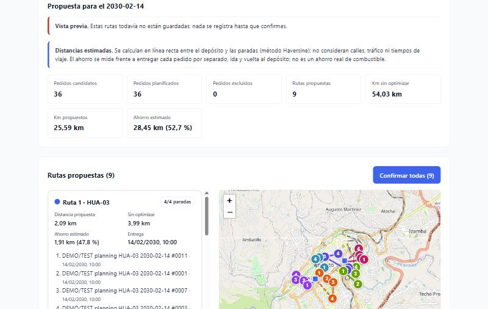
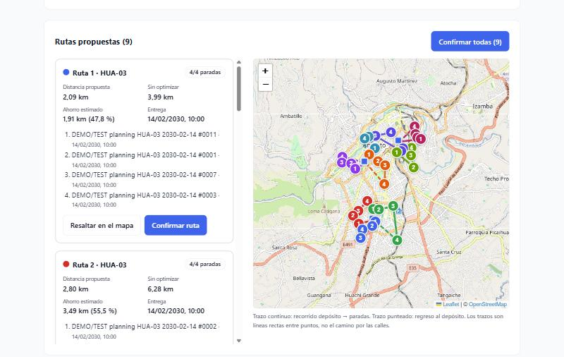
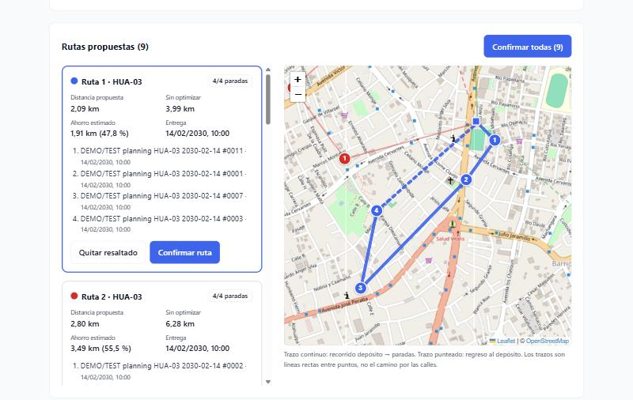
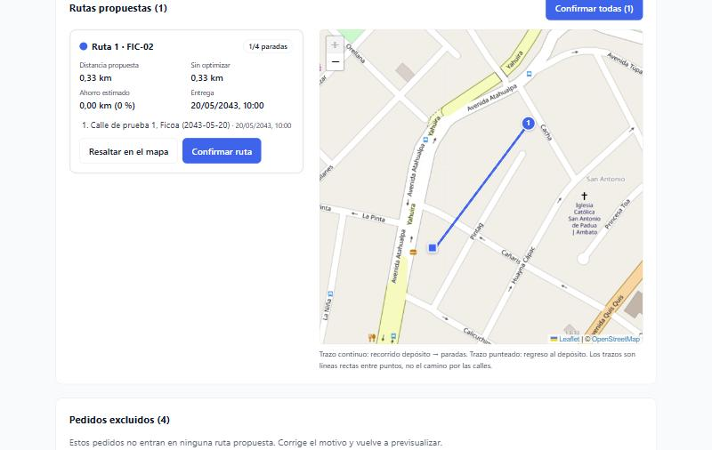
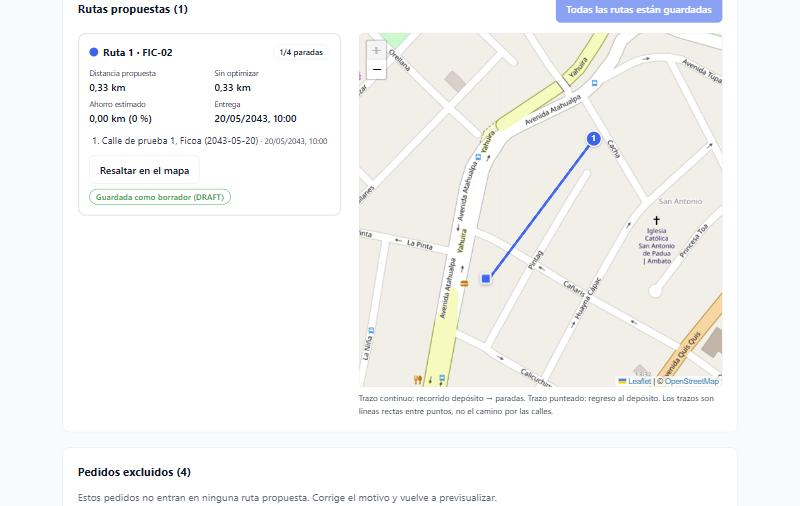
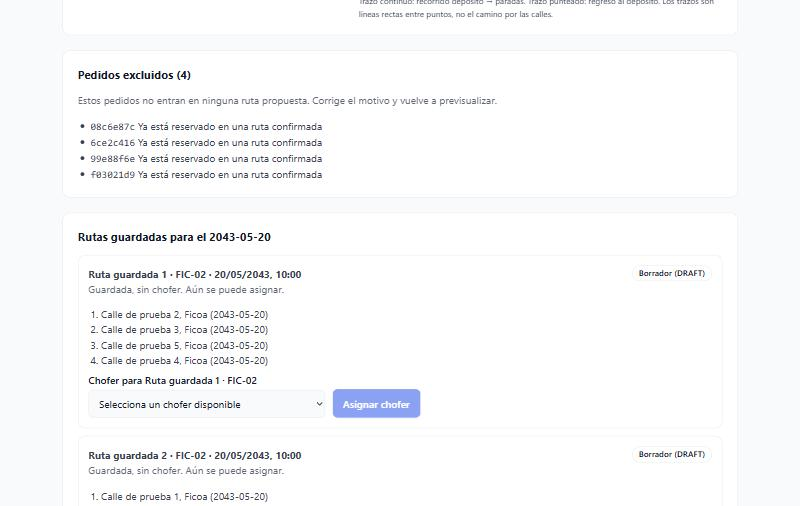
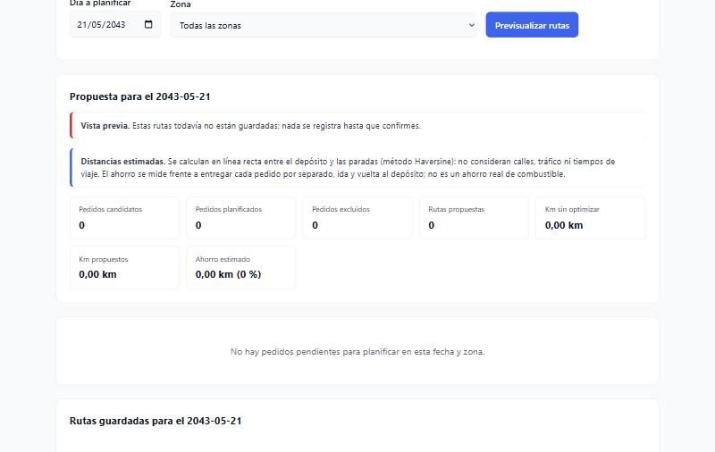
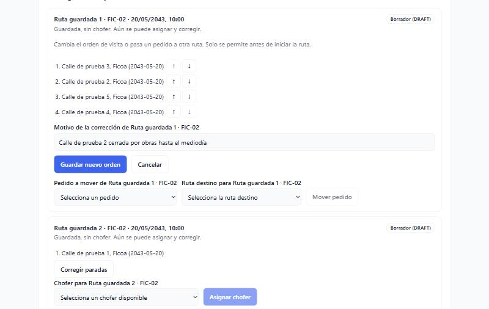
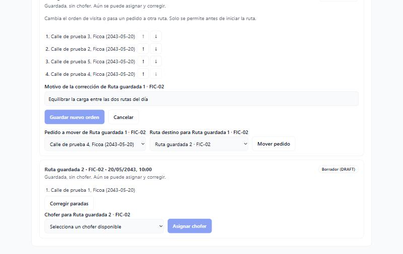
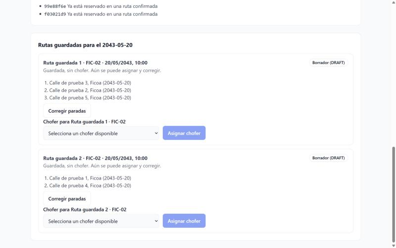

# Evidencia · Issue #7 — Panel de planificación con propuestas Clarke & Wright, mapa y métricas

Pantalla **Planificación** (`/planificacion`) para el ADMIN: previsualiza las rutas que propone el backend (Clarke & Wright)
para un día y una zona, las dibuja en un mapa Leaflet con sus métricas, permite confirmarlas como rutas `DRAFT` y, en la
lista de rutas guardadas del día, corregir sus paradas antes de iniciarlas y asignar un chofer disponible. Probado contra el backend real (NestJS + PostgreSQL).

- **Issue:** [#7](https://github.com/logistica-gc-uta/frontend-web-logistica/issues/7)
- **Fecha de ejecución:** 13/10/2026 (panel) y 15/10/2026 (corrección de paradas)
- **Backend:** `logistica-gc-uta/backend` en `main` @ `09d4621`
- **Frontend:** rama `feat/7-panel-planificacion`, al día con `main` (incluye el #6 fusionado)

## 1. Qué se implementó

| Parte                                             | Detalle                                                                                                                                                                                                                                                                                                  |
| ------------------------------------------------- | -------------------------------------------------------------------------------------------------------------------------------------------------------------------------------------------------------------------------------------------------------------------------------------------------------- |
| Previsualizar (`GET /route-proposals`)            | Filtros de día (por defecto, hoy en Guayaquil) y zona opcional. **Solo calcula**: repetirla no guarda nada. Indicador de carga y error con el motivo (incluido el tiempo de espera agotado).                                                                                                             |
| Resumen y métricas                                | Pedidos candidatos, planificados y excluidos; número de rutas; km sin optimizar, km propuestos y ahorro (km y %). Por ruta: paradas frente a la capacidad, distancia, ahorro y rango de entrega.                                                                                                         |
| Mapa (`components/map/RoutesMap`)                 | Cada ruta con su color, paradas numeradas en orden de visita, depósito y regreso punteado. Se puede resaltar una ruta desde la lista o desde el mapa. Con más de 60 rutas solo se dibuja la seleccionada.                                                                                                |
| Aviso sobre las distancias                        | **Km geodésicos estimados**: en línea recta (Haversine), no distancia por carretera, sin tráfico ni tiempos de llegada; el ahorro se compara con visitar cada pedido en un viaje aparte.                                                                                                                 |
| Pedidos excluidos                                 | Lista con el motivo en español (p. ej. _"ya está reservado en una ruta confirmada"_).                                                                                                                                                                                                                    |
| Confirmar (`POST /routes`)                        | Por ruta o **Confirmar todas**. Guarda la ruta como `DRAFT`. Un doble clic confirma una sola vez; si una de varias falla, las demás se guardan y solo la fallida queda pendiente. 409 y 403 con mensaje propio.                                                                                          |
| Rutas guardadas (`GET /routes`)                   | Rutas del día elegido con su estado (`DRAFT`, `ASSIGNED`, `IN_PROGRESS`, `COMPLETED`), paradas en orden y chofer.                                                                                                                                                                                        |
| Asignar chofer (`POST /routes/{id}/assign`)       | Solo en rutas `DRAFT` y solo con choferes **efectivamente disponibles** (`GET /drivers`).                                                                                                                                                                                                                |
| Corregir paradas (`POST /dispatch/interventions`) | Solo en rutas `DRAFT` y `ASSIGNED` (antes de iniciar). **Reordenar** con flechas ↑↓ (`REORDER`) o **mover un pedido** a otra ruta del mismo día y zona, sin iniciar y con lugar (`MOVE`). Pide un motivo, que el backend audita. Un 409 (por ejemplo, ruta ya iniciada) se explica y no se da por hecho. |
| Rutas `IN_PROGRESS` y `COMPLETED`                 | Se muestran **sin ninguna acción**: ni corregir paradas ni asignar chofer.                                                                                                                                                                                                                               |

## 2. Preparación del entorno

Igual que en el issue #6 ([`6-pedidos-leaflet.md`](6-pedidos-leaflet.md) §2): base recreada con `pnpm prisma db init`,
`pnpm run seed` y `pnpm run seed:planning-demo`.

Datos de prueba propios para las pruebas manuales: **5 pedidos el 20/05/2043 en la zona FIC-02** (producto propio de
prueba), creados con la API. Así no se tocan los pedidos de demostración del 14/02/2030.

## 3. Verificaciones de calidad

| Comando                                    | Resultado                                                                 |
| ------------------------------------------ | ------------------------------------------------------------------------- |
| `pnpm lint`                                | 0 errores                                                                 |
| `pnpm typecheck`                           | 0 errores                                                                 |
| `pnpm format:check`                        | Sin observaciones                                                         |
| `pnpm test:coverage` (umbral del CI: 80 %) | **358/358** pruebas (49 archivos) · 99,8 % de líneas · 96,8 % de ramas    |
| `pnpm build`                               | Correcto (aviso de tamaño del paquete > 500 kB: es un aviso, no un error) |
| `pnpm test:integration`                    | **28/28** pruebas contra la API real (22 previas + 6 de planificación)    |

Pruebas unitarias destacadas:

- **Bloqueo:** las rutas `IN_PROGRESS` y `COMPLETED` no muestran botones ni selectores (componente y página).
- **Corrección de paradas:** reordenar con ↑↓, motivo obligatorio, cancelar sin cambios, mover solo a rutas del mismo día y
  zona, sin iniciar y con lugar; una ruta de una parada no puede quedar vacía; un 409 de ruta iniciada se explica y el
  panel sigue abierto; un resultado distinto de `APPLIED` no se toma como éxito; cada intento lleva un `requestId` nuevo.
- **Asignación de chofer** (solo con pruebas automáticas, ver §6): éxito, error 409 con la ruta todavía en `DRAFT`,
  doble clic y reintento.
- **Seguridad:** el hash de contraseña que envía el backend en `GET /routes` y `GET /drivers` nunca llega al estado de la aplicación.
- **Mapa:** colores, orden de paradas, regreso punteado, resaltado y límite de rutas dibujadas (con react-leaflet simulado).

## 4. Pruebas de integración con la API real (`src/integration/planning.int.test.ts`)

Cada ejecución usa **un día propio al azar** (un miércoles entre 2050 y 2079) y su propio producto, y crea 5 pedidos en
una zona con depósito. Las rutas confirmadas quedan guardadas, así que no se reutiliza el día. **No asigna choferes.**

```
 ✓ … · día 2072-08-24 > propone rutas para todos los pedidos del día, con métricas coherentes
 ✓ … · día 2072-08-24 > previsualizar dos veces no guarda nada: da el mismo resultado y no crea rutas
 ✓ … · día 2072-08-24 > confirmar guarda un DRAFT sin chofer, sus pedidos quedan reservados y no se puede repetir
 ✓ … · día 2072-08-24 > corrige rutas DRAFT con auditoría: reordena paradas y mueve un pedido a otra ruta del día
 ✓ … · día 2072-08-24 > las rutas y los choferes no exponen el hash de contraseña dentro de la aplicación
 ✓ … · día 2072-08-24 > un CLIENT no puede ver propuestas, confirmar ni corregir rutas (403)

 Test Files  5 passed (5)
      Tests  28 passed (28)
```

La prueba de corrección confirma las dos rutas del día (4 + 1 paradas), invierte el orden de la grande (`REORDER`,
resultado `APPLIED`), comprueba que una lista incompleta de paradas se rechaza con 409 y mueve un pedido a la pequeña
(`MOVE`), verificando ambas rutas con `GET /routes`.

## 5. Pruebas manuales en el navegador

Realizadas con el backend real y el usuario ADMIN del seed.

| #   | Caso                                                                                         | Resultado                                                                                                                                                                                                                                       |
| --- | -------------------------------------------------------------------------------------------- | ----------------------------------------------------------------------------------------------------------------------------------------------------------------------------------------------------------------------------------------------- |
| M1  | Previsualizar el día de demostración **14/02/2030** (todas las zonas)                        | ✅ 36 pedidos y 9 rutas. Los totales coinciden con la API: 54,03 km sin optimizar, 25,59 km propuestos, ahorro de 28,45 km (52,7 %). El mapa dibuja cada ruta con su color, paradas numeradas y depósitos.                                      |
| M2  | **Resaltar en el mapa** la Ruta 1                                                            | ✅ El mapa se acerca a la ruta: recorrido depósito → 1 → 2 → 3 → 4 y regreso punteado; la tarjeta queda marcada y el botón cambia a _Quitar resaltado_.                                                                                         |
| M3  | Día de prueba **20/05/2043** (5 pedidos propios en FIC-02, con una ruta de 4 ya confirmada)  | ✅ Queda 1 ruta propuesta (el pedido libre). Los otros 4 aparecen como excluidos: _"Ya está reservado en una ruta confirmada"_.                                                                                                                 |
| M4  | **Confirmar ruta** sobre la ruta restante                                                    | ✅ La tarjeta muestra _Guardada como borrador (DRAFT)_ y el botón general pasa a _Todas las rutas están guardadas_. En **Rutas guardadas** aparecen las 2 rutas `DRAFT` del día con sus paradas en orden y el selector de choferes disponibles. |
| M5  | Un día sin pedidos (**21/05/2043**)                                                          | ✅ Resumen en cero y el aviso _"No hay pedidos pendientes para planificar en esta fecha y zona."_                                                                                                                                               |
| M6  | **Corregir paradas** de la Ruta guardada 1 (20/05/2043): bajar la primera parada, con motivo | ✅ El backend aplicó el nuevo orden (3, 2, 5, 4) y la lista se actualizó. 15/10/2026.                                                                                                                                                           |
| M7  | **Mover** _Calle de prueba 4_ de la Ruta guardada 1 a la 2, con motivo                       | ✅ La Ruta 1 quedó con 3 paradas y la Ruta 2 con 2; cada ruta conservó su número. 15/10/2026.                                                                                                                                                   |

La asignación de chofer **no se probó manualmente** a propósito (ver §6): está cubierta por las pruebas automáticas.

### Capturas

| M1 · Resumen del día de demostración                           | M1 · Rutas propuestas y mapa                             |
| -------------------------------------------------------------- | -------------------------------------------------------- |
|  |  |

| M2 · Ruta resaltada                                   | M3 · Día de prueba: ruta restante                              |
| ----------------------------------------------------- | -------------------------------------------------------------- |
|  |  |

| M4 · Ruta confirmada como DRAFT                        | M3 y M4 · Excluidos y rutas guardadas del día                                |
| ------------------------------------------------------ | ---------------------------------------------------------------------------- |
|  |  |

| M5 · Día sin pedidos                                   | M6 · Corregir el orden de las paradas                 |
| ------------------------------------------------------ | ----------------------------------------------------- |
|  |  |

| M7 · Mover un pedido a otra ruta del día            | M6 y M7 · Rutas corregidas                                        |
| --------------------------------------------------- | ----------------------------------------------------------------- |
|  |  |

## 6. Hallazgos

| Hallazgo                                                                                                                                                   | Tipo                                 | Acción                                                                                                                                            |
| ---------------------------------------------------------------------------------------------------------------------------------------------------------- | ------------------------------------ | ------------------------------------------------------------------------------------------------------------------------------------------------- |
| `GET /drivers` y `GET /routes` envían el **hash de la contraseña** del usuario chofer.                                                                     | Defecto de seguridad (backend)       | El frontend copia solo los campos que usa (con prueba de regresión). Se sugiere un issue en el backend para no enviarlo.                          |
| Asignar un chofer real lo deja ocupado hasta que termine su ruta; `seed:reset-drivers` no lo libera. Por eso la asignación no se probó contra la API real. | Limitación del entorno de pruebas    | La asignación se verifica con pruebas automáticas (éxito, conflicto 409, doble clic y reintento). Las pruebas de integración no asignan choferes. |
| La API no informa el **tiempo de cálculo** de la propuesta.                                                                                                | Limitación del backend               | No se muestra; la pantalla indica mientras calcula.                                                                                               |
| Algunos mensajes del backend están en inglés (p. ej. _"Order already reserved by another proposal"_ en un 409).                                            | Observación                          | Se muestran después de _"Conflicto:"_ con una indicación en español. Se propone un issue para traducir los mensajes conocidos.                    |
| Con dos rutas guardadas de la misma zona y hora, la lista y el selector de chofer tenían el mismo nombre (visto en M4).                                    | Defecto del frontend (accesibilidad) | Corregido: las rutas guardadas se numeran (_Ruta guardada 1 · FIC-02_), también en la etiqueta del selector (con prueba).                         |
| Tras corregir una ruta, las rutas guardadas cambiaban de número, porque `GET /routes` las devuelve en otro orden (visto en M6).                            | Defecto del frontend                 | Corregido: se ordenan por el momento en que se confirmaron (`createdAt`), con prueba de regresión.                                                |
| La lista de excluidos corresponde al momento de previsualizar: tras confirmar, no se recalcula sola.                                                       | Comportamiento esperado              | La pantalla lo indica (_"vuelve a previsualizar"_); las rutas guardadas sí se actualizan al confirmar.                                            |
| Cada ejecución de las pruebas de integración deja un día con pedidos y una ruta `DRAFT`.                                                                   | Datos de prueba                      | Usan días lejanos que no se mezclan con los reales; se eliminan recreando la base.                                                                |

## 7. Fuera de alcance de este PR

Bandeja de urgencias, reasignación de chofer y reprogramación (issue #8), desasignar choferes, iniciar o cerrar rutas y
el cálculo por calles o con tráfico.

## 8. Cobertura del Issue #7

| Pedido del issue                                                                                          | Evidencia                                                                                   |
| --------------------------------------------------------------------------------------------------------- | ------------------------------------------------------------------------------------------- |
| Elegir fecha y zona; diferenciar PREVISUALIZAR de CONFIRMAR                                               | §1, M1, M3–M4; integración "previsualizar dos veces no guarda nada"                         |
| Paradas ordenadas, color y etiqueta por ruta, depósito y detalle de cada pedido                           | M1–M2; pruebas de `RoutesMap`                                                               |
| Capacidad N/4, distancia Haversine, suma, ahorro frente a la línea base                                   | M1; integración "métricas coherentes"                                                       |
| Tiempo de cálculo "si disponible"                                                                         | La API no lo informa (§6)                                                                   |
| Km etiquetados como geodésicos estimados (no carretera, ETA ni combustible); salida y regreso al depósito | Aviso de distancias, leyenda del mapa y regreso punteado (M1–M2)                            |
| Evitar confirmaciones duplicadas; estado vacío, errores y zonas sin depósito                              | Doble clic (prueba), 409 al repetir (integración), M5 y zonas "(sin depósito)" en el filtro |
| Propuesta verificable para 5+ pedidos con al menos dos rutas                                              | Integración (5 pedidos → 2 rutas) y M1 (36 pedidos → 9 rutas)                               |
| La confirmación persiste sin duplicar pedidos; los errores se explican                                    | Integración (DRAFT, reserva y 409); pruebas de 403, 409 y tiempo agotado                    |
| Diferenciar `DRAFT` y `ASSIGNED`; asignar chofer validando disponibilidad                                 | Rutas guardadas (M4) y pruebas de asignación (§3)                                           |
| Corrección de paradas/agrupación solo antes de `IN_PROGRESS`                                              | M6–M7, integración de `REORDER`/`MOVE` y pruebas de bloqueo                                 |
| Fallos 403/409/tiempo agotado no se presentan como éxito                                                  | Pruebas de confirmación, asignación y corrección                                            |
| Prueba de bloqueo de paradas de `IN_PROGRESS`                                                             | Pruebas de `SavedRoutes` y de la página (sin acciones en `IN_PROGRESS`/`COMPLETED`)         |
| Pruebas de UI y evidencia visual                                                                          | §3 y capturas de §5                                                                         |

El issue nombra los casos **CP-RUT-001/002/011** y la adenda **CP-RUT-001/005/008**. El catálogo _Casos v2.0_ no está en
el repositorio, así que la trazabilidad se presenta por criterio de aceptación; si se comparte el catálogo, se agrega el
código de cada caso a esta tabla.
