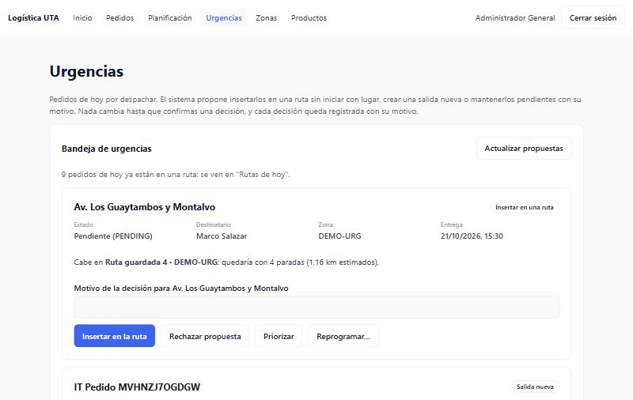
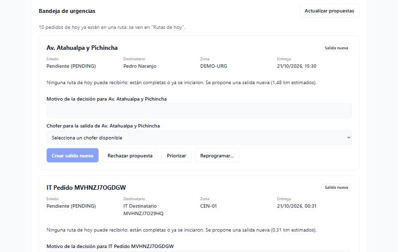
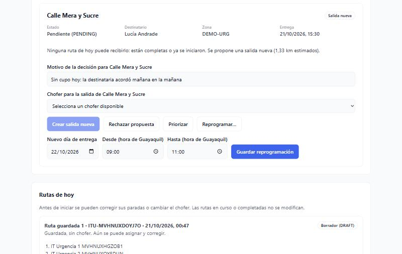
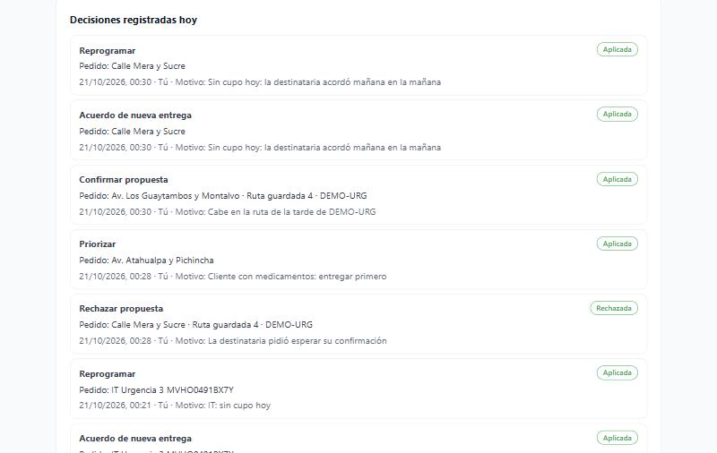
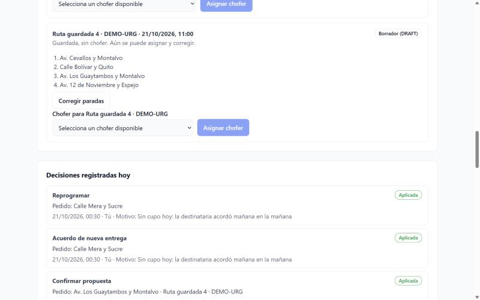

# Evidencia · Issue #8 — Bandeja de urgencias y reasignación manual auditada

Pantalla **Urgencias** (`/urgencias`) para el ADMIN: lista los pedidos de **hoy** por despachar con la propuesta del
backend (insertar en una ruta, salida nueva o bloqueado con motivo) y permite decidir con un motivo auditado. Incluye
las rutas de hoy (corregir paradas o cambiar el chofer antes de iniciar) y el historial de decisiones del día. Probado
contra el backend real (NestJS + PostgreSQL).

- **Issue:** [#8](https://github.com/logistica-gc-uta/frontend-web-logistica/issues/8)
- **Fecha de ejecución:** 21/10/2026
- **Backend:** `logistica-gc-uta/backend` en `main` @ `13a557e` (incluye backend #12, urgencias y decisiones auditadas)
- **Frontend:** rama `feat/8-bandeja-urgencias` (desde `main` con #6 y #7 fusionados)

## 1. Qué se implementó

| Parte                                          | Detalle                                                                                                                                                                                                                                                                                                                                                                          |
| ---------------------------------------------- | -------------------------------------------------------------------------------------------------------------------------------------------------------------------------------------------------------------------------------------------------------------------------------------------------------------------------------------------------------------------------------- |
| Bandeja (`GET /dispatch/inbox`)                | Pedidos de hoy (Guayaquil) por despachar, cruzados con `GET /orders` para mostrar dirección, destinatario, zona y hora. Los priorizados aparecen primero.                                                                                                                                                                                                                        |
| Propuesta explicada                            | **Insertar en una ruta** (cabe en una ruta de hoy sin iniciar y con lugar), **Salida nueva** (ninguna ruta puede recibirlo: completas o ya iniciadas) o **Bloqueado** con sus motivos en español (sin depósito, sin choferes disponibles, ubicación sin confirmar…).                                                                                                             |
| Decisiones (`POST /dispatch/interventions`)    | **Insertar en la ruta** y **Crear salida nueva** (`CONFIRM`, esta última con un chofer disponible), **Rechazar propuesta** (`REJECT`: el pedido sigue PENDING), **Priorizar** (`PRIORITIZE`) y **Reprogramar** con día y franja (`CONTACT` + `RESCHEDULE`). Todas piden un motivo, que el backend audita; tras una decisión registrada el motivo se limpia para no reutilizarlo. |
| Resultado verificado                           | Cada acción comprueba el resultado esperado (`REJECTED` para un rechazo, `APPLIED` para lo demás); otro resultado no se presenta como éxito. Cada intento lleva un `requestId` nuevo.                                                                                                                                                                                            |
| Pedidos ya en una ruta                         | El backend también los lista (bloqueados por `ACTIVE_ROUTE_CLAIM`); no se muestran como urgencias, solo se indica cuántos son y que se ven en "Rutas de hoy".                                                                                                                                                                                                                    |
| Entregas fallidas                              | Se cuentan con un aviso, pero se gestionan en la bandeja de fallos (issue #13), como pide la adenda.                                                                                                                                                                                                                                                                             |
| Rutas de hoy                                   | Las mismas de Planificación: corregir paradas (`REORDER`/`MOVE`) y, nuevo, **cambiar el chofer** de una ruta `ASSIGNED` sin iniciar (`REASSIGN_DRIVER`, con motivo). `IN_PROGRESS` y `COMPLETED` sin acciones.                                                                                                                                                                   |
| Choferes ocupados                              | Se muestran **deshabilitados con el motivo**: _"ocupado hasta que regrese al depósito"_ (tiene una ruta) o _"marcado como no disponible"_. No se pueden elegir.                                                                                                                                                                                                                  |
| Decisiones registradas (`GET /dispatch/audit`) | Las de hoy, la más reciente primero: acción, resultado, pedido (dirección) y ruta, fecha y hora, responsable (_Tú_ u _Otro administrador_) y motivo.                                                                                                                                                                                                                             |
| Errores                                        | 403, 409 (propuesta, ruta o chofer cambiaron), tiempo agotado y **sin conexión** se explican en la tarjeta; el pedido sigue pendiente y se puede reintentar.                                                                                                                                                                                                                     |

## 2. Preparación del entorno

Backend actualizado a `main` (`git pull` + `pnpm install`, por las dependencias de tiempo real; sin migraciones nuevas).

Datos de prueba para las pruebas manuales, creados con la API el 21/10/2026: zona **DEMO-URG** con depósito, una ruta
`DRAFT` de 3 paradas y 3 pedidos urgentes de hoy (15:30). La bandeja también muestra 2 pedidos de hoy creados por la
prueba de integración de pedidos (zona CEN-01).

## 3. Verificaciones de calidad

| Comando                                    | Resultado                                                              |
| ------------------------------------------ | ---------------------------------------------------------------------- |
| `pnpm lint`                                | 0 errores                                                              |
| `pnpm typecheck`                           | 0 errores                                                              |
| `pnpm format:check`                        | Sin observaciones                                                      |
| `pnpm test:coverage` (umbral del CI: 80 %) | **408/408** pruebas (53 archivos) · 99,8 % de líneas · 94,2 % de ramas |
| `pnpm build`                               | Correcto                                                               |
| `pnpm test:integration`                    | **34/34** pruebas contra la API real (28 previas + 6 de urgencias)     |

Pruebas unitarias destacadas:

- **Decisiones:** cuerpo exacto de cada acción, `requestId` nuevo, huella de la propuesta, chofer solo para salida nueva,
  resultado inesperado ≠ éxito, reprogramación en dos pasos (y sin segundo paso si el acuerdo falla).
- **Tarjeta:** motivo obligatorio y limpio tras una decisión registrada (se conserva si falló), choferes ocupados
  deshabilitados, bloqueados sin confirmar ni rechazar, validación de la franja de reprogramación.
- **Página:** propuesta vieja (409) y falta de permisos (403) explicadas sin sacar el pedido de la bandeja, pedidos ya en
  ruta no mostrados como urgencias, cambio de chofer auditado, rutas `IN_PROGRESS` sin acciones, reintento de carga.
- **Sin conexión:** el mensaje _"No se pudo conectar con el servidor"_ se muestra y nada se da por hecho.

## 4. Pruebas de integración con la API real (`src/integration/dispatch.int.test.ts`)

Cada ejecución crea **su propia zona con depósito** y pedidos de **hoy** (la bandeja solo muestra el día actual), así que
otras urgencias no interfieren. Cerca de la medianoche (sin un "más tarde hoy") la suite se omite en lugar de fallar.
**No asigna choferes.**

```
 ✓ … hoy 2026-10-21 > un pedido de hoy sin rutas disponibles aparece PENDING con su propuesta y motivos
 ✓ … hoy 2026-10-21 > rechazar y priorizar quedan auditados sin cambiar el pedido ni la ruta; una propuesta vieja da 409
 ✓ … hoy 2026-10-21 > insertar una urgencia con la propuesta vigente la agrega a la ruta DRAFT
 ✓ … hoy 2026-10-21 > reprogramar mueve el pedido a la fecha y franja acordadas y deja la bandeja de hoy
 ✓ … hoy 2026-10-21 > el historial registra cada decisión con su responsable y motivo
 ✓ … hoy 2026-10-21 > un CLIENT no puede ver la bandeja ni tomar decisiones (403)

 Test Files  6 passed (6)
      Tests  34 passed (34)
```

## 5. Pruebas manuales en el navegador

Realizadas el 21/10/2026 con el backend real, el usuario ADMIN del seed y los datos de DEMO-URG.

| #   | Caso                                                                     | Resultado                                                                                                                                                                                                                           |
| --- | ------------------------------------------------------------------------ | ----------------------------------------------------------------------------------------------------------------------------------------------------------------------------------------------------------------------------------- |
| M1  | Abrir la bandeja con 3 urgencias que caben en la ruta de DEMO-URG        | ✅ Las 3 aparecen como _Insertar en una ruta_ con dirección, destinatario, zona y hora; _"Cabe en Ruta guardada 4 · DEMO-URG: quedaría con 4 paradas"_. Los pedidos que ya están en una ruta solo se cuentan.                       |
| M2  | **Rechazar** _Calle Mera y Sucre_ con motivo                             | ✅ Registrado como _Rechazada_; el pedido sigue PENDING en la bandeja y la ruta no cambia.                                                                                                                                          |
| M3  | **Priorizar** _Av. Atahualpa y Pichincha_                                | ✅ Pasa al primer lugar de la bandeja.                                                                                                                                                                                              |
| M4  | **Insertar** _Av. Los Guaytambos y Montalvo_                             | ✅ Sale de la bandeja y aparece como 3.ª parada de la ruta (4/4). Como la ruta quedó **completa**, los otros pedidos pasan solos a _Salida nueva_ (_"están completas o ya se iniciaron"_), con el selector de choferes disponibles. |
| M5  | **Reprogramar** _Calle Mera y Sucre_ para el 22/10/2026 de 09:00 a 11:00 | ✅ Sale de la bandeja de hoy; el historial muestra _Acuerdo de nueva entrega_ y _Reprogramar_.                                                                                                                                      |
| M6  | Historial del día                                                        | ✅ Cada decisión con acción, resultado, dirección del pedido (también del reprogramado) y ruta, hora, _Tú_ y el motivo escrito.                                                                                                     |

_Crear salida nueva_ y _Cambiar chofer_ **no se probaron manualmente** a propósito (ver §6): asignan un chofer real.

### Capturas

| M1 · Bandeja: urgencias que caben en una ruta       | M4 · Ruta completa: se propone salida nueva                   |
| --------------------------------------------------- | ------------------------------------------------------------- |
|  |  |

| M5 · Reprogramar con día y franja              | M6 · Decisiones registradas hoy                           |
| ---------------------------------------------- | --------------------------------------------------------- |
|  |  |

| M4 · Rutas de hoy: la urgencia insertada             |
| ---------------------------------------------------- |
|  |

## 6. Hallazgos

| Hallazgo                                                                                                                                     | Tipo                              | Acción                                                                                    |
| -------------------------------------------------------------------------------------------------------------------------------------------- | --------------------------------- | ----------------------------------------------------------------------------------------- |
| Un rechazo se registra con resultado `REJECTED`; la validación heredada del #7 (solo `APPLIED`) lo habría mostrado como error.               | Defecto evitado (frontend)        | Cada acción valida su resultado esperado (con prueba).                                    |
| La bandeja incluye pedidos de hoy que ya están en una ruta (bloqueados por `ACTIVE_ROUTE_CLAIM`).                                            | Comportamiento del backend        | No se muestran como urgencias; se cuentan y se remiten a "Rutas de hoy" (con prueba).     |
| El motivo quedaba escrito tras una decisión registrada y podía reutilizarse por error en la siguiente (visto en M2–M3).                      | Defecto del frontend              | Corregido: se limpia al registrarse la decisión y se conserva si falló (con pruebas).     |
| El historial nombraba por su id al pedido reprogramado (ya no es de hoy).                                                                    | Defecto del frontend              | Corregido: se consulta su dirección con `GET /orders/{id}` (con prueba).                  |
| La API no distingue "ruta completa" de "ruta iniciada": ambas terminan en _Salida nueva_.                                                    | Limitación del backend            | La pantalla lo explica así (_"están completas o ya se iniciaron"_), sin inventar motivos. |
| _Crear salida nueva_ y _Cambiar chofer_ asignan un chofer real, que queda ocupado hasta confirmar su regreso al depósito desde la app móvil. | Limitación del entorno de pruebas | Cubiertos con pruebas automáticas; no se ejecutaron contra la API real.                   |
| La bandeja solo considera el día actual; las pruebas de integración crean pedidos de hoy.                                                    | Datos de prueba                   | Usan una zona propia por ejecución; se eliminan recreando la base.                        |

## 7. Fuera de alcance de este PR

Bandeja de entregas fallidas, contacto con el destinatario tras un intento fallido y su reprogramación (issue #13);
iniciar o cerrar rutas; seguimiento en tiempo real (issue #9).

## 8. Cobertura del Issue #8

| Pedido del issue                                                                                                        | Evidencia                                                                                    |
| ----------------------------------------------------------------------------------------------------------------------- | -------------------------------------------------------------------------------------------- |
| Bandeja de urgencias pendientes con motivo (ruta completa, ruta iniciada, sin repartidor, sin depósito, inconsistencia) | M1, M4; motivos traducidos (pruebas de `UrgencyCard`)                                        |
| Consultar propuestas, aprobar una ruta nueva, reasignar una ruta no iniciada, reprogramar con motivo                    | _Actualizar propuestas_, _Crear salida nueva_ (prueba), _Cambiar chofer_ (prueba), M5        |
| Deshabilitar y explicar acciones no permitidas en `IN_PROGRESS`                                                         | Rutas `IN_PROGRESS`/`COMPLETED` sin acciones (pruebas); bloqueados sin confirmar ni rechazar |
| Mostrar confirmaciones persistidas, actor/fecha y errores 403/409                                                       | M6; pruebas de 403 y 409                                                                     |
| Probar sin capacidad, ruta iniciada, permisos y conexión perdida                                                        | M4 (ruta completa), pruebas de bloqueo, 403 (integración y UI), sin conexión (prueba)        |
| Pedido sin capacidad permanece PENDING con motivo                                                                       | M2 y M4; integración (rechazo sin cambios)                                                   |
| ADMIN resuelve la urgencia de forma segura y el cambio persiste                                                         | M3–M5; integración (insertar, priorizar, reprogramar)                                        |
| Ninguna acción de UI ni API modifica paradas `IN_PROGRESS`                                                              | Sin acciones en rutas iniciadas; el backend responde 409 (cubierto en #7)                    |
| Adenda: urgencias separadas de fallos ya intentados                                                                     | Aviso de entregas fallidas y §7                                                              |
| Adenda: el conductor ocupado/retornando no se ofrece hasta estar disponible                                             | Choferes deshabilitados con motivo (pruebas)                                                 |
| Adenda: errores 403/409/tiempo agotado claros; no duplicar confirmaciones                                               | Pruebas de errores; doble clic bloqueado por pedido (`useKeyedActions`)                      |
| Pruebas UI y evidencia E2E del escenario                                                                                | §3–§5                                                                                        |

El issue nombra los casos **CP-RUT-003/004/005/009/010** (y la adenda CP-RUT-008). El catálogo _Casos v2.0_ no está en el
repositorio, así que la trazabilidad se presenta por criterio de aceptación; si se comparte el catálogo, se agrega el
código de cada caso a esta tabla.
