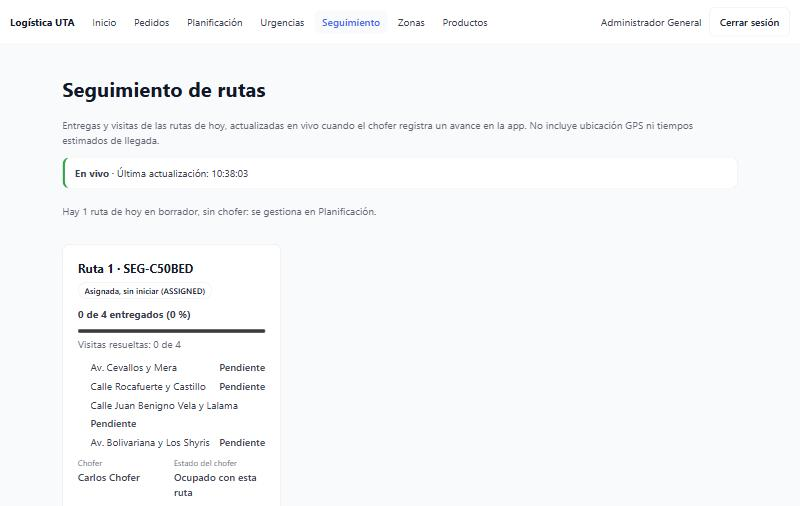
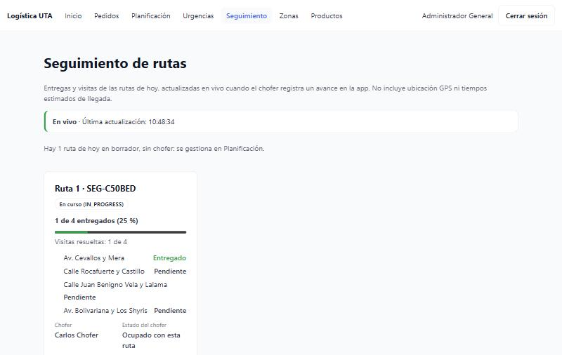
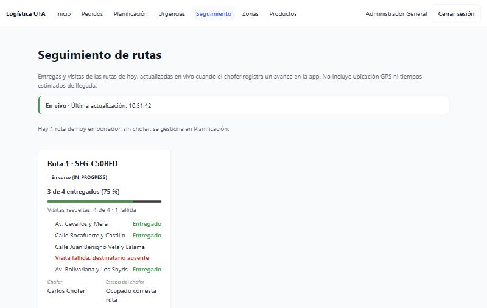
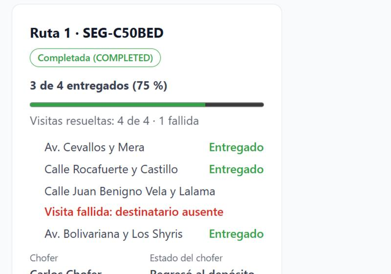
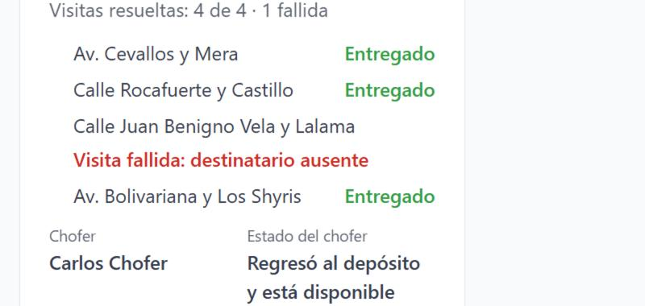
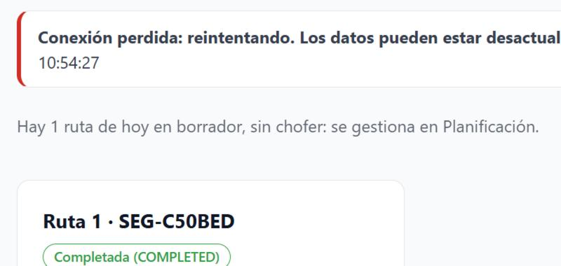
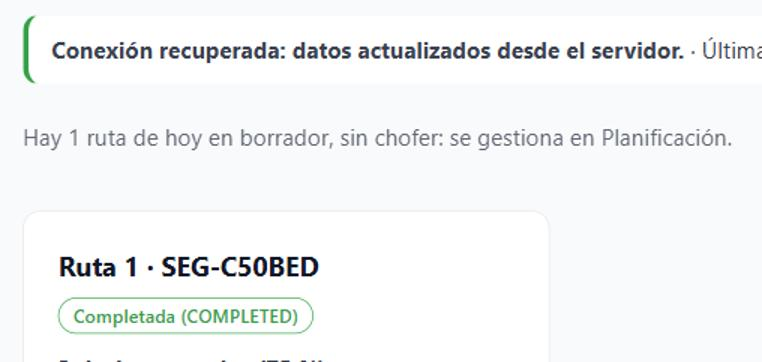

# Evidencia · Issue #9 — Seguimiento en tiempo real de rutas y entregas con Socket.IO

Pantalla **Seguimiento** (`/seguimiento`) para el ADMIN: muestra las rutas de hoy con chofer y se actualiza sola cuando el
chofer registra un avance, sin recargar la página. Usa el Socket.IO del backend (#13) solo como **aviso de cambio**: el
estado que se muestra siempre sale de `GET /routes` y `GET /drivers` (PostgreSQL). Probado contra el backend real.

- **Issue:** [#9](https://github.com/logistica-gc-uta/frontend-web-logistica/issues/9)
- **Fecha de ejecución:** 03/11/2026
- **Backend:** `logistica-gc-uta/backend` en `main` @ `adfe30c` (incluye tiempo real #13 y ciclo de ruta #10)
- **Frontend:** rama `feat/9-seguimiento-tiempo-real` (desde `main` @ `58ca6a7`)

## 1. Qué se implementó

| Parte                                      | Detalle                                                                                                                                                                                                                                                                                                                       |
| ------------------------------------------ | ----------------------------------------------------------------------------------------------------------------------------------------------------------------------------------------------------------------------------------------------------------------------------------------------------------------------------- |
| Conexión (`lib/realtime/realtimeClient`)   | Socket.IO en `/realtime`. El token viaja **solo en el `auth` del handshake** y se lee en cada conexión o reconexión (siempre el vigente); nunca va en la URL ni en registros.                                                                                                                                                 |
| Suscripciones                              | A cada ruta de hoy, a **cada pedido** de sus paradas, a su chofer y a las incidencias. El backend avisa una entrega solo a quien sigue ese pedido, no la ruta. Una suscripción rechazada se informa y no se reintenta con otra más amplia.                                                                                    |
| Actualización (`hooks/useRealtimeUpdates`) | Cada evento (`order.status.updated`, `route.updated`, `dispatch.incident.updated`, `driver.availability.updated`) solo provoca una nueva consulta por REST; varios seguidos se agrupan en una. Un evento repetido, atrasado o fuera de orden **no deshace** un estado más reciente, porque manda lo que responde el servidor. |
| Reconexión                                 | Al conectar o reconectar se suscribe de nuevo y consulta por `GET`: los eventos perdidos sin conexión no se repiten. Si el servidor cierra la conexión, se ofrece **Reconectar**.                                                                                                                                             |
| Estado visible (`ConnectionStatus`)        | _En vivo_, _Conexión perdida: reintentando…_, _Conexión recuperada: datos actualizados desde el servidor_ o _El servidor cerró la conexión_, con la **hora de la última actualización** (hh:mm:ss). Con texto, no solo color.                                                                                                 |
| Progreso (`routeProgress`)                 | **Entregas exitosas** ("3 de 4 entregados (75 %)", con barra y texto) separadas de las **visitas resueltas** ("4 de 4 · 1 fallida"): una ruta con un fallo no aparece como 100 %.                                                                                                                                             |
| Paradas e incidencias                      | Cada parada con _Entregado_, _Pendiente_ o _Visita fallida_ y su **motivo tipificado** (destinatario ausente / rechazó la entrega). No se muestran el texto libre del chofer ni datos del destinatario.                                                                                                                       |
| Estado de la ruta y del chofer             | Ruta asignada, en curso o completada; chofer _ocupado con esta ruta_, _retornando al depósito: todavía no está disponible_ o _regresó y está disponible_ (solo tras el regreso confirmado por el servidor).                                                                                                                   |
| Datos mínimos (`monitorService`)           | De `GET /routes` solo se copian estado, fechas, zona, chofer (nombre), paradas, resultados y motivo del último fallo.                                                                                                                                                                                                         |

No incluye GPS ni tiempos estimados de llegada, como indica el issue.

## 2. Preparación del entorno

Backend actualizado a `main` y base recreada (`docker compose down -v`, `docker compose up -d`, `pnpm install`,
`pnpm prisma db init`, `pnpm run seed`, `pnpm run seed:planning-demo`), porque el backend trajo migraciones nuevas.

Nueva dependencia del frontend: `socket.io-client` `^4.8.4`, la misma versión que usa el backend.

## 3. Verificaciones de calidad

| Comando                                    | Resultado                                                              |
| ------------------------------------------ | ---------------------------------------------------------------------- |
| `pnpm lint`                                | 0 errores                                                              |
| `pnpm typecheck`                           | 0 errores                                                              |
| `pnpm format:check`                        | Sin observaciones                                                      |
| `pnpm test:coverage` (umbral del CI: 80 %) | **450/450** pruebas (58 archivos) · 99,8 % de líneas · 93,1 % de ramas |
| `pnpm build`                               | Correcto                                                               |
| `pnpm test:integration`                    | **39/39** pruebas contra la API real (34 previas + 5 de tiempo real)   |

Pruebas unitarias destacadas (con un socket simulado, `test/fakeSocket.ts`):

- **Evento recibido:** una entrega se refleja sin recargar.
- **Evento repetido y fuera de orden:** se agrupan en una consulta y el estado final es el del servidor.
- **Reconexión:** conexión perdida → recuperada, nueva suscripción y nueva consulta por `GET`.
- **Autorización:** suscripción rechazada informada sin ampliar; cierre por el servidor con botón _Reconectar_; el token va
  en el handshake y se renueva en cada conexión (nunca en la URL).
- **Progreso:** 3 entregas + 1 fallida = 75 % entregado y 4/4 resueltas; paradas sin resultado no cuentan.
- **Chofer:** completar la ruta no lo libera; solo el regreso confirmado.
- **Privacidad:** de `GET /routes` no pasan datos del destinatario, el texto libre de los intentos ni el usuario del chofer.

## 4. Pruebas de integración con la API real (`src/integration/realtime.int.test.ts`)

Conexión real al Socket.IO del backend. Cada ejecución crea su propia zona, pedidos y una ruta `DRAFT` en un día lejano, y
la reordena para provocar un evento real. No asigna choferes.

```
 ✓ Integración real · tiempo real (Socket.IO /realtime) > un ADMIN se conecta con su token y puede seguir rutas, pedidos e incidencias
 ✓ Integración real · tiempo real (Socket.IO /realtime) > un cambio real en la ruta llega como aviso sin datos sensibles; el estado se lee por GET
 ✓ Integración real · tiempo real (Socket.IO /realtime) > un recurso que no existe se rechaza sin unirse
 ✓ Integración real · tiempo real (Socket.IO /realtime) > un CLIENT no puede seguir rutas ajenas ni las incidencias
 ✓ Integración real · tiempo real (Socket.IO /realtime) > un token inválido no logra conectarse

 Test Files  7 passed (7)
      Tests  39 passed (39)
```

## 5. Prueba de sistema: el chofer avanza y la pantalla se actualiza sola

Realizada el 03/11/2026 con el backend real. Las acciones del chofer se hicieron **con la API, igual que la app Flutter**
(mismos endpoints y el usuario chofer del seed): iniciar ruta, `PATCH /orders/{id}/status` (`IN_TRANSIT` → `DELIVERED`),
visita fallida, completar y regreso al depósito. La pantalla de Seguimiento quedó abierta todo el tiempo; una marca dejada
en la pestaña al inicio siguió intacta al final, lo que prueba que **la página nunca se recargó**.

| #   | Acción del chofer                                                                | La pantalla mostró sola                                                                                                                           |
| --- | -------------------------------------------------------------------------------- | ------------------------------------------------------------------------------------------------------------------------------------------------- |
| S1  | Ruta de 4 paradas asignada al chofer                                             | _Asignada, sin iniciar_ · 0 de 4 entregados (0 %) · chofer _Ocupado con esta ruta_ · _En vivo_                                                    |
| S2  | Inicia la ruta y entrega la parada 1                                             | _En curso_ · **1 de 4 entregados (25 %)** · parada 1 _Entregado_                                                                                  |
| S3  | Entrega las paradas 2 y 4; la 3 queda como visita fallida (destinatario ausente) | **3 de 4 entregados (75 %)** · **Visitas resueltas: 4 de 4 · 1 fallida** · _Visita fallida: destinatario ausente_ (sin el texto libre del chofer) |
| S4  | Completa la ruta                                                                 | _Completada_ · sigue al 75 % · chofer **_Retornando al depósito: todavía no está disponible_**                                                    |
| S5  | Confirma el regreso al depósito                                                  | Chofer **_Regresó al depósito y está disponible_**, con la hora del regreso                                                                       |
| S6  | Se detiene el backend                                                            | **_Conexión perdida: reintentando. Los datos pueden estar desactualizados._**, conservando la hora de la última actualización                     |
| S7  | Se vuelve a encender el backend                                                  | **_Conexión recuperada: datos actualizados desde el servidor._** Se reconectó y consultó sin intervención                                         |

### Capturas

| S1 · Ruta asignada                                 | S2 · Primera entrega, en vivo                                |
| -------------------------------------------------- | ------------------------------------------------------------ |
|  |  |

| S3 · 3 entregas y 1 visita fallida                             | S4 · Ruta completada                                 |
| -------------------------------------------------------------- | ---------------------------------------------------- |
|  |  |

| S5 · Regreso confirmado: chofer disponible                     | S6 · Conexión perdida                                 |
| -------------------------------------------------------------- | ----------------------------------------------------- |
|  |  |

| S7 · Conexión recuperada                                 |
| -------------------------------------------------------- |
|  |

## 6. Hallazgos

| Hallazgo                                                                                                | Tipo                       | Acción                                                                                                             |
| ------------------------------------------------------------------------------------------------------- | -------------------------- | ------------------------------------------------------------------------------------------------------------------ |
| Una entrega solo se avisa a quien está suscrito **al pedido** (`order:<id>`), no a la ruta.             | Comportamiento del backend | El monitor se suscribe a cada pedido de las rutas que sigue (con prueba).                                          |
| Si un permiso deja de valer, el servidor corta la conexión y Socket.IO no se reconecta solo.            | Comportamiento del backend | Se muestra el aviso y el botón _Reconectar_ (con prueba).                                                          |
| El orden de `GET /routes` cambia cuando se modifica una ruta.                                           | Comportamiento del backend | Las rutas se ordenan por fecha de creación para que cada una conserve su número (con prueba).                      |
| El backend dejó de enviar el hash de contraseña en `GET /routes` y `GET /drivers` (reportado en el #7). | Corrección del backend     | El monitor igual copia solo los campos que usa.                                                                    |
| La prueba de sistema simula la app del chofer con la API.                                               | Alcance de la evidencia    | Mismos endpoints que la app Flutter; la prueba con la app real queda para la validación conjunta de la plataforma. |
| La prueba de sistema dejó en la base local la zona de demostración, su ruta completada y sus pedidos.   | Datos de prueba            | Se eliminan recreando la base.                                                                                     |

## 7. Fuera de alcance de este PR

GPS, mapa en vivo o tiempos estimados de llegada (excluidos por el issue); bandeja de entregas fallidas y su gestión
(issue #13); acciones sobre las rutas desde esta pantalla (se hacen en Planificación y Urgencias).

## 8. Cobertura del Issue #9

| Pedido del issue                                                                                               | Evidencia                                                                                                  |
| -------------------------------------------------------------------------------------------------------------- | ---------------------------------------------------------------------------------------------------------- |
| Suscribirse a Socket.IO con autorización, sin exponer el JWT en logs ni URLs                                   | Token solo en el handshake (prueba de `realtimeClient`); integración: ADMIN sí, CLIENT y token inválido no |
| Actualizar rutas, pedidos y progreso tras un evento, sin depender solo del color                               | S2–S5; texto y barra; pruebas de página                                                                    |
| Tras reconectar o al abrir el panel, consultar `GET` para reconciliar con PostgreSQL                           | S6–S7; pruebas del hook y de la página                                                                     |
| Fecha y hora de actualización, conexión perdida/recuperada y carga o error                                     | S1, S6, S7; pruebas de `ConnectionStatus` y de error con _Reintentar_                                      |
| Pruebas de evento recibido, repetido, fuera de orden, reconexión y autorización                                | §3 y §4                                                                                                    |
| La entrega se refleja en React sin refresco manual                                                             | S2–S5 (sin recargar la página)                                                                             |
| Al perder eventos y reconectar, el estado final proviene de `GET`                                              | S6–S7; prueba "al recuperarla consulta de nuevo y toma el estado del servidor"                             |
| 3 de 4 entregados = 75 % sin datos locales ficticios                                                           | S3; prueba de `routeProgress`                                                                              |
| Pruebas unitarias/UI y de sistema enlazadas al PR                                                              | §3–§5                                                                                                      |
| Adenda: visitas resueltas ≠ entregas exitosas (4/4 resueltas con 3 DELIVERED y 1 fallida, 75 %)                | S3                                                                                                         |
| Adenda: estado de ruta, entregas e incidencias y estado del chofer por separado                                | Tarjeta de ruta (S1–S5)                                                                                    |
| Adenda: ruta COMPLETED no implica chofer disponible hasta el regreso confirmado                                | S4–S5; prueba de `driverState`                                                                             |
| Adenda: notificaciones de cambios persistidos, incluidas incidencias y regreso; respetar permisos y privacidad | Suscripción a incidencias y al chofer; S3 y S5; motivo tipificado sin texto libre                          |
| Adenda: eventos duplicados, tardíos o fuera de orden no deshacen un estado más reciente                        | Prueba "un evento repetido o atrasado no deshace el estado más reciente"                                   |
| No implementar GPS ni ETA vial                                                                                 | §7                                                                                                         |

El issue nombra los casos **CP-SEG-002/003/006/007**. El catálogo _Casos v2.0_ no está en el repositorio, así que la
trazabilidad se presenta por criterio de aceptación; si se comparte el catálogo, se agrega el código de cada caso.
